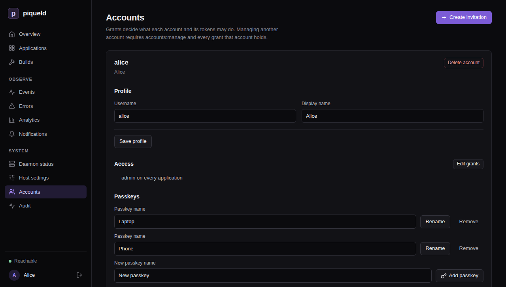
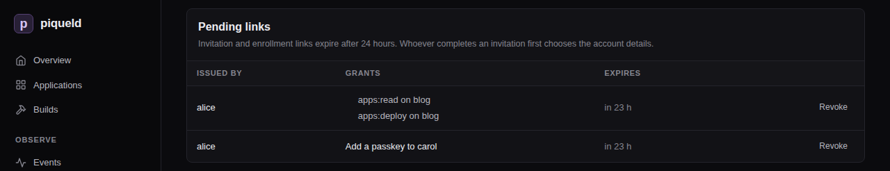
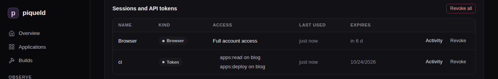

# Managing accounts

Invite people to piqueld, help them add passkeys, and remove their access when
they leave. You do this on the dashboard's **Accounts** page;
`piquelctl account` covers the most common tasks.

## Before you start

- You have [an account](../getting-started/first-account.md). Everyone can
  change their own account. Changing someone else's needs `accounts:manage`
  and every grant their account holds; see
  [who may manage accounts](permissions.md#who-may-manage-accounts).
- The `piquelctl` commands on this page run on your machine, signed in as your
  account, as when you
  [signed it in](../getting-started/first-account.md#sign-piquelctl-in).
  [`piquelctl account`](../reference/cli-commands.md#piquelctl-account) lists
  their options.

## The Accounts page

Open **Accounts** in the dashboard's sidebar. Each account has a card with its
**Profile**, its **Access**, its **Passkeys**, and its **Sessions and API
tokens**.



Without `accounts:manage`, the page only shows your own account. With it, the
page lists every account, the invitation and enrollment links waiting to be
used under **Pending links**, and the browsers signed in as the host operator
under **Host operator sessions**.

`piquelctl account list` prints the same accounts and their grants:

```console
$ piquelctl account list
alice (01a16b4b-ef93-7971-b6f6-e8359d3c4d52)
  admin on every application
bob (01a16b4c-84dc-70d1-98eb-0ddfde57971b)
  apps:read on blog, shop
  apps:write on blog, shop
…
```

## Invite someone

An invitation is a link that creates one account. You choose what the account
may do: there's no default access. The person who opens the link chooses its
username and registers its passkey.

The link isn't tied to a person or an email address: whoever completes it
first gets the account and its access. Send it only to the person it's for,
over a private channel you trust. If anyone else may have seen it,
[revoke it](#revoke-an-invitation).

1. On the **Accounts** page, select **Create invitation**.
2. To limit the access to some applications, clear **Application permissions
   apply to every application, including future ones**, and select them.
3. Choose a **Preset**, or select permissions one by one.
   [Permissions](permissions.md) says what each one allows.
4. Select **Create link**.
5. At the top of the **Accounts** page, select **Copy** next to the new link,
   then **Done**.
6. Send the link to the person it's for.

With `piquelctl`:

```console
piquelctl account invite --preset developer --app blog --app shop
```

It prints the link, such as
`https://piqueld.<tailnet>.ts.net/dashboard/auth#invite=…`. `--preset` and
`--permission` choose the access, and `--app` limits it to applications, by
name or ID. [Give an account access](permissions.md#give-an-account-access)
describes these options. You can only hand out access you hold yourself.

When the person opens the link, the **Create your account** page asks for a
**Username**, an optional display name, and a **Passkey name**. They select
**Create account with a passkey**, save the passkey, and the dashboard opens,
signed in.

The link works once, within 24 hours. Opening it doesn't use it up, so
someone who closes the page before finishing can open the original link
again. The dashboard removes the link from the browser's address bar and
history as soon as it reads it.

## Revoke an invitation

Links waiting to be used are listed under **Pending links**, at the bottom of
the **Accounts** page, with who issued them, what they grant, and when they
expire. Enrollment links show **Add a passkey to** and the account's name.



Select **Revoke** to cancel a link before it's used. Deleting the account that
issued a link also revokes it. `piquelctl` doesn't list or revoke links.

## Add a passkey

Each passkey belongs to one account, and only that account adds one: from a
browser where it's signed in, or through an enrollment link.

### To your own account

1. On your card, under **Passkeys**, enter a **New passkey name**, such as
   `Phone`.
2. Select **Add passkey**, and save the passkey when your browser asks.

To add one on a device with no browser signed in, print an enrollment link for
your own account with `piquelctl`, signed in with your account's full access:

```console
piquelctl account enroll alice
```

Open the link on that device yourself, and don't share it: it signs in
whoever uses it.

A second passkey, on another device or in a password manager, means losing one
device doesn't lock you out. If you've already lost them all, see
[someone lost their passkey](recovery.md#someone-lost-their-passkey).

### To someone else's account

When someone has lost their passkeys, or wants to sign in on a device that
can't share them, send them an enrollment link.

Whoever uses the link registers a passkey on the account and signs in as it,
with all its access. Before you create one, check that the request comes
from the account's owner, such as in person or over a channel you already
know is theirs. Send the link over a private channel you trust. If anyone else
may have seen it, [revoke it](#revoke-an-invitation).

1. On their card, under **Passkeys**, select **Create enrollment link**.
2. At the top of the **Accounts** page, select **Copy** next to the new link,
   then **Done**.
3. Send them the link.

Or create it with `piquelctl`:

```console
piquelctl account enroll bob
```

When they open the link, the **Add a passkey** page asks for a **Passkey
name**. They select **Register passkey**, save the passkey, and the dashboard
opens, signed in as their account.

The link works once, within 24 hours. Creating another link doesn't cancel the
first; revoke the ones you no longer need under **Pending links**.

## Rename or remove a passkey

Under **Passkeys**, edit a **Passkey name** and select **Rename**.

Removing a passkey can't be undone, and the dashboard doesn't ask to confirm.
To remove one, select **Remove** next to it. `piquelctl` doesn't rename or
remove passkeys.

Removing a passkey stops it from signing in, but it doesn't end the sessions
and tokens already open. If the passkey was lost or stolen,
[revoke the account's sessions and tokens](#revoke-sessions-and-tokens) too.

## Edit a profile

Under **Profile**, change the **Username** or the **Display name**, then select
**Save profile**.

- A username has 1 to 64 ASCII letters, digits, dots, dashes or underscores.
  It is unique regardless of case: `Alice` and `alice` are the same name.
- A display name is optional, up to 200 bytes.

`piquelctl` doesn't edit profiles.

Renaming an account doesn't change its ID, which the
[audit trail](../guides/observability.md#audit-trail) and saved CLI logins
use. To change someone's access instead, see
[give an account access](permissions.md#give-an-account-access).

## Revoke sessions and tokens

**Sessions and API tokens** lists everything that acts as the account: browser
sessions (**Browser**), `piquelctl` logins (**Cli**), and
[API tokens](cli-and-tokens.md#create-an-api-token) (**Token**). Each row
shows what it may do, when it was last used, and when it expires.



- **Revoke** ends one at once.
- **Revoke all** ends all of them, including the session you're using if it's
  your own account.
- **Activity** opens its requests in the audit trail.

`piquelctl token list` lists your own sessions and tokens, and
`piquelctl token revoke <id>` revokes one; see
[revoke a token](cli-and-tokens.md#revoke-a-token).

## Delete an account

Deleting an account also deletes its passkeys, sessions and tokens, and the
links it issued. It can't be undone. Its requests stay in the audit trail.

1. On its card, select **Delete account**.
2. Confirm in the dialog that asks whether to delete the account and all its
   passkeys, sessions, and tokens.

You can delete your own account. `piquelctl` doesn't delete accounts.

## Troubleshooting

- **The change is refused with `account_lockout`.** At least one account must
  keep `admin` on every application and a passkey, so that someone can always
  sign in and manage piqueld. piqueld refuses to remove the last such
  account's access, its last passkey, or the account itself. Make another
  account that has a passkey an administrator first.
- **The change is refused with `permission_exceeded`.** The account holds
  access you don't, or you're handing out access you don't hold. Ask someone
  who holds it.
- **A link answers "API returned 401 Unauthorized: authentication_required
  (Sign in with a passkey or run piquelctl login)".** It was already used, has
  expired, or was revoked. Ask for a new link.
- **The same refusal comes after the browser saved the passkey.** The link
  expired, was revoked or was used in the meantime, or its issuer can't
  create it any more: they lost `accounts:manage` or the access it grants, or,
  for an enrollment link, the right to change that account. Delete the saved
  passkey from the device, and ask for a new link. A link refused because of
  its issuer stays under **Pending links** until it expires.
- **Registration fails with `account_conflict`.** Another account has that
  username, regardless of case. The browser has already saved a passkey by
  then: delete it from the device, and register again with another name.
- **Creating a link answers "the host operator is not an account".** Sign in
  with an account to create invitations and enrollment links.
