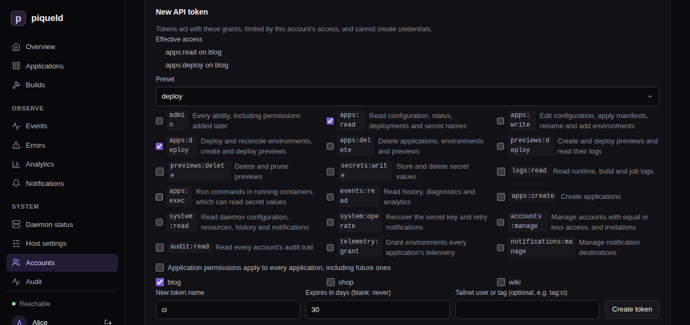

# Signing in from the CLI and automation

Sign `piquelctl` in, keep several accounts signed in, and give scripts, CI
jobs and agents an API token that can only do what they need.

## Before you start

- You have [an account](../getting-started/first-account.md) with a passkey.
- The commands on this page run on your machine. They reach the daemon at the
  dashboard's address, which you give `piquelctl` once per shell:

  ```console
  export PIQUELD_URL=https://piqueld.<tailnet>.ts.net
  ```

  To keep the address for good, save it as a
  [connection profile](../reference/cli.md#connection-profiles).

## Sign piquelctl in

```console
$ piquelctl login
Open https://piqueld.<tailnet>.ts.net/dashboard/auth#device
Enter code: KQ7M-3XHT
The daemon sees this login coming from: 100.101.102.103
Waiting for passkey login…
alice (01a16b4b-ef93-7971-b6f6-e8359d3c4d52)
```

Open the link, sign in with your passkey, and approve the code:
[creating your account](../getting-started/first-account.md#sign-piquelctl-in)
walks through it. `piquelctl` then prints the account it signed in as. This
works over SSH too, since the browser can run on another machine than the
terminal.

Anyone who can reach the daemon can start a login, and approving it gives
their terminal your account's access. Only approve a code from a terminal you
started yourself, whose address matches **Requested from**. Behind your own
reverse proxy, every login shows the proxy's address: check that the code is
the one your terminal printed. Approving a login never creates an account: new
people need an [invitation](accounts.md#invite-someone) first.

On the daemon's host, root and the daemon's user need no login: they act as
the [host operator](recovery.md#the-host-operator).

Check who you're signed in as:

```console
$ piquelctl whoami
alice (01a16b4b-ef93-7971-b6f6-e8359d3c4d52)
  admin on every application
```

The login lasts 30 days. Then run `piquelctl login` again.

### Ask for less access

A login can do less than your account, which suits a shared or less trusted
machine:

```console
piquelctl login --preset read-only
```

`--preset`, `--permission` and `--app` choose the access, as in
[give an account access](permissions.md#give-an-account-access). Here, `--app`
only takes application IDs, such as `app-01a16b4c59db7202b51fefb283dee86b`,
which `piquelctl app list` prints: names can't be looked up before you're
signed in.

The approval page shows the access asked for under **Access**, and you can
only approve access you hold. `whoami` then shows `limited credential` next to
your account. Like a token, a limited login
[can't create credentials](#what-tokens-cant-do).

### Sign in over plain HTTP

`piquelctl` refuses to send credentials to a remote daemon over plain HTTP. If
something else already encrypts the connection, such as Tailscale, allow it
with `--allow-insecure-http`, on every command:

```console
piquelctl --allow-insecure-http --url http://<tailnet-host>:7845 login
```

This doesn't encrypt anything itself. HTTPS, `localhost` and the daemon's Unix
socket need no flag. Passkeys still only work at the dashboard's HTTPS
address.

## Saved logins

`login` saves its credential in `$XDG_CONFIG_HOME/piqueld/credentials.json`,
by default `~/.config/piqueld/credentials.json`, which only you can read. Set
`PIQUELD_CREDENTIALS_FILE` to use another file. Connection profiles never
hold credentials.

Logins are saved per daemon address and account. The daemon's Unix socket and
its network address count as different addresses, and so do two spellings of
one address, such as `localhost` and `127.0.0.1`. Your most recent login is
the default for its address. To use another saved account, add `--account`
with its username or ID:

```console
$ piquelctl --account carol whoami
carol (01a16b4c-8584-7390-a0cb-b6b2c348ec20)
  apps:read on blog
  logs:read on blog
  events:read on blog
```

`--account` matches the username exactly as it was when you logged in. When
you rename an account with
[`piquelctl account update`](accounts.md#edit-a-profile), its saved login on
that daemon is renamed too. After a rename on the dashboard, select the login
by ID, or log in again.

`piquelctl logout` revokes the login and removes it from the file. With
`--account`, it signs that account out.

`piquelctl` also creates `credentials.json.lock` next to the file. Don't
delete it while `login` or `logout` is running.

## Create an API token

A token lets a script act as your account without a passkey. It acts with its
own grants, limited on every request by your account's current access:
lowering your access lowers your tokens' access too.

1. On the **Accounts** page, go to **New API token**, on your own card.
2. Choose the token's access: clear **Application permissions apply to every
   application, including future ones** and select applications to limit it,
   then choose a **Preset** or permissions. **Effective access** shows what
   the token will be able to do.
3. Enter a **New token name**, such as `ci`.
4. Under **Expires in days (blank: never)**, keep `90` or enter another number
   of days.
5. Select **Create token**.
6. At the top of the **Accounts** page, select **Copy** next to the new token,
   then **Done**. The token isn't shown again.



With `piquelctl`:

```console
$ piquelctl token create ci --preset deploy --app blog --days 30
pqd_0UJj…
```

It prints the token, which starts with `pqd_` so that secret scanners can find
leaked ones. piqueld only keeps a hash of it.

- `--preset`, `--permission` and `--app` choose its access, from the access
  you hold.
- `--days` sets its lifetime, 90 days by default. `--no-expiry` makes it
  last until you revoke it.

[`piquelctl token create`](../reference/cli-commands.md#piquelctl-token-create)
lists all its options.

The daemon's [`auth.max_token_days`](../reference/configuration-settings.md#authmax_token_days)
setting can limit how long new tokens last. With a limit, tokens without
expiry are refused, and so are tokens that outlive it.

### What tokens can't do

Tokens, and [limited logins](#ask-for-less-access), can't create credentials:
no tokens, passkeys, invitations, enrollment links or CLI login approvals.
They can't give anyone access, and they can't change their own account. They
can revoke themselves. So a leaked token never outlives or exceeds its own
limits.

Without `accounts:manage`, a token only sees itself.
`piquelctl account list` shows its account with the token's own access, and
`piquelctl token list` shows the token alone. Your passkeys and your other
sessions and tokens stay hidden from it.

A token with `accounts:manage` can still edit other accounts' profiles and
passkeys, revoke their sessions and tokens, and delete them, within its
access. It can't change their grants.

## Use a token in automation

Give the token to the script in `PIQUELD_TOKEN`, from your CI's secret store:

```console
export PIQUELD_URL=https://piqueld.<tailnet>.ts.net
export PIQUELD_TOKEN=pqd_…
piquelctl app deploy blog --yes
```

`PIQUELD_TOKEN` takes precedence over saved logins. Don't put tokens in
connection profiles or in your Nix configuration. HTTP API clients send it as
`Authorization: Bearer pqd_…`.

With `PIQUELD_TOKEN` set, `piquelctl logout` revokes that token and leaves
saved logins alone.

## Bind a token to tailnet devices

When piqueld has its own [tailnet node](../reference/configuration.md#tailnet-node),
or a [dashboard hostname](../guides/ingress.md#dashboard-hostname), you can
bind a token to a tailnet user or tag. A leaked CI token is then useless
outside your tailnet's CI runners.

On the dashboard, fill in **Tailnet user or tag (optional, e.g. tag:ci)** when
you create the token. Its row then shows **Only from tailnet tag:ci**.

With `piquelctl`, add `--tailnet`:

```console
piquelctl token create ci --preset deploy --app blog --tailnet tag:ci
piquelctl token create laptop --preset read-only --tailnet alice@example.com
```

piqueld then accepts the token only through its tailnet node, or that
hostname, from a device signed in as that user or carrying that tag. It checks
on every request, and again when a command started with `app exec` begins, so
removing a tag or signing a device out takes effect at once. Anywhere else,
including the Unix socket and other devices, the token is refused with 401
`tailnet_binding_mismatch`, and the refusal is recorded in the
[audit trail](../guides/observability.md#audit-trail).

Tagged devices belong to no user, so a user binding never matches them: bind
their tokens to a tag. Logins can't be bound.

## Revoke a token

On the dashboard, select **Revoke** next to the token, under
[**Sessions and API tokens**](accounts.md#revoke-sessions-and-tokens) on your
card.

With `piquelctl`, list your sessions and tokens, then revoke one by its ID:

```console
$ piquelctl token list
…
01a16b4c-3504-7053-b78f-e68736555bdf cli piquelctl (expires at Unix 1795393518)
  the account's full access
…
01a16b4e-6995-79b2-bfb1-0f72630a4d96 token ci (expires at Unix 1795393663)
  apps:read on blog
  apps:deploy on blog
$ piquelctl token revoke 01a16b4e-6995-79b2-bfb1-0f72630a4d96
Info: revoked 01a16b4e-6995-79b2-bfb1-0f72630a4d96
```

Your logins are listed as `piquelctl`, and browser sessions as `Browser`.

Deleting an application removes every grant on it. A token or limited login
left with no grant at all can do nothing, and expires a minute later. That
minute lets `piquelctl app delete`, run with such a token, see the
deletion finish.

## How long credentials last

| Credential | Lasts |
| --- | --- |
| Browser session | 7 days, or until it goes 24 hours unused |
| `piquelctl` login | 30 days |
| API token | 90 days by default; any number of days, or no expiry, within `auth.max_token_days` |
| Host operator browser session | 12 hours |

piqueld never renews a credential. When one expires, sign in again or create
a new token.

## Troubleshooting

- **"remote HTTP authentication requires HTTPS or an explicit insecure HTTP
  opt-in".** Use the dashboard's HTTPS address, or
  [`--allow-insecure-http`](#sign-in-over-plain-http).
- **"--app "blog" must be an application ID when signing in".** Pass the ID
  from `piquelctl app list` instead.
- **Approving a login is refused with `permission_exceeded`.** The login asks
  for access your account doesn't hold. Start it again with less access.
- **"login expired; run piquelctl login again".** The code is valid for 10
  minutes. Run `piquelctl login` again.
- **Starting a limited login fails with `request_body_too_large`.** The access
  it asks for is over 16 KiB, which fits a preset on a few dozen
  applications. Ask for every application instead of listing them.
- **"token lifetime exceeds this installation's auth.max_token_days".** Pass a
  `--days` within the limit. The limit also applies to the default 90 days.
- **Creating a bound token answers "tailnet bindings need the daemon's
  tailnet node (tailscale.enabled) or a dashboard hostname
  (ingress.private.dashboard_hostname)".** Turn on piqueld's
  [tailnet node](../reference/configuration.md#tailnet-node) or set a
  [dashboard hostname](../guides/ingress.md#dashboard-hostname).
- **A bound token is refused with `tailnet_binding_mismatch`.** Use it
  through piqueld's tailnet address, from a device with that user or tag.
  `tailnet_unavailable` (503) means `tailscaled` didn't answer in time: retry.
- **"credentials file must be readable only by its owner (chmod 600)".** Run
  `chmod 600` on the credentials file.
- **"the daemon predates limited tokens" or "it predates limited logins".**
  The daemon is too old to limit access, so `piquelctl` refuses rather than
  getting full access. [Upgrade it](../guides/backups-and-upgrades.md).
