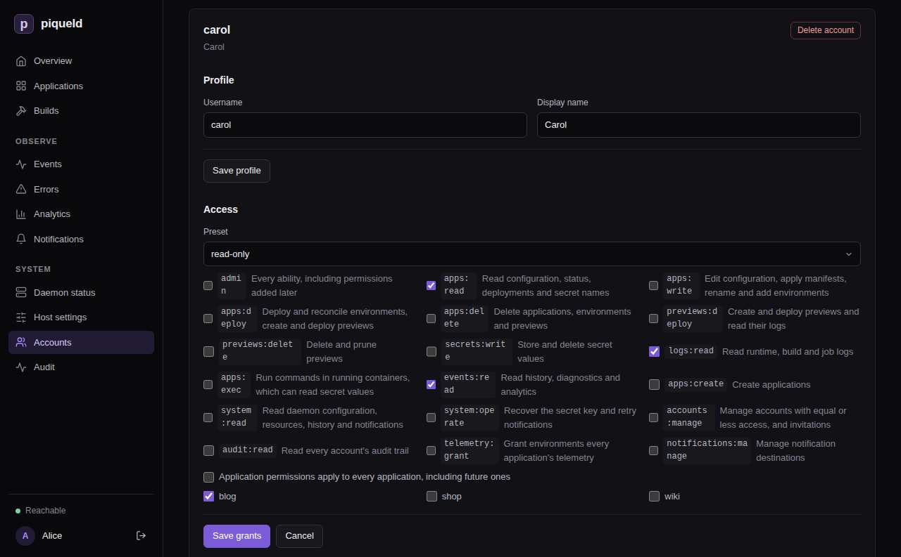

# Permissions

Decide what each account, and each of its tokens, may do. You choose an
account's grants when you [invite it](accounts.md#invite-someone), and change
them on the **Accounts** page or with `piquelctl account access`.

## Before you start

- To change someone's grants, you need `accounts:manage`, every grant their
  account holds, and every grant you give them; see
  [who may manage accounts](#who-may-manage-accounts).
- Run the `piquelctl` examples on the host, or on any machine where
  `piquelctl` is [signed in](cli-and-tokens.md) with your account's full
  access. A limited login or token can't change grants.

## Grants

A grant gives one permission, either on every application or only on the
applications it lists. An account's access is all of its grants together:

```text
admin                          every ability, including permissions added later
admin on blog                  every application permission on blog
apps:deploy on blog, shop      deploy these two applications
previews:deploy on blog        create and deploy blog's previews, not blog itself
system:read                    installation-wide; never limited to applications
```

A grant on every application also covers applications created later. A grant
on an application covers all its environments and previews, including ones
added later.

## Presets

Presets fill in common grants for you. piqueld only saves the grants a preset
selected, not the preset.

| Preset | Grants |
| --- | --- |
| `read-only` | `apps:read`, `logs:read`, `events:read` |
| `deploy` | `apps:read`, `apps:deploy` |
| `developer` | `apps:read`, `apps:write`, `apps:deploy`, `secrets:write`, `logs:read`, `apps:exec`, `events:read`: everything on applications except deleting them |
| `admin` | `admin` |

On every application, `read-only` and `developer` also add `system:read`.
`developer` includes `apps:exec`, because someone who deploys their own
configuration can already reach everything a command in a container could.

## Give an account access

1. On the account's card on the **Accounts** page, under **Access**, select
   **Edit grants**.
2. To limit the access to some applications, clear **Application permissions
   apply to every application, including future ones**, and select them.
3. Choose a **Preset**, or select permissions one by one. Each permission
   shows what it allows.
4. Select **Save grants**.



The applications you select apply to every
[application permission](#application-permissions).
[Installation-wide permissions](#installation-wide-permissions) always apply
everywhere. Choose the applications before the preset: a preset adds
`system:read` when it covers every application at the moment you choose it.

With `piquelctl`:

```console
$ piquelctl account access carol --preset read-only --app blog
Replace every grant of "carol"? [y/N] y
carol (01a16b4c-8584-7390-a0cb-b6b2c348ec20)
  apps:read on blog
  logs:read on blog
  events:read on blog
```

The new grants replace all the old ones. In a script, add `--yes` to skip the
confirmation. The same options choose the grants of invitations, tokens and
limited logins:

- `--preset` starts from a preset: `read-only`, `deploy`, `developer` or
  `admin`.
- `--permission` adds a permission, and can be repeated.
- `--app` limits the application permissions to an application, by name or
  ID, and can be repeated. Installation-wide permissions still apply
  everywhere.

For example, `--preset deploy --permission secrets:write --app blog` lets an
account deploy blog and change its secrets.
[`piquelctl account access`](../reference/cli-commands.md#piquelctl-account-access)
lists all its options.

## Application permissions

These permissions can be limited to applications. Each one also lets its
holder read the application, so a token that may only deploy can still follow
its deployments.

| Permission | Allows |
| --- | --- |
| `admin` | On the applications it lists: every permission in this table. On every application: everything, including the installation-wide permissions and permissions added in later versions |
| `apps:read` | Reading configuration, environments, previews, releases, status, deployments, operations, builds and job runs, promotion plans, the push webhook's address, and the names of secrets and which environments may mount them |
| `apps:write` | Editing configuration, applying and planning manifests, renaming the application, adding and renaming environments, changing an environment's branch or source, opting environments out of sync, and into it (with `apps:deploy` when the application deploys on push), and generating webhook secrets |
| `apps:deploy` | Deploying, promoting releases into and reconciling environments, and everything `previews:deploy` allows. With `apps:write`, saving and deploying in one step, turning on [deploying on push](../reference/manifest.md#deploying-on-push), or opting an environment into it |
| `apps:delete` | Deleting the application, its environments and its previews |
| `previews:deploy` | Creating and deploying [previews](#let-agents-and-ci-manage-previews), including from a local worktree, and reading their logs |
| `previews:delete` | Deleting and pruning previews |
| `secrets:write` | Storing, regenerating and deleting secret values, and choosing which environments may mount them |
| `logs:read` | Reading runtime, build and job logs, which may contain sensitive output |
| `apps:exec` | Running commands in running containers, with `piquelctl app exec` and `preview exec`. A command reaches everything its container can, including secret values |
| `events:read` | Reading the application's history, diagnostics and deployment analytics |

## Installation-wide permissions

These permissions always apply to the whole installation.

| Permission | Allows |
| --- | --- |
| `apps:create` | Creating applications; see [who may create applications](#who-may-create-applications) |
| `system:read` | Reading the daemon's configuration, resources, history and diagnostics, notification destinations and deliveries, and DNS providers and certificates |
| `system:operate` | Recovering from a [lost secret key](../reference/configuration.md#recovering-from-a-lost-key), retrying notification deliveries, and checking DNS providers |
| `accounts:manage` | Managing other accounts and invitations; see [who may manage accounts](#who-may-manage-accounts) |
| `audit:read` | Reading every account's [audit trail](../guides/observability.md#audit-trail), and verifying its integrity. Everyone reads their own |
| `telemetry:grant` | Granting and revoking an environment's [telemetry](#telemetry) |
| `notifications:manage` | Creating, changing, testing and deleting [notification destinations](../guides/observability.md#notifications). A destination can select any application, so this reveals every application's notifications |

Every signed-in account may read the daemon's status and readiness, and the
[OpenAPI document](../../openapi-v1.json), which names what each operation
needs in its `x-piqueld-access` extension: `public`, `authenticated`, or a
permission.

## Let agents and CI manage previews

Agents and CI jobs that create, test and delete [previews](../introduction.md#concepts)
need no access to your long-lived environments. Give them only the previews
permissions. On the dashboard, [create a token](cli-and-tokens.md#create-an-api-token)
limited to blog, and select only `previews:deploy` and `previews:delete`. With
`piquelctl`:

```console
piquelctl token create agent --app blog \
  --permission previews:deploy --permission previews:delete
```

This [token](cli-and-tokens.md#create-an-api-token) can create and deploy
previews of blog, including from a local worktree, read their logs, and delete
and prune them, including previews created later. Like every application
permission, it can read blog, including its environments' status and
deployments.

It can't:

- deploy, promote into, reconcile or delete blog's long-lived environments,
  or read their logs
- change blog's configuration, environments or secrets
- delete blog

Reconciling a preview needs `apps:deploy`. Running commands in a preview needs
`apps:exec`, which reaches the secrets previews mount. Reading history,
including a preview's, needs `events:read`.

`apps:deploy` and `apps:delete` include the previews permissions, so people who
hold them can hand the previews permissions out. People who hold only the
previews permissions can't hand out the others.

## What people without access see

- An application you can't read doesn't exist for you. It answers as not found
  (404), and it's left out of lists, history, builds, analytics, the event
  stream, the routes in system readiness, and the preview counts in system
  status.
- On an application you can read, a missing permission is refused with 403
  `permission_denied`, naming the permission:

  ```console
  $ piquelctl app logs blog
  Error: This action requires the logs:read permission (permission_denied)
    API code: permission_denied
    Request ID: 68e8a36a-6429-43c5-8311-f6866ffff09e
  Details: {"permission":"logs:read"}
  ```

- Applying a manifest with the name of an existing application you can't read
  is refused with 403, rather than treated as a new application.
- The daemon's own history needs `system:read`, and an application's history
  needs `events:read` on it.
- Events are numbered across the whole installation, so you can tell that
  events you can't read happened, but not what they were or where.

## Who may create applications

Creating an application needs `apps:create`. You then get, on the new
application, every application permission you hold on some applications but
not all. For example, bob holds `developer` on blog and shop, and
`apps:create`. When he creates notes, he gets `developer` on notes too.
Permissions you hold on every application already cover it.

Creating and deploying in one step, or creating an application that
[deploys on push](../reference/manifest.md#deploying-on-push), also needs
`apps:deploy` on some application. Applications created with an
[API token](cli-and-tokens.md#create-an-api-token) or a
[limited login](cli-and-tokens.md#ask-for-less-access) give no new grants,
since those credentials never hand out lasting access.

## Who may manage accounts

Everyone may manage their own account: edit its profile, add, rename and
remove its passkeys, see and revoke its sessions and tokens, create tokens for
it, lower its grants (with `piquelctl account access`), and delete it.

Changing another account needs `accounts:manage` and every grant that account
holds. This covers its profile, grants, passkeys, sessions and tokens,
enrollment links, and deleting it. You also only hand out grants you hold,
whether to an account or an invitation. So a team lead with `developer`
access and `accounts:manage` can manage developers but not administrators,
and administrators can manage each other. Anything beyond your own access is
refused with 403 `permission_exceeded`.

Invitation and enrollment links act with their issuer's authority, checked
again when someone uses them. A link stops working if its issuer couldn't
create it any more, for example after the issuer lost `accounts:manage`, or
the target account was given access beyond the issuer's. Revoking a link needs
the same authority as creating it.

At least one account must keep `admin` on every application and a passkey.
Changes that would remove the last such account are refused with 409
`account_lockout`.

The [host operator](recovery.md#the-host-operator) holds `admin` on every
application without being an account, so it doesn't count, and these rules
apply to the changes it makes too. If every administrator still loses access,
it can [create a new one](recovery.md#no-administrator-can-sign-in). Revoking
a host operator browser session needs `accounts:manage` and `admin` on every
application.

## Links between applications

[Links](../reference/manifest.md#links) are part of an application's
configuration. Editing its exports or imports needs `apps:write` on it, and
deploying them needs `apps:deploy`, or `previews:deploy` for a preview's
imports. Importing needs no permission on the exporting application: its
export, deployed by the people who may write it, is its consent. So:

- An export with `previews = true` lets anyone who may deploy previews of an
  application it names reach the service.
- An export naming an application that doesn't exist yet goes to whichever
  application takes that name, and the exporter's next deployment binds it to
  that application. When a named application is deleted, its name passes to
  the next application that takes it, from the exporter's next deployment.

Link reports never reveal applications you can't read. An import of a missing
environment and an import that isn't exported to it both read `unavailable`,
and an environment's importers only list applications you can read.

## Telemetry

An environment granted telemetry gets the daemon's traces, metrics and logs
from **every** application in its
[receiving service](../guides/observability.md#receiving-telemetry-in-an-application).
So granting it can't depend on that application's own permissions: it needs
`telemetry:grant` and reading the application.

On the dashboard, select **Grant telemetry** on the environment's
**Overview** tab. With `piquelctl`:

```console
piquelctl env telemetry blog production on
```

No preset includes `telemetry:grant`. Only `admin` on every application holds
it, unless it's granted on its own. Anyone who may write or deploy the
receiving application can then read every application's telemetry, so grant
it only where they're trusted with that.

Marking a service as the receiver is ordinary configuration, which needs
`apps:write`, and does nothing until the environment is granted. Revoking
with `off` stops the export at once. The telemetry status in
`piquelctl status` and on the dashboard's **Daemon status** only lists the
receivers of applications you can read.

## When access changes take effect

piqueld checks grants on every request, so a change applies at once to every
session and token of the account. Changes also check your access again just
before they're saved, so a change already under way when access is removed or
revoked can't use the access it lost.

Connections that stay open check again while they last: event streams, and
commands started with `apps:exec`. They notice a grant change, an account
deletion or a revoked credential within a second. They notice everything else
within about 30 seconds, such as an expired credential, a token revoked
because its application was deleted, or a tailnet device that no longer
matches a token's [binding](cli-and-tokens.md#bind-a-token-to-tailnet-devices).

For a token bound to tailnet devices, each of these checks first looks the
device up again on the tailnet, which can add up to 10 seconds. If the
lookup doesn't answer in time, the connection ends with
`tailnet_unavailable`.

- An event stream stops sending history you may no longer read. When you lose
  access entirely, it ends with an `access_ended` message.
- A command that lost access ends with the refusal, such as 401, 403 or 404.
  As with a disconnect, the command itself may keep running in its container.

Both also end when the daemon shuts down.

## Troubleshooting

- **A request is refused with `permission_denied`.** Your account, or the
  token you used, lacks the permission in `details.permission`. Ask someone
  with `accounts:manage` to grant it.
- **An application you expect is "not found".** You can't read it. Any
  permission on it lets you read it.
- **You created an application and can't see it.** Your only permission is
  `apps:create`, and the new application only gets the application
  permissions you hold elsewhere. Ask an administrator for access to it.
- **A request is refused with `credential_scoped`.** API tokens and limited
  logins can't create credentials, hand out access, or change their own
  account. Use a full `piquelctl login` or the dashboard.
- **A change is refused with `permission_exceeded` or `account_lockout`.** See
  [managing accounts](accounts.md#troubleshooting).
