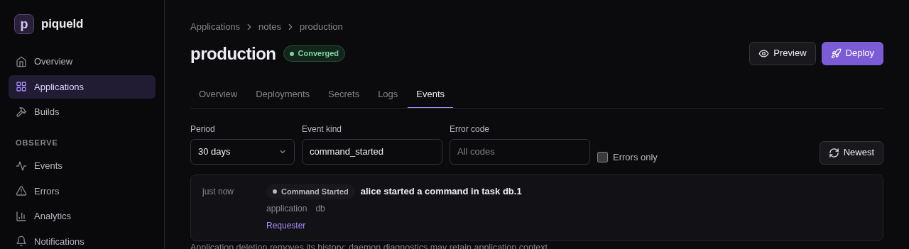

# Running commands in a container

Run a one-off command in a running container of a service, such as a database
console or an administration task, with `piquelctl`.

## Before you start

- Your account needs the `apps:exec` [permission](../accounts/permissions.md#grants)
  on the application. A command reaches everything its container can,
  including secret values, so grant it only to people you trust with those.
- The service has a running replica.
- Run the commands on this page on the host, or on any machine where
  `piquelctl` is [signed in](../getting-started/first-account.md#sign-piquelctl-in).
  You don't need SSH access to the host. The dashboard can't run commands.
- The examples use `notes`, from [Configuring services](services.md).

## Run a command

```console
$ piquelctl app exec notes db -- psql -U notes -c "SELECT pg_size_pretty(pg_database_size('notes'))"
 pg_size_pretty
----------------
 7614 kB
(1 row)

```

Everything after `--` is the program to run and its arguments. `piquelctl`
prints the command's output as it comes, and exits with the command's exit
code.

The command runs in one running replica of the service, as the container's
user, with its environment variables, secrets, volumes and network. It runs
without a shell. To use pipes or variables, run one:

```console
piquelctl app exec notes db -- sh -c 'ls /var/lib/postgresql/data | wc -l'
```

When the application has several environments, name one with `--env`:

```console
piquelctl app exec notes db --env staging -- psql -U notes
```

## Send input to the command

`-i` sends what you pipe to `piquelctl` to the command, such as a database
dump to restore:

```console
piquelctl app exec notes db -i -- psql -q -U notes notes < notes.sql
```

For an interactive program, such as a console or a shell, add `-t` too. It
gives the command a terminal, so you can type and use Ctrl-C:

```console
piquelctl app exec notes db -it -- psql -U notes
piquelctl app exec notes web -it -- sh
```

`-t` needs `piquelctl` to run in a terminal itself, not in a script.

## Run a command in a preview

`preview exec` runs a command in a [preview](previews.md) instead. Name the
preview by its branch, its slug or its ID, and add `--slot` for a preview with
a slot. If `notes` read its manifest from Git and had a preview of branch
`feat/login`:

```console
piquelctl preview exec notes feat/login web -it -- sh
```

## What's recorded

The environment's history records each command, without the command line
itself, which may hold secrets: who started it, in which replica, and its exit
code. Open the environment's **Events** tab in the dashboard to see them. To
see only commands, enter `command_started` or `command_finished` under
**Event kind**:



The [audit trail](../guides/observability.md#audit-trail) also records the
request.

## If the connection drops

If `piquelctl` stops before the command ends, for example when you close its
terminal or lose the connection, the command keeps running in the container
until it ends on its own. The history then records that the command's stream
failed, instead of its exit code.

To stop such a command, run another one that stops it, such as `kill` with its
process ID.

`--timeout` only limits how long `piquelctl` takes to start the command, not
how long the command runs.

If your access to the application is revoked while a command runs, the session
ends, but the command may keep running.

## Troubleshooting

- **`service_not_running`.** The service has no running replica in that
  environment. Deploy it, or check its health.
- **`environment required`.** The application has several environments. Name
  one with `--env`.
- **`--tty requires standard input to be a terminal`.** `-t` only works when
  you run `piquelctl` in a terminal. In a script, use `-i`, or neither.
- **`executable file not found in $PATH`.** The image doesn't have that
  program. Minimal images often have no shell at all, so `sh` doesn't work
  there.
- **`permission_denied`.** Your account or token lacks `apps:exec` on the
  application.
- **`not_found`.** Your account or token can't read the application at all,
  or there is no application of that name.

[Running commands](../reference/cli.md#running-commands) describes how
`app exec` and `preview exec` work, and
[`piquelctl app exec`](../reference/cli-commands.md#piquelctl-app-exec) lists
their options.
