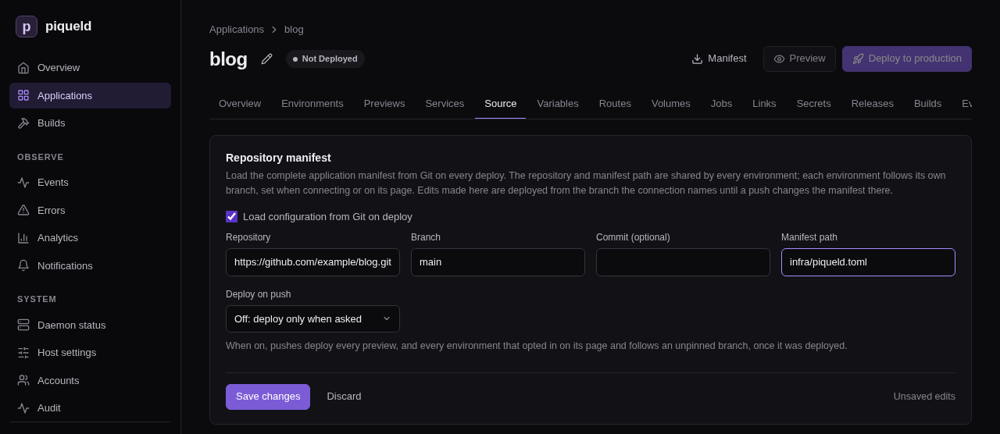
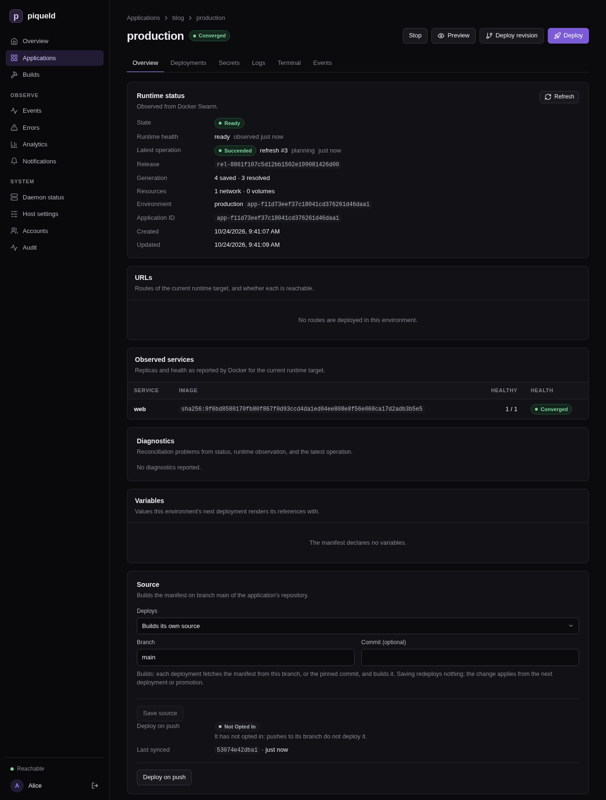

# Deploying on push

Keep an application's manifest in its Git repository, next to its code.
piqueld then reads the manifest from there each time it deploys, and can
deploy every push to a branch.

## Before you start

- You have [an account](../getting-started/first-account.md), and `piquelctl`
  is signed in. Run the commands on this page on the host, or on any machine
  where `piquelctl` is signed in. On another machine, keep `PIQUELD_URL` set,
  as when you
  [signed it in](../getting-started/first-account.md#sign-piquelctl-in).
- The host can read the repository. For a private one, give the daemon's user
  [an SSH key](git-builds.md#build-from-a-private-repository).
- Creating the application needs `apps:create`. Connecting it, and
  generating its webhook secret, need `apps:write` on it. Deploying it, and
  turning on deploying on push, need `apps:deploy` too; see
  [permissions](../accounts/permissions.md#grants).
- To deploy on push with a GitHub webhook, GitHub must reach the daemon. It
  needs [HTTP ingress with a webhook hostname](../guides/ingress.md#push-webhooks)
  whose DNS is public, and you need to be able to change the GitHub
  repository's settings.

## Keep the manifest in the repository

This example deploys a static website. Its repository holds an `index.html`
page and, at its root, a `Dockerfile` that serves it on port 80:

```dockerfile
FROM nginx:alpine
COPY index.html /usr/share/nginx/html/
```

Commit the application's manifest next to them, for example as
`infra/piqueld.toml`, and push it to `main`:

```toml
api_version = "piqueld.dev/v1alpha1"
kind = "Application"

[metadata]
name = "blog"

[[spec.services]]
name = "web"

[spec.services.source]
type = "git"
repository = "self"

[spec.services.source.build]
type = "docker"
dockerfile = "Dockerfile"

[spec.services.healthcheck]
type = "http"
port = 80
path = "/"
```

With `repository = "self"`, `web` builds the repository's own `Dockerfile`, at
the commit the manifest was read from. See
[building from the manifest's own repository](git-builds.md#build-from-the-manifests-own-repository).

## Connect the application to the repository

Create the application, empty, then connect it to the manifest and deploy it.
Until that first deployment, the application has no services, and its
`production` environment is not deployed: the deployment is what reads the
manifest. To connect an application you already run, skip creating it.

> **Warning:** when you connect an application you already run, its
> environments without a branch of their own start following the branch you
> give, so their next deployment deploys that branch instead of the saved
> manifest. Environments with a branch, such as one set with
> `piquelctl env branch`, keep it. Previews and promoted environments are
> unchanged.

### In the dashboard

1. Open **Applications**, select **New application**, fill in **Application
   name** with `blog`, and select **Create application**. The application
   opens, without services.

2. On its **Source** tab, check **Load configuration from Git on deploy**.
   Fill in **Repository** with your repository's URL, **Branch** with `main`,
   and **Manifest path** with `infra/piqueld.toml`, then select **Save
   changes**.

   

3. Select **Deploy to production**, at the top of the page.

### With piquelctl

```console
piquelctl app create blog
piquelctl app repository connect blog https://github.com/example/blog.git infra/piqueld.toml --branch main
piquelctl --timeout 10m app deploy blog
```

Use your repository's URL instead of `https://github.com/example/blog.git`.
`--branch` is `main` by default.

The deployment reads `infra/piqueld.toml` from the latest commit of `main`,
builds `web` from that commit, and runs it:

```console
$ piquelctl app show blog
blog (app-01a16d9202157fe18b0580467224f247)

Configuration revision: 3
Sync: off
Environment: production (app-01a16d9202157fe18b0580467224f247): ready, deploys from main

Service: web
  Replicas: 1
  Source: git self (manifest repository)
```

The application is now *repository-backed*: every deployment reads the file
again. The `metadata.name` in `infra/piqueld.toml` must stay `blog`.

The repository and the path belong to the application, and the branch to
each environment. To deploy another branch to a staging environment, see
[environments](environments.md#add-an-environment).

To stop reading the manifest from Git, uncheck **Load configuration from Git
on deploy** on the **Source** tab and select **Save changes**, or run
`piquelctl app repository disconnect blog`. The application keeps its current
manifest. Its services with `repository = "self"` build from the repository's
URL and branch instead.

## Edit a repository-backed application

You can still edit the application. For example, to run two replicas of
`web`, set **Replicas** to `2` on the service's **Source & scaling** tab and
select **Save changes**, or run:

```console
piquelctl app service replicas blog web 2
```

A notice at the top of each of the application's settings tabs, such as
**Services** and **Variables**, then lists how the application differs from
the repository. So does `piquelctl app show`:

```text
Edited since read from the repository (reset with `app repository reset`):
  ~ services.web.replicas   1 → 2
```

Deployments of `main` deploy your edits, until a push changes
`infra/piqueld.toml`. That deployment deploys the file, which replaces your
edits. Previews, and environments that follow other branches, always deploy
the file of their own branch.

To discard your edits and save the repository's manifest again, select
**Reset to repository** on that notice, or run:

```console
piquelctl app repository reset blog
```

Add `--deploy` to also deploy it.

## Deploy another branch or commit once

To try another branch or commit in an environment without changing the
branch it follows, deploy it once. In the dashboard, select **Deploy
revision** on the environment's page. Choose **The head of a branch** and
fill in **Branch name**, or **A commit** and its full **Commit hash**, then
select **Deploy**. With `piquelctl`:

```console
piquelctl env deploy blog production --branch feat/login
piquelctl env deploy blog production --commit <full-commit-hash>
```

The deployment reads the manifest and builds from that branch or commit.
Nothing is saved: the environment's next deployment, or the next push to its
branch when it deploys on push, returns to its own branch.

## Deploy every push

Deploying on push is off by default. Turn it on for the application, then
opt in each environment that should follow its branch. Every
[preview](previews.md) follows its branch as soon as it is on.

piqueld learns about pushes by polling: it checks the repository on an
interval, between 60 and 86,400 seconds, and every 300 seconds by default.
Polling works with any Git server. With GitHub, a
[webhook](#deploy-on-push-with-a-github-webhook) can report each push
instead.

### In the dashboard

1. On the application's **Source** tab, set **Deploy on push** to **Poll:
   check the branches on an interval**, fill in **Poll interval (seconds)**
   with `120`, and select **Save changes**.

2. Open the environment, such as **production** on the **Environments** tab.
   On its **Overview**, select **Deploy on push** on its **Source** card.

   

   **Stop deploying on push** opts it out again.

### With piquelctl

1. Turn polling on, every two minutes:

   ```console
   piquelctl app repository sync blog poll --interval 120
   ```

2. Opt the environment in:

   ```console
   $ piquelctl env sync blog production on
   Environment production (app-01a16d9202157fe18b0580467224f247), deploys from branch main, opted into sync.
   ```

`app repository connect` takes the same `--sync` and `--interval` options, to
connect the application and turn it on at once.

### In the manifest

An environment the manifest
[declares](environments.md#declare-environments-in-the-manifest) opts in with
`sync = true` in its block. Turning deploying on push on for the application
stays in the dashboard or `piquelctl`: it is part of the connection to the
repository, which piqueld never reads from the repository's file.

### How it deploys

Once on, each environment that opted in deploys its branch's latest commit
whenever the branch moves past the commit it last deployed. An environment
pinned to a commit doesn't follow pushes. It starts following after its first
deployment. A push during a
deployment waits for it to finish, then the latest commit deploys, so commits
pushed in between, or between two polls, don't deploy on their own. A
deployment that fails is not retried until the next push. A
[stopped](environments.md#stop-an-environment) environment doesn't follow
pushes: once started, it deploys the latest commit it missed. When the daemon
starts, it checks the repository once, in case it missed pushes while it was
stopped.

## Deploy on push with a GitHub webhook

With a webhook, GitHub tells piqueld about each push, so pushes deploy within
seconds. piqueld then lists the repository's branches itself: a delivery
can't choose what deploys.

Switch the application to webhooks, and generate the webhook's secret, in the
dashboard or with `piquelctl`. Then add the webhook in GitHub.

### In the dashboard

1. On the application's **Source** tab, set **Deploy on push** to **Webhook:
   when GitHub reports a push**, and select **Save changes**. A **GitHub
   webhook** card then lists the settings for GitHub.

2. Opt the environment in on its **Overview**, if you haven't yet, as in
   [deploying every push](#in-the-dashboard-1).

3. On the **GitHub webhook** card, select **Generate secret**. The card shows
   the secret once, with a **Copy** button, until you select **Done** or
   leave the **Source** tab.

   

### With piquelctl

1. Switch the application to webhooks:

   ```console
   piquelctl app repository sync blog webhook
   ```

2. Opt the environment in, if you haven't yet:

   ```console
   piquelctl env sync blog production on
   ```

3. Generate the webhook's secret:

   ```console
   $ piquelctl app repository webhook rotate blog
   Payload URL: https://hooks.example.com/hooks/github/app-01a16d9202157fe18b0580467224f247
   Secret: 3f9c…
   Configure this secret in GitHub now; piqueld never shows it again.
   ```

   The command asks you to confirm first; in a script, add `--yes`.

`piquelctl app repository webhook show blog` prints the same settings later,
without the secret. Without a payload URL, it says that the daemon must set
[`ingress.webhook_hostname`](../reference/configuration-settings.md#ingresswebhook_hostname).

### In GitHub

Keep the secret at hand: piqueld can't show it again. In GitHub, open the
repository's **Settings**, then **Webhooks**, and select **Add webhook**.
Set:

- **Payload URL** to the payload URL piqueld shows;
- **Content type** to `application/json`;
- **Secret** to the secret you generated;
- the events to **Just the push event**.

Then select **Add webhook**.

### Rotate the secret

Generating a new secret replaces the old one at once: GitHub's deliveries fail
until you update the secret there too. In the dashboard, it is **Rotate
secret** on the **GitHub webhook** card, which asks you to confirm. With
`piquelctl`, run:

```console
piquelctl app repository webhook rotate blog
```

It asks you to confirm every time; in a script, add `--yes`.

## Check that it works

Push a commit to `main`, then open the environment. Its **Source** card says
**following** under **Deploy on push**, and **Last synced** is the commit its
last deployment found on `main`. **Last sync check**, on the application's
**Source** tab, says when piqueld last listed the repository's branches, or
why it couldn't.

With `piquelctl`:

```console
$ piquelctl env show blog production
production of blog (app-01a16d9202157fe18b0580467224f247)

Intent: ready
Runtime: ready (observed 2 s ago)
Source: main
Sync: following, last synced 44928efc5d3229a7b6a918182df49a32afc18a3e
Release: rel-01a16d9438b27093811074404283fef8
Configuration revision: 6
Resolved revision: 6
```

`following` means pushes deploy it, and `last synced` is the commit its last
deployment found on `main`. `piquelctl app show blog` also prints
`Last sync check: succeeded`, or the error of the last check.

Each deployment that follows a push records a `branch_synced` event, such as
`branch main moved to 44928ef…`, requested by `sync:poll` or `sync:webhook`.
They are on the application's **Events** tab, and in `piquelctl events`.

With a webhook, GitHub's **Recent Deliveries**, on the webhook's settings,
shows each delivery and piqueld's response: `204` when it was accepted.

## Troubleshooting

- **A push deploys nothing.** The environment's **Source** card says why
  under **Deploy on push**, and so does the `Sync` line of
  `piquelctl env show`: `off` when the application doesn't deploy on push,
  `off (not opted in)` when the environment isn't opted in,
  `off (pinned)` when it deploys a pinned commit, `off (stopped)` when it is
  [stopped](environments.md#stop-an-environment), and
  `off (waiting for a deployment)` until its first deployment, or the first
  one after its branch or the repository's URL changed. A deployment that
  failed waits for the next push: deploy by hand to retry it.
- **`Last sync check` reports an error.** piqueld couldn't list the
  repository's branches. Git's error is in the daemon's log
  (`journalctl -u piqueld`). piqueld tries again after a minute, then waits
  longer each time, up to an hour. For a private repository, see
  [building from a private repository](git-builds.md#build-from-a-private-repository).
- **The deployment fails with `manifest_fetch_failed`.** piqueld couldn't
  read the repository. Git's error is in the daemon's log
  (`journalctl -u piqueld`). For a private repository, see
  [building from a private repository](git-builds.md#build-from-a-private-repository).
- **GitHub's deliveries get `401`.** The secret doesn't match, or the payload
  URL names another application. Generate a new secret, and copy it and the
  payload URL into GitHub again.
- **The deployment fails with `manifest_not_found`.** There is no file at the
  manifest's path on that commit. Correct **Manifest path** on the
  **Source** tab, or run
  `piquelctl app repository path blog infra/piqueld.toml`.
- **A deployment warns about `manifest_connection_ignored`.** The file's own
  `[spec.manifest]` names another repository or path. piqueld ignores it and
  keeps the application's connection. Change the connection on the
  **Source** tab, or with `piquelctl app repository url` or
  `piquelctl app repository path`.
- **Your edits are gone.** A push changed the manifest file, and its
  deployment replaced them. Make the change in the repository instead.
- **`piquelctl app rename` fails with `repository_managed`.** The name must
  match the repository's manifest. Disconnect the application, rename it,
  and change `metadata.name` in the repository. Then connect it again, with
  the deploy-on-push mode it had:

  ```console
  piquelctl app repository connect <new-name> https://github.com/example/blog.git infra/piqueld.toml --sync poll
  ```

  Finally, reset each environment's branch with `piquelctl env branch`, and
  deploy each one.
