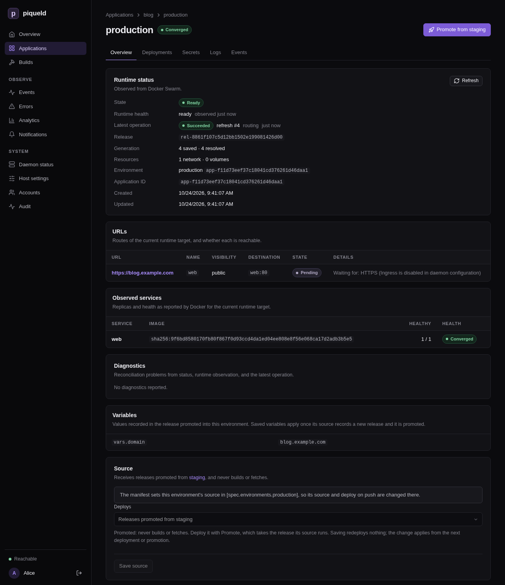
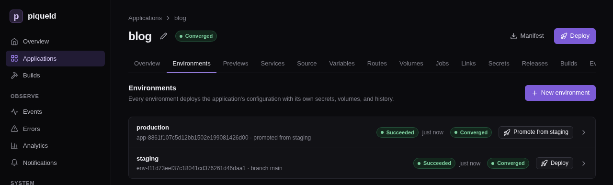

# Environments and promotion

An application can run several environments, such as `staging` and
`production`. Each has its own deployments, secrets, volumes and routes. This
page adds environments, gives each its own settings, and promotes what staging
runs to production without building it again.

## Before you start

- You have an application, such as `hello` from
  [deploying your first application](../getting-started/first-app.md). If you
  deleted it at the end of that page, apply `hello.toml` again with
  `piquelctl app apply --file hello.toml --deploy`.
- `piquelctl` is signed in. Run the commands on this page on the host, or on
  any machine where `piquelctl` is signed in. On another machine, keep
  `PIQUELD_URL` set, as when you
  [signed it in](../getting-started/first-account.md#sign-piquelctl-in).
- For an environment to follow its own branch, or to deploy on push, the
  application reads its manifest from Git. See
  [deploying on push](deploy-on-push.md).
- Adding environments needs `apps:write` on the application, deploying or
  promoting them `apps:deploy`, and deleting them `apps:delete`; see
  [permissions](../accounts/authorization.md#grants).

## Add an environment

1. Add a `staging` environment to `hello`:

   ```console
   $ piquelctl env create hello staging
   Environment staging (env-01a16d902a9e7fa2a37914ff1fd0a3d6), deploys from the saved manifest.
   ```

2. Deploy it:

   ```console
   piquelctl env deploy hello staging
   ```

Both environments now run the application's manifest:

```console
$ piquelctl env list hello
NAME  STATE  SOURCE  RESOLVED  ID
production  ready  saved  2  app-01a16d8f99567681ada904f809903066
staging  ready  saved  2  env-01a16d902a9e7fa2a37914ff1fd0a3d6
```

`env` commands take the application, then the environment. Commands that act
on an application's only environment, such as `piquelctl app deploy hello`,
now fail and list the environments to choose from.

When the application reads its manifest from Git, each environment follows
its own branch. `env create` takes `--branch`, by default the branch the
connection names. With `--branch`, `--commit` pins one commit. `env branch`
changes the branch later, and the environment's next deployment reads the
new branch:

```console
piquelctl env create notes qa --branch develop
piquelctl env branch notes qa release
```

In the dashboard, open the application's **Environments** tab and select
**New environment**. Fill in **Environment name**, and **Branch** for an
application that reads its manifest from Git, then select **Create
environment**. Each environment's row has its own **Deploy** button, and
selecting the row opens the environment's page.

## Declare environments in the manifest

A manifest can list the application's environments, each in its own block:

```toml
[spec.environments.staging]

[spec.environments.production]
```

The manifest then decides which environments exist. Saving it creates the
environments it declares that don't exist yet, without deploying them.
`piquelctl app plan` lists them before you save, as in
[setting up staging and production](#set-up-staging-and-production).

A declared environment can't be created, renamed or deleted with `piquelctl
env` or the dashboard: change the manifest instead. Removing a block doesn't
delete its environment, since it holds volumes and secrets. It keeps running,
and `piquelctl app show` lists it as no longer declared until you delete it
with `piquelctl env delete`.

A block also sets where its environment deploys from:

| Setting | Effect |
| --- | --- |
| `branch`, `commit` | The branch it follows, or the commit it deploys |
| `sync` | Whether pushes to its branch [deploy it](deploy-on-push.md#deploy-every-push) |
| `promote_from` | The environment it [receives releases from](#promote-releases), instead of building |
| `visibility` | `private` [keeps all its routes on your tailnet](#keep-an-environment-on-your-tailnet) |
| `variables` | Its [own values](#give-each-environment-its-own-values) |

The [manifest reference](../reference/manifest.md#declared-environments)
describes each one. When a block sets where its environment deploys from,
the environment's **Source** card in the dashboard says so, and can't change
it:



## Give each environment its own values

Values that differ between environments, such as a hostname or a number of
replicas, come from variables. Declare a default, override it for an
environment, and use it as `${{ vars.<name> }}`.

1. Add these blocks to the end of `hello.toml`:

   ```toml
   [spec.variables]
   web_replicas = 1

   [spec.environments.staging]

   [spec.environments.production.variables]
   web_replicas = 3
   ```

   A `[spec.environments.<name>]` block, even an empty one, declares its
   environment, so the manifest lists both. An environment may also set a
   variable that has no default, such as its hostname.

2. Make `web` use the variable, in its existing `[[spec.services]]` entry:

   ```diff
    [[spec.services]]
    name = "web"
   -replicas = 2
   +replicas = "${{ vars.web_replicas }}"
   ```

   Production runs three replicas, and staging one.

3. Check what production would run:

   ```console
   $ piquelctl app plan --file hello.toml --env production
   Application: app-01a16d8f99567681ada904f809903066

   Changes:
     ~ services.web.replicas   2 → 3

   Actions: 1 total · 0 runtime mutations · 0 destructive · 0 blocking
      1. Resolve image web
         no risk · resolution required

   Variables:
     app.name = hello
     deployment.id = preview
     env.name = production
     env.slug = production
     vars.web_replicas = 3

   Rollout:
     web: start-first (derived) · monitor 30s
   ```

   The plan shows the values production renders. piqueld sets system
   variables, such as `env.name` and `app.name`, itself. The
   [manifest reference](../reference/manifest.md#variables) lists them, and
   the settings that accept variables.

4. Save the manifest:

   ```console
   piquelctl app apply --file hello.toml
   ```

5. Deploy each environment:

   ```console
   piquelctl env deploy hello staging
   piquelctl env deploy hello production
   ```

With `piquelctl`, set the default, production's value, and the reference:

```console
piquelctl app variable set hello web_replicas 1
piquelctl app variable set hello web_replicas 3 --env production
piquelctl app service replicas hello web '${{ vars.web_replicas }}'
```

When the manifest doesn't declare environments yet, setting a value for one
adds a block for every existing environment, which
[declares](#declare-environments-in-the-manifest) them all. From then on,
`piquelctl env delete` and `env rename` fail for them with
`environment_declared`.

In the dashboard, the application's **Variables** tab has one row per
variable, with its **Default** and a column for each environment. Select
**Add variable** to add one, then **Save changes**.

## Keep an environment on your tailnet

To keep an environment's routes on your tailnet, whatever each route says,
set its visibility to private:

```console
piquelctl env visibility hello staging private
```

Deploy the environment to apply it. A promoted environment gets its
visibility from the release it receives instead: promote a release that
staging deployed after the change.

On the environment's **Overview**, it is the **Visibility** card. When the
manifest doesn't declare environments yet, setting a visibility declares them
all, as setting a variable's value for one environment does.

## Promote releases

Once a deployment of an environment has built or pulled its images, piqueld
records a release: the manifest it deployed and its exact images. A promoted
environment never builds. It receives the release another environment runs,
so production runs exactly the images you tested on staging.

### Set up staging and production

This section creates a new application, `notes`, that builds on staging from
every push to `main`, and promotes to production. It follows
[`examples/staging-production.toml`](https://github.com/piquel-fr/piqueld/blob/main/examples/staging-production.toml).

If you created `notes` while following [deploying on push](deploy-on-push.md),
delete it first. This removes its containers and history:

```console
piquelctl app delete notes
```

1. Commit the manifest to the application's repository as
   `infra/piqueld.toml`, and push it to `main`:

   ```toml
   api_version = "piqueld.dev/v1alpha1"
   kind = "Application"

   [metadata]
   name = "notes"

   [spec.manifest]
   path = "infra/piqueld.toml"
   sync = { mode = "poll", interval_seconds = 120 }

   [spec.manifest.repository]
   url = "https://github.com/example/notes.git"
   branch = "main"

   [spec.environments.staging]
   sync = true
   visibility = "private"

   [spec.environments.staging.variables]
   domain = "staging.notes.example.com"

   [spec.environments.production]
   promote_from = "staging"

   [spec.environments.production.variables]
   domain = "notes.example.com"

   [[spec.services]]
   name = "web"

   [spec.services.source]
   type = "git"
   repository = "self"

   [spec.services.source.build]
   type = "docker"
   dockerfile = "Dockerfile"

   # A runtime setting, not a build argument, so staging's image suits production.
   [spec.services.environment]
   ORIGIN = "https://${{ vars.domain }}"

   [spec.services.healthcheck]
   type = "http"
   port = 80
   path = "/"

   [[spec.routes]]
   name = "web"
   hostname = "${{ vars.domain }}"
   service = "web"
   port = 80
   visibility = "public"
   ```

   - `staging` follows `main` and deploys every push to it.
   - `production` only receives releases promoted from `staging`.
   - Each environment serves its own hostname, through the `domain`
     variable. Staging's route stays on your tailnet.

2. Check what saving the same file would do:

   ```console
   piquelctl app plan --file infra/piqueld.toml
   ```

   Among its changes, the plan lists the environments it creates. `…` marks
   the lines left out here:

   ```text
   …
   Environments:
     + staging   created, deploys from branch main, follows pushes
     + production   created, deploys from releases promoted from staging
   …
   ```

3. Save it and deploy it:

   ```console
   piquelctl --timeout 10m app apply --file infra/piqueld.toml --deploy
   ```

   This creates both environments and deploys staging. Production waits for
   its first promotion:

   ```console
   $ piquelctl env list notes
   NAME  STATE  SOURCE  RESOLVED  ID
   production  not_deployed  promoted from staging  none  app-01a16d95dab27100a7df0f7acf4d907b
   staging  ready  main  1  env-01a16d95dac072e2beee6b3df0553b0c
   ```

### Promote staging to production

1. Test staging.

2. See what promoting would change:

   ```console
   piquelctl env promote notes production --plan
   ```

   The plan lists how production would change, the release and where it
   comes from, and the values it renders there. `…` marks the lines left out
   here:

   ```text
   Application: app-01a16d95dab27100a7df0f7acf4d907b

   Changes:
     + manifest   path: infra/piqueld.toml, repository: branch: main, url: https://github.com/example/notes.git, sync: interval seconds: 120, mode: poll
     + routes.notes.example.com   name: web, port: 80, service: web, visibility: public
     …

   Actions: 3 total · 2 runtime mutations · 0 destructive · 0 blocking
     …

   Release:
   rel-01a16d95e1627d5191c37f6cf0e8a041  commit 16139dfe6e37dc5f6a12c04c24629136d4c4e289  created 1792839901532
     Images: all present
     web: sha256:c0dcd0655ca8b48797f2ba02f1e323d17d12b04b18bf7a9f82c27849475d4fc4 (built from https://github.com/example/notes.git (16139dfe6e37dc5f6a12c04c24629136d4c4e289) at 16139dfe6e37dc5f6a12c04c24629136d4c4e289)
     Origin: promoted from staging's deployment operation-01a16d95dac676919a2e9efe0dc3299b

   Variables:
     …
     env.name = production
     …
     vars.domain = notes.example.com
   …
   ```

3. Promote it:

   ```console
   $ piquelctl --timeout 5m env promote notes production
   Promoting release rel-01a16d95e1627d5191c37f6cf0e8a041 into environment production: promoted from staging's deployment operation-01a16d95dac676919a2e9efe0dc3299b, deployment operation-01a16d964c787761b0128e7898e78122.
   Operation: operation-01a16d964c787761b0128e7898e78122
     State: succeeded
     Environment: app-01a16d95dab27100a7df0f7acf4d907b
     Phase: routing
   ```

   After you confirm, production deploys the release staging runs, rendered
   with production's variables, and the command waits until it's done.

Promotion never happens on its own: pushes to `main` only redeploy staging.
Promote again whenever staging runs something you want in production.

In the dashboard, production's row on the **Environments** tab, and its page,
offer **Promote from staging**. Staging's page offers **Promote**. Both show
the plan first, then **Promote release** deploys it.



Only staging's current deployment can be promoted, once it succeeded and runs
healthy. To promote exactly the deployment you tested, pass its ID with
`--deployment`. If staging deploys again in the meantime, the promotion then
fails rather than promoting the newer deployment.

### Deploy an earlier release

`piquelctl app releases notes` lists the application's releases, newest
first, with the environments they were promoted to:

```text
rel-01a16d95e1627d5191c37f6cf0e8a041  commit 16139dfe6e37dc5f6a12c04c24629136d4c4e289  created 1792839901532
  Images: all present
  web: sha256:c0dcd0655ca8b48797f2ba02f1e323d17d12b04b18bf7a9f82c27849475d4fc4 (built from https://github.com/example/notes.git (16139dfe6e37dc5f6a12c04c24629136d4c4e289) at 16139dfe6e37dc5f6a12c04c24629136d4c4e289)
  Deployed to: production as operation-01a16d964c787761b0128e7898e78122, promoted from staging's deployment operation-01a16d95dac676919a2e9efe0dc3299b
```

To go back to an earlier one, deploy it to the promoted environment by ID:

```console
piquelctl env promote notes production --release <release-id>
```

In the dashboard, open the application's **Releases** tab, expand the release,
and select **Deploy to production**.

Images from a registry are pulled again. Images piqueld built can only be
deployed while it keeps them: what each environment runs, and its last three
successful deployments. `images.keep_deployments`, in the
[daemon's configuration](../reference/configuration.md), changes that number.

### Keep builds the same in every environment

A release's images are built once, on staging. So every setting that goes
into a build must be the same in production: the image, the Dockerfile and
context, the build arguments and the target. A build argument that uses a
variable, such as `GREETING = "Hello from ${{ vars.domain }}"`, stops the
promotion:

```text
web.source.build.args.GREETING: renders differently in this environment than in the release, whose images were built from it (release_incompatible)
```

Pass such values to the running service instead, in `environment`, as
`ORIGIN` is above.

### Promote without declaring environments

For an environment the manifest doesn't declare, make it promoted with
`piquelctl`:

```console
piquelctl env create notes production --promote-from staging
piquelctl env source notes production --promote-from staging
piquelctl env source notes production --tracking
```

The first creates a promoted environment, and the second converts an
existing one. `--tracking` makes it build its own source again. None of them
deploys anything.

In the dashboard, choose the source in **Promote from** when you create the
environment. For an existing one, open its **Overview**, set **Deploys** on
its **Source** card to **Releases promoted from staging**, and select **Save
source**.

## Check that it works

```console
$ piquelctl env list notes
NAME  STATE  SOURCE  RESOLVED  ID
production  ready  promoted from staging  1  app-01a16d95dab27100a7df0f7acf4d907b
staging  ready  main  1  env-01a16d95dac072e2beee6b3df0553b0c
```

`piquelctl env show notes production` also prints the release the
environment runs, its variables and its URLs.

## Delete an environment

Deleting an environment removes its services, secrets and deployment
history. Its named volumes are kept, with their data. If the manifest
declares the environment, remove its block and save the manifest first.

```console
piquelctl env delete hello staging
```

In the dashboard, it is **Delete environment**, at the bottom of the
environment's **Overview**.

## Troubleshooting

- **A command says `environment required`.** The application has several
  environments. Use the `env` command and name one, such as
  `piquelctl env deploy hello staging`.
- **It fails with `environment_declared`.** The manifest declares that
  environment, so it decides whether it exists and where it deploys from.
  Change its `[spec.environments.<name>]` block instead.
- **It fails with `environment_unknown`.** No environment has that name, and
  editing with `piquelctl` or the dashboard never creates one. Check the
  name, or declare the environment and apply the manifest.
- **Planning or deploying fails with `variable_value_missing`.** The
  environment has no value for a variable the manifest uses. Set one for it,
  or a default.
- **Deploying fails with `environment_promoted`.** A promoted environment
  never builds: promote it with `piquelctl env promote`.
- **Promoting fails with `promotion_source_not_ready`.** The source's current
  deployment failed, or one of its services isn't healthy right now. Fix the
  source first.
- **Promoting fails with `promotion_source_changed`.** The source deployed
  again since you reviewed it. Plan the promotion again.
- **Promoting fails with `release_incompatible`.** A build setting renders
  differently in the target environment. See
  [keeping builds the same](#keep-builds-the-same-in-every-environment).
- **Promoting fails with `image_unavailable`.** piqueld removed the release's
  images. Promote a newer release.
- **Promoting fails with `secrets_unavailable`.** The release mounts secrets
  the target environment doesn't have or may not use. The error lists each
  one.
- **Deleting fails with `promotion_source_in_use`.** Other environments
  promote from it. Point them at another source first.
- **Deploying fails with `hostname_conflict`.** Two environments render the
  same route hostname. Give each its own value, through a variable.
