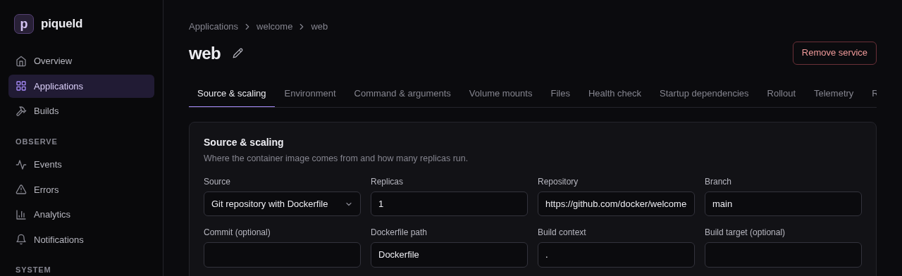
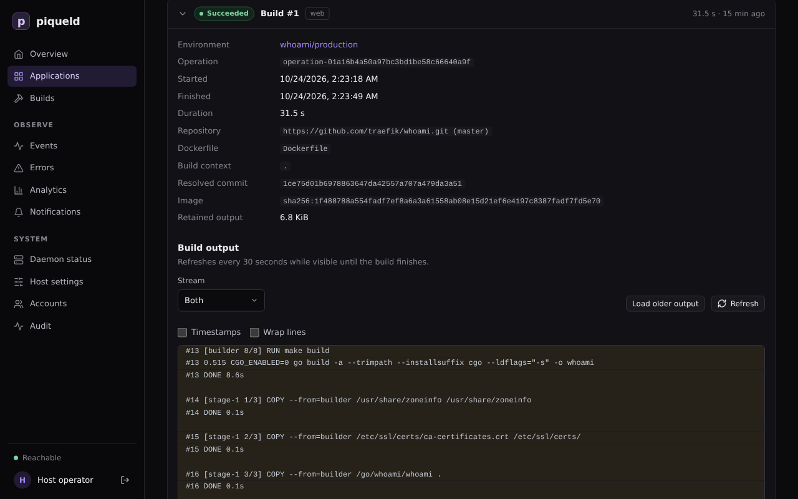

# Building images from Git

A service can build its image from a Git repository with a Dockerfile, instead
of pulling one from a registry. Each time you deploy, piqueld checks the
repository out and builds the image on the host.

## Before you start

- You have [an account](../getting-started/first-account.md), and `piquelctl`
  is signed in. Run the commands on this page on the host, or on any machine
  where `piquelctl` is signed in, unless a section says otherwise. On another
  machine, keep `PIQUELD_URL` set, as when you
  [signed it in](../getting-started/first-account.md#sign-piquelctl-in).
- Creating an application needs `apps:create`, and changing and deploying it
  `apps:write` and `apps:deploy` on it; see
  [permissions](../accounts/permissions.md#grants).
- The host can reach the repository. Public repositories work as they are;
  private ones need [an SSH key](#build-from-a-private-repository).
- The host's `docker` command has the Buildx plugin, which builds the images.
- You trust the repository. Its Dockerfile's instructions run on the host's
  Docker engine.

## Build a service from a repository

This example builds
[docker/welcome-to-docker](https://github.com/docker/welcome-to-docker),
Docker's sample web page, whose repository has a Dockerfile at its root, as
the application `welcome`. Its service, `web`, builds branch `main`, and is
healthy once it answers on `/`, on port 3000.

### In the dashboard

1. Create the application `welcome`, and add a service named `web` to it, as
   in [deploying your first application](../getting-started/first-app.md#in-the-dashboard).
   Its image doesn't matter: the next step replaces it.
2. Open `web` on the application's **Services** tab. On its **Source &
   scaling** tab, set **Source** to **Git repository with Dockerfile**.
3. Fill in **Repository** with
   `https://github.com/docker/welcome-to-docker.git`, **Branch** with `main`,
   and **Dockerfile path** with `Dockerfile`, then select **Save changes**.
   **Commit (optional)** pins a commit.

   

4. On its **Health check** tab, set **Check type** to **HTTP**, **Port** to
   `3000` and **Path** to `/`, then select **Save changes**.
5. On the application's page, select **Deploy to production**.

### With piquelctl

```console
piquelctl app create welcome
piquelctl app service add welcome web --git https://github.com/docker/welcome-to-docker.git --branch main
piquelctl app service health http welcome web 3000 --path /
piquelctl --timeout 10m app deploy welcome
```

`--timeout 10m` gives the build time to finish. By default, `piquelctl`
waits 30 seconds.

To switch a service you already have to Git:

```console
piquelctl app service source git welcome web https://github.com/docker/welcome-to-docker.git --branch main
```

`source git` replaces the whole source. Any option you leave out goes back to
its default: branch `main`, Dockerfile `Dockerfile`, context `.`, and no
build arguments or target. To change one setting, use its own command, such
as `source branch`, `source dockerfile`, or `source context` for a repository
whose Dockerfile isn't at its root:

```console
piquelctl app service source branch welcome web main
piquelctl app service source dockerfile <app> <service> build/Dockerfile
piquelctl app service source context <app> <service> build
```

These commands only save the change. Deploy it with
`piquelctl --timeout 10m app deploy welcome`, or add `--deploy` to the command.

### From a manifest

1. Save this manifest as `welcome.toml`:

   ```toml
   api_version = "piqueld.dev/v1alpha1"
   kind = "Application"

   [metadata]
   name = "welcome"

   [[spec.services]]
   name = "web"

   [spec.services.source]
   type = "git"

   [spec.services.source.repository]
   url = "https://github.com/docker/welcome-to-docker.git"
   branch = "main"

   [spec.services.source.build]
   type = "docker"
   dockerfile = "Dockerfile"

   [spec.services.healthcheck]
   type = "http"
   port = 3000
   path = "/"
   ```

   - `repository` names the repository and the branch to build.
   - `build` names the Dockerfile, relative to the root of the repository.
     The build context is the root too, unless you set `context`.

2. Save the manifest and deploy it:

   ```console
   piquelctl --timeout 10m app apply --file welcome.toml --deploy
   ```

[Manifest settings](../reference/manifest-settings.md#specservicessource-1)
lists every setting of a source.

### How it builds

Each deployment builds the latest commit of the branch. Docker reuses the
steps that didn't change, so later builds are faster. It pulls base images
every time, so they stay up to date. If the checkout or the build fails, the
deployment fails and the application keeps running what it ran before.

To build one exact commit instead, pin its full hash: fill in **Commit
(optional)** in the dashboard, or run:

```console
piquelctl app service source commit welcome web 68c1b9f87c41fb3fef2667e27149865c2f42d1eb
```

In the manifest, it is `commit` in `repository`:

```toml
[spec.services.source.repository]
url = "https://github.com/docker/welcome-to-docker.git"
branch = "main"
commit = "68c1b9f87c41fb3fef2667e27149865c2f42d1eb"
```

To follow the branch again, empty **Commit (optional)**, run
`piquelctl app service source commit welcome web --clear`, or remove `commit`.

## Pass build arguments and choose a stage

A Dockerfile can read build arguments with `ARG`, and a multi-stage one can
build a stage other than the last. For a Dockerfile with an `ARG VERSION` and
a `runtime` stage:

- **In the dashboard,** on the service's **Source & scaling** tab, select
  **Add build argument** under **Build arguments (not secret)**, and fill in
  **Build target (optional)**.
- **With `piquelctl`,** pass them to `source git`, which replaces the whole
  source:

  ```console
  piquelctl app service source git <app> <service> <url> \
    --branch main --build-arg VERSION=1.10 --target runtime
  ```

- **In the manifest,** add `args` and `target` to `build`:

  ```toml
  [spec.services.source.build]
  type = "docker"
  dockerfile = "Dockerfile"
  args = { VERSION = "1.10" }
  target = "runtime"
  ```

Build arguments aren't secret. Docker stores them in the image, and piqueld
shows them in the manifest and the build history. Give secrets to the running
service instead.

The `build` settings accept [variables](../reference/manifest.md#variables).
The `repository` settings don't: a variable there fails validation with
`variable_not_allowed`. An image built from a value that differs between
environments can't be promoted from one to the other. See
[keeping builds the same everywhere](environments.md#keep-builds-the-same-in-every-environment).

## Build from a private repository

piqueld reaches private repositories over SSH, with a key belonging to the
daemon's user, `piqueld`. Run these commands on the host. They use
`/var/lib/piqueld`, the user's home directory when piqueld is
[installed](../getting-started/install.md) as described.

1. Create a key without a passphrase:

   ```console
   sudo -u piqueld mkdir -p -m 700 /var/lib/piqueld/.ssh
   sudo -u piqueld ssh-keygen -t ed25519 -N '' -C piqueld -f /var/lib/piqueld/.ssh/id_ed25519
   ```

   Git runs without a terminal, so it can't ask for a passphrase.

2. Give the key read access to the repository. On GitHub, open the
   repository's **Settings**, then **Deploy keys**, and add the contents of
   `/var/lib/piqueld/.ssh/id_ed25519.pub`, without write access.

   GitHub accepts a deploy key on one repository only. To read several,
   add the key to a GitHub account that can read them all instead.

3. Connect once, so that SSH records the server's host key:

   ```console
   sudo -u piqueld ssh -T git@github.com
   ```

   Check that the fingerprint SSH shows matches the server's published one,
   such as [GitHub's](https://docs.github.com/en/authentication/keeping-your-account-and-data-secure/githubs-ssh-key-fingerprints),
   and answer `yes`. Git can't answer that question later.

4. Use the repository's SSH URL, such as `git@github.com:example/notes.git`,
   as the service's repository: in **Repository** in the dashboard, with
   `piquelctl app service source url`, or as `url` in the manifest's
   `repository`.

Git uses the daemon user's `~/.ssh` and `~/.gitconfig`, but not the host's
`/etc/gitconfig`. piqueld refuses credentials written in a URL, such as
`https://token@github.com/…`.

## Build from the manifest's own repository

When piqueld reads an application's manifest from Git, as described in
[deploying on push](deploy-on-push.md), its services can build from that same
repository. In the dashboard, set the service's **Source** to **Manifest
repository with Dockerfile**. With `piquelctl`, pass `self` instead of the
repository's URL:

```console
piquelctl app service source git blog web self
```

`piquelctl app service add blog worker --git self` adds a service that builds
from it. In the manifest:

```toml
[spec.services.source]
type = "git"
repository = "self"

[spec.services.source.build]
type = "docker"
dockerfile = "Dockerfile"
```

The service builds the commit the manifest was read from, so a deployment's
manifest and images always come from one commit. It has no branch or commit
of its own. Each environment builds the branch it follows.

## Check that it works

piqueld records every build, whether it succeeds or fails. In the dashboard,
**Builds** in the sidebar lists the builds of every application, and an
application's **Builds** tab lists its own. Select a build to see the commit
it built, the image it produced, and its output.



With `piquelctl`, `app show` lists each service's source:

```console
$ piquelctl app show welcome
welcome (app-01a16d91fb2c7b93bfe138a7d95dc56f)

Configuration revision: 1
Environment: production (app-01a16d91fb2c7b93bfe138a7d95dc56f): ready, deploys from saved

Service: web
  Replicas: 1
  Source: git https://github.com/docker/welcome-to-docker.git (main)
```

List the application's builds by its ID, which `app show` prints:

```console
$ piquelctl builds list --application app-01a16d91fb2c7b93bfe138a7d95dc56f
1  app-01a16d91fb2c7b93bfe138a7d95dc56f  web  Succeeded  1792839646134
```

Each line is a build: its number, the environment's ID, the service, its
state, and when it started, in Unix milliseconds. Read a build's output by its
number:

```console
piquelctl builds logs 1
```

It prints the latest output. When there is more, its last line,
`Info: Load older output with --before <offset>`, gives the option that
prints the earlier part.

## Troubleshooting

- **The deployment fails with `git_build_failed`.** The checkout or the build
  failed. Its output ends with the error: open the build on the **Builds**
  page, or run `piquelctl builds logs`. Fix the repository or the source's
  settings, then deploy again. `piquelctl` suggests `env reconcile`, which
  retries the same deployment: it only helps when the cause was temporary,
  such as the network.
- **The deployment fails with `preparation_timeout`.** A deployment has
  `reconciliation.prepare_timeout_seconds`, 300 seconds by default, to check
  out and build its services. The host builds one image at a time, and the
  time spent waiting for other builds counts too. Raise
  [`reconciliation.prepare_timeout_seconds`](../reference/configuration-settings.md#reconciliationprepare_timeout_seconds)
  in the daemon's configuration.
- **`piquelctl` times out, but the build goes on.** The command stopped
  waiting, not the deployment, and exited with code 4. Follow the deployment
  on the **Builds** page or with `piquelctl --timeout 10m env wait welcome`, or
  give `piquelctl` a longer `--timeout`.
- **The build output says `Permission denied (publickey)` or `Host key
  verification failed`.** The daemon's user has no key the server accepts, or
  doesn't know the server's host key yet. Follow
  [building from a private repository](#build-from-a-private-repository).
- **Validation fails with `git_credentials_inline`.** The repository URL is an
  HTTP or HTTPS URL with a user name or token in it, or has a password. Use an
  SSH URL, such as `git@github.com:example/notes.git`, and a key instead.
- **A Git setting of the host doesn't apply,** such as a rule rewriting
  GitHub URLs to SSH. Git ignores `/etc/gitconfig`: add the setting to the
  daemon user's `~/.gitconfig`.
- **A large repository fails to check out.** Checkouts must fit in
  [`checkouts.max_bytes`](../reference/configuration-settings.md#checkoutsmax_bytes), 4 GiB
  by default, and hold at most 500,000 files and directories. piqueld doesn't
  fetch Git submodules or Git LFS files.
- **The build output stops before the end.** piqueld keeps the first 4 MiB of
  each build's output for 30 days.
  [`build_history.log_max_bytes`](../reference/configuration-settings.md#build_historylog_max_bytes)
  and
  [`build_history.log_retention_days`](../reference/configuration-settings.md#build_historylog_retention_days)
  in the daemon's configuration change that.
