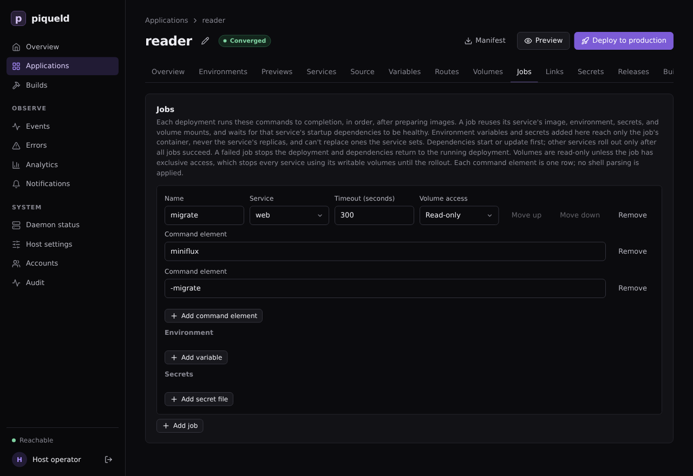
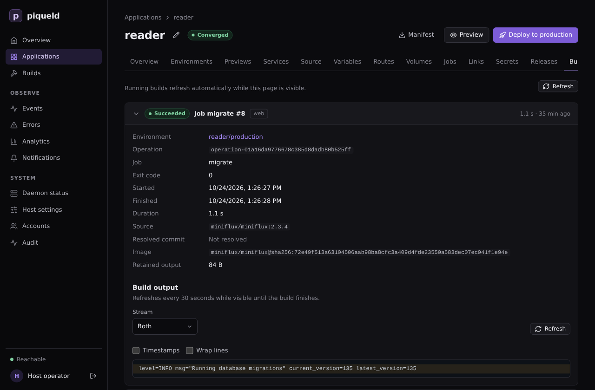

# Running jobs before a rollout

A job runs a command to completion during each deployment, before the new
version of your services starts. Use it for database migrations, so that the
new version only ever runs on a migrated database.

## Before you start

- Your application's image has a command that migrates its database. The
  examples use `reader`, an application that runs
  [Miniflux](https://miniflux.app), a feed reader, in its `web` service:

  ```toml
  [[spec.services]]
  name = "web"
  depends_on = ["db"]

  [spec.services.source]
  type = "image"
  image = "miniflux/miniflux:2.3.4"

  [spec.services.environment]
  DATABASE_URL_FILE = "/run/secrets/database-url"

  [[spec.services.secrets]]
  name = "database-url"
  target = "/run/secrets/database-url"

  [spec.services.healthcheck]
  type = "http"
  port = 8080
  path = "/healthcheck"
  ```

  `db` is a PostgreSQL service like the one in
  [Configuring services](services.md). Miniflux reads the database's address,
  password included, from the [stored secret](secrets-and-variables.md#store-a-secret)
  `database-url`, and `miniflux -migrate` migrates the database.
- Run the commands on this page on the host, or on any machine where
  `piquelctl` is [signed in](../getting-started/first-account.md#sign-piquelctl-in).
- Editing an application needs the `apps:write`
  [permission](../accounts/authorization.md) on it, and deploying it
  `apps:deploy`. Reading a job's output needs `logs:read`.

## Add a migration job

1. Add the job at the end of the manifest:

   ```toml
   [[spec.jobs]]
   name = "migrate"
   service = "web"
   command = ["miniflux", "-migrate"]
   run = "before-rollout"
   ```

   - `service` is the service whose image the job runs, with its environment
     variables, secrets, volumes and network. Here, the job gets `web`'s
     database address.
   - `command` is the program to run and its arguments, without a shell. It
     replaces the image's entrypoint, so name the program itself.
   - `run = "before-rollout"` runs the job before the services roll out. It's
     the only choice, and it's required.

2. Deploy:

   ```console
   piquelctl app apply --file reader.toml --deploy
   ```

Each deployment now runs the job before the rollout:

1. It starts the services `web` [depends on](services.md#startup-dependencies),
   here `db`, and waits until they're healthy.
2. It runs `migrate`, and waits until it exits.
3. Once the job has succeeded, it rolls out the services.

While the job runs, the previous version of `web`, if there is one, keeps
serving.

The job runs at every deployment, even when nothing changed, so it must succeed
when there's nothing to do. `miniflux -migrate` then only checks that the
database is up to date.

With `piquelctl`, give the job's name, its service, and its command after `--`:

```console
piquelctl app job set reader migrate web -- miniflux -migrate
```

In the dashboard, open the application's **Jobs** tab and select **Add job**.
Enter the **Name**, pick the **Service**, and enter the command, one
**Command element** per row: **Add command element** adds a row. Then select
**Save changes**.



## Check that it works

Each run of a job, with its output, is kept in the application's build history.
`piquelctl builds list` lists the latest runs and builds, newest first:

```console
$ piquelctl builds list
3  app-01a16da791427563adb574452b389f92  job migrate (web)  Succeeded  1792841094238
```

The first column is the run's ID. Read its output:

```console
$ piquelctl builds logs 3
level=INFO msg="Running database migrations" current_version=0 latest_version=135
```

In the dashboard, open the application's **Builds** tab, and select a run to
see its output.



## Give the job its own variables and secrets

A job can get environment variables and secrets that its service doesn't. Use
them for what only the migration needs, such as the password of a database
user allowed to change the schema. Add them after the job's other settings:

```diff
 [[spec.jobs]]
 name = "migrate"
 service = "web"
 command = ["miniflux", "-migrate"]
 run = "before-rollout"
+
+[spec.jobs.environment]
+LOG_LEVEL = "debug"
+
+[[spec.jobs.secrets]]
+name = "db-owner-password"
+target = "/run/secrets/db-owner-password"
```

The job gets them on top of its service's. The service's replicas never get
them. Like any secret, `db-owner-password` must be
[stored or generated](secrets-and-variables.md).

A job can't change what its service sets: a variable the service sets, or a
path the service mounts something at, fails validation.

With `piquelctl`, add `--env KEY=VALUE` and `--secret NAME=TARGET`, once for
each:

```console
piquelctl app job set reader migrate web --env LOG_LEVEL=debug --secret db-owner-password=/run/secrets/db-owner-password -- miniflux -migrate
```

They replace the job's own variables and secrets. Without them, `job set`
keeps the job's, and `--clear-env` and `--clear-secrets` remove them. In the
dashboard, the job's **Environment** and **Secrets** sections list them:
select **Add variable** or **Add secret file**.

## Set a timeout

A job that runs longer than its timeout is stopped, and the deployment fails.
The timeout is 300 seconds by default, and at most 86,400 (a day):

```diff
 [[spec.jobs]]
 name = "migrate"
 service = "web"
 command = ["miniflux", "-migrate"]
 run = "before-rollout"
+timeout_seconds = 600
```

With `piquelctl`, add `--timeout-seconds 600` to `job set`. In the dashboard,
it's the job's **Timeout (seconds)**.

## Run several jobs

Jobs run one after the other, in the order the manifest lists them, and the
services roll out once every job has succeeded. To change the order, move a
job to another position:

```console
piquelctl app job move reader migrate 1
```

In the dashboard, select **Move up** or **Move down** next to a job.

## Jobs and volumes

While a job runs, the previous version of its service keeps running and writing
its volumes. So by default, the job mounts its service's volumes read-only.

A migration that has to write a volume, such as one that changes an SQLite
database, needs `volume_access = "exclusive"`. Then, before the job runs,
piqueld stops every service that mounts one of its service's writable volumes.
They start again with the rollout. The application is unavailable meanwhile,
and `piquelctl app plan` warns about it with `job_stops_services`, naming the
services that stop.

With `piquelctl`, add `--volume-access exclusive` to `job set`. In the
dashboard, pick **Exclusive** under the job's **Volume access**.

## If a job fails

A job fails when it exits with a code other than 0, or runs past its timeout.
The deployment then stops before the rollout, and `piquelctl` prints why:

```text
Error: operation ended in state failed

Context:
...
Code: job_failed
Message: job migrate exited with status 1; rollout stopped
...
```

The services keep running their previous version, and the environment shows as
degraded until a deployment succeeds. The services the job depended on return
to their previous version too. Anything the job changed, such as the database,
stays changed.

piqueld doesn't run a failed job again on its own. Read its output, fix the
cause, and deploy again.

## Troubleshooting

- **The deployment fails with `job_failed`.** Read the job's output with
  `piquelctl builds logs`. Its last line says how the container ended, such as
  `piqueld: task: non-zero exit (1)`.
- **The deployment fails with `job_timeout`.** The job ran longer than its
  `timeout_seconds`. Raise it, or find out what the job waits for.
- **Validation fails with `job_setting_conflict`.** The job sets a variable,
  or mounts a secret at a path, that its service already uses. Rename one of
  them.
- **Validation fails with `job_dependency_order_invalid`.** A job starts a
  service whose own jobs come later. Move those jobs before it.
- **Validation fails with `job_volume_access_invalid`.** An exclusive job's
  service mounts no writable volume, or one of the job's startup dependencies
  mounts the same volume.
- **The job can't reach a service.** On the first deployment, only the job's
  startup dependencies run when it starts. Add the services it needs to its
  service's `depends_on`.
- **The job behaves differently from its service.** The job's command replaces
  the image's entrypoint, so a setup script the entrypoint runs, such as one
  reading `_FILE` variables, doesn't run for the job.
- **The job can't reach another application.** A job can't use a
  [link](links.md) on the deployment that adds it. Deploy the import first.

The [manifest reference](../reference/manifest.md#jobs) describes every job
setting.
