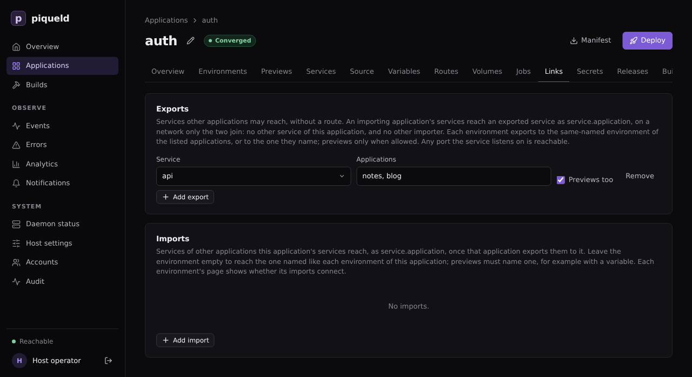
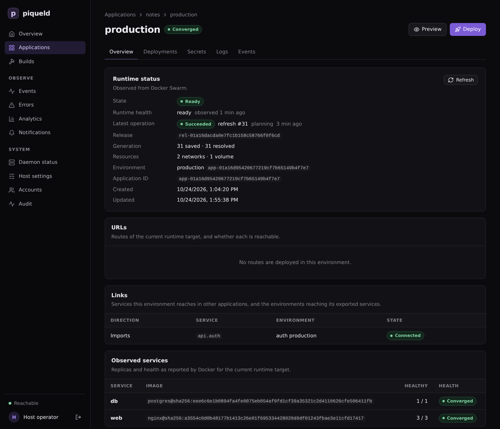

# Connecting applications

Let the services of one application reach a service of another application
over a private network, without a public route. Both applications have to
agree: one exports the service, the other imports it.

## Before you start

- You have two applications. The examples use `notes`, from
  [Configuring services](services.md), and `auth`, whose service `api` the
  services of `notes` need to reach. Here, `api` runs `traefik/whoami`, a small
  web server that replies with a description of each request it receives.
- Run the commands on this page on the host, or on any machine where
  `piquelctl` is [signed in](../getting-started/first-account.md#sign-piquelctl-in).
- Editing each side needs the `apps:write`
  [permission](../accounts/authorization.md) on its application, and deploying
  it `apps:deploy`. Importing needs no permission on the exporting application:
  its export is its consent.

## Set it up

1. In `auth`, export `api` to `notes`. Save this manifest as `auth.toml`:

   ```toml
   api_version = "piqueld.dev/v1alpha1"
   kind = "Application"

   [metadata]
   name = "auth"

   [[spec.services]]
   name = "api"

   [spec.services.source]
   type = "image"
   image = "traefik/whoami"

   [spec.services.healthcheck]
   type = "http"
   port = 80
   path = "/health"

   [[spec.exports]]
   service = "api"
   applications = ["notes"]
   ```

   `[[spec.exports]]` names the service, and the applications that may import
   it.

2. Deploy it:

   ```console
   piquelctl app apply --file auth.toml --deploy
   ```

3. In `notes`, import `api`. Add at the end of `notes.toml`:

   ```toml
   [[spec.imports]]
   application = "auth"
   service = "api"
   ```

4. Deploy it:

   ```console
   piquelctl app apply --file notes.toml --deploy
   ```

The services of `notes` now reach `api` as `api.auth`, that is
`<service>.<application>`, on any port it listens on, such as
`http://api.auth`.

You can deploy the two sides in either order. The link connects once both
have deployed it.

With `piquelctl`, export and import the service, then deploy each application:

```console
piquelctl app export set auth api --applications notes
piquelctl app import add notes auth api
piquelctl app deploy auth
piquelctl app deploy notes
```

`--applications` takes a comma-separated list.

In the dashboard, open each application's **Links** tab:

- In `auth`, under **Exports**, select **Add export**, pick the **Service**,
  and enter the **Applications**, separated by commas.
- In `notes`, under **Imports**, select **Add import**, and enter the
  **Application** and the **Service**. Leave **Environment** empty.

Each list has its own **Save changes** button. Then deploy each application.



## Check that it works

```console
$ piquelctl env show notes
production of notes (app-01a16d95420677219cf7b65149b4f7e7)
...
Import: api.auth from auth production: connected
```

The exporting side lists who imports its services:

```console
$ piquelctl env show auth
...
Imported by: notes production: api
```

In the dashboard, the environment's **Overview** has a **Links** card, which
lists each import with its state.



To try the connection, [run a command](commands.md) in a service of `notes`:

```console
$ piquelctl app exec notes web -- wget -qO- http://api.auth
Hostname: f09d400b7004
IP: 127.0.0.1
...
GET / HTTP/1.1
Host: api.auth
User-Agent: Wget
...
```

## Choose which environment an import reaches

An import reaches the environment of the same name in the exporting
application: `notes` production reaches `auth` production, and `notes`
staging reaches `auth` staging. If `auth` has no staging, the import of
`notes` staging waits:

```console
$ piquelctl env show notes staging
...
Import: api.auth from auth staging: waiting: not exported to this environment
```

To reach another environment, name it in the import:

```diff
 [[spec.imports]]
 application = "auth"
 service = "api"
+environment = "production"
```

With `piquelctl`, add `--environment production` to `import add`. In the
dashboard, enter it under **Environment**.

`environment` can come from a [variable](secrets-and-variables.md#use-different-values-per-environment),
so each environment chooses its own.

An export grants every environment of the applications it lists, including
ones created later. Each environment of the exporting application exports what
it deploys: `auth` staging and `auth` production can export different
services.

## Previews

An application whose manifest is in a Git repository can have
[previews](../reference/manifest.md#previews). A preview can import a service
too, if the export allows previews:

```diff
 [[spec.exports]]
 service = "api"
 applications = ["notes"]
+previews = true
```

With `piquelctl`, add `--previews` to `export set`. In the dashboard, check
**Previews too**. Previews themselves never export.

A preview's name is its slug, such as `notes-feat-login-3fa2c1`, which no
environment of the exporting application has. So name the environment previews
reach, with a variable:

```toml
[[spec.imports]]
application = "auth"
service = "api"
environment = "${{ vars.auth_env }}"

[spec.variables]
auth_env = "${{ env.name }}"

[spec.previews.variables]
auth_env = "staging"
```

Environments reach the `auth` environment of their own name, and previews reach
`auth` staging.

## What a link reaches

- Each link has its own network, which only the importing environment's
  services and the imported service join. `notes` can't reach `auth`'s other
  services, and two applications that import from `auth` can't reach each
  other.
- Every port the exported service listens on is reachable. Export services
  that only listen where importers should connect.
- The exported service can also reach the services of the importing
  environment, on the link's network.

## How a link changes

A link follows what both sides deploy, never what's only saved. It goes away
once either side deploys without it, or is deleted. The other side adjusts
within seconds, without a deployment.

Each time a link connects or goes away, piqueld rolls out the imported service
and the importing services again, as for any change of network. Deployments
never wait for a link: until it connects, `api.auth` doesn't resolve, so make
your services retry.

Renaming the exporting application changes the name its services answer to:
`api.auth` becomes `api.<new name>`.

## Troubleshooting

- **The import is `waiting: not exported to this environment`.** No deployed
  environment of that name exports the service to this application. Check
  that the export lists the importing application, that the exporting side
  deployed it, and that the import reaches the right environment. A preview
  also needs `previews = true`.
- **The import is `waiting: the exporter links to too many environments`.**
  An exported environment links to at most 64 importing environments. The
  oldest keep their links, and newer ones wait until one goes away.
- **The name doesn't resolve right after the link connects.** The importing
  services are rolling out again. Commands you run during that time may land
  in a replica that isn't on the link's network yet: wait until the rollout
  ends.
- **A job can't reach an import.** A job can't use a link on the deployment
  that adds it. Deploy the import first, then add the job.
- **Validation fails with `export_service_missing`.** The export names a
  service that the application doesn't have.
- **Validation fails with `export_duplicate` or `import_duplicate`.** A service
  is exported twice, an application is listed twice in one export, or a
  service is imported twice.

The [manifest reference](../reference/manifest.md#links) describes links in
full, and [authorization](../accounts/authorization.md#links-between-applications)
who may set them up.
