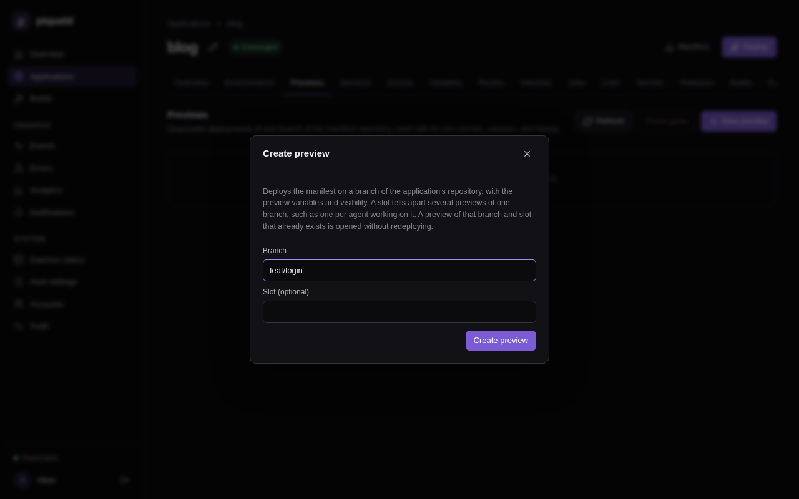
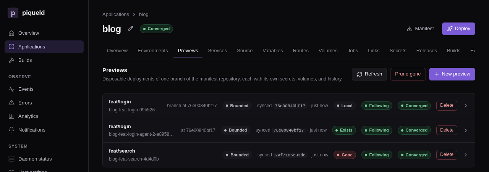
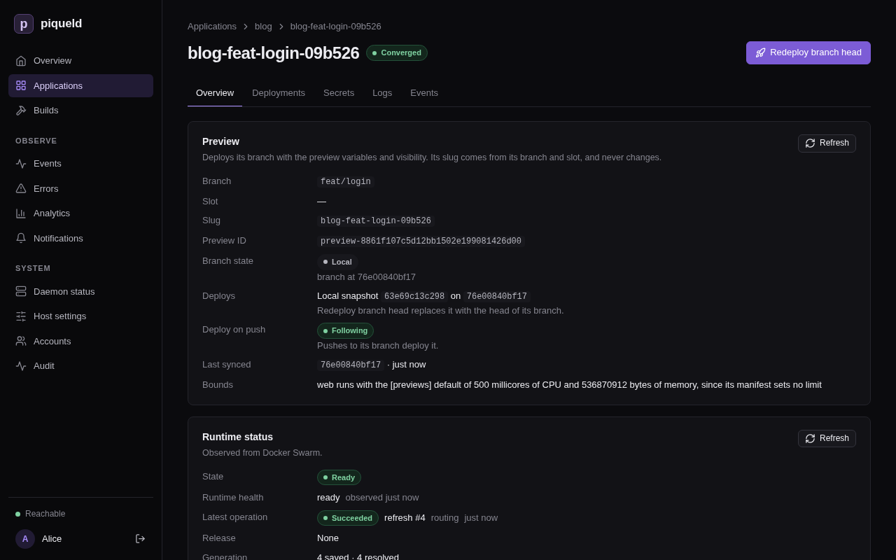

# Previews

A preview is a short-lived copy of an application that runs one Git branch,
or the uncommitted changes in your worktree. Use one to try a change before it
reaches staging, then delete it.

## Before you start

- This page continues with the `blog` application of
  [setting up staging and production](environments.md#set-up-staging-and-production).
  Its manifest comes from Git, and its `web` route's hostname is
  `${{ vars.domain }}`, so each preview gets an address of its own. A
  preview of an application without routes runs, but has no URL.
- Creating and deploying previews needs `previews:deploy` on the application,
  and deleting them `previews:delete`. `apps:deploy` and `apps:delete`
  include them; see [preview permissions](../accounts/permissions.md#let-agents-and-ci-manage-previews).
- Previews' routes are private by default, so their URLs work once the daemon
  serves [private routes](../guides/ingress.md#public-and-private-routes).
- `piquelctl` is signed in. Run the commands on this page on the host, or on
  any machine where `piquelctl` is signed in. On another machine, keep
  `PIQUELD_URL` set, as when you
  [signed it in](../getting-started/first-account.md#sign-piquelctl-in).

## Preview a branch

1. Give previews their own settings. Previews ignore the
   `[spec.environments.<name>]` blocks of the manifest, and use its
   `[spec.previews]` block instead. Add it to `infra/piqueld.toml`:

   ```toml
   [spec.previews]
   visibility = "private"

   [spec.previews.variables]
   domain = "${{ env.slug }}.preview.blog.example.com"
   ```

   - `visibility` is the strictest visibility of their routes. It is
     `private` by default, which keeps every preview on your tailnet.
   - `variables` override the defaults of `[spec.variables]` for every
     preview. Every variable without a default, such as `domain` in
     [the staging and production manifest](environments.md#set-up-staging-and-production),
     needs a value here, or the preview's deployment fails.
   - `${{ env.slug }}` is the preview's slug, so each preview gets its own
     hostname.

   The [manifest reference](../reference/manifest.md#previews) describes how
   to name preview hostnames, so that one wildcard certificate covers them
   all. Previews read the manifest of their own branch, so set this in the
   repository's file, not in the dashboard or with `piquelctl`.

2. Commit it to a branch, such as `feat/login`, and push the branch to the
   application's repository. Previews read the manifest from their own
   branch.

3. Create the branch's preview. In the dashboard, open the application's
   **Previews** tab and select **New preview**. Fill in **Branch** with
   `feat/login`, then select **Create preview**.

   

   With `piquelctl`:

   ```console
   $ piquelctl --timeout 10m preview create blog --branch feat/login
   Preview blog-feat-login-09b526 of branch feat/login (preview-01a16d974c7f7300b014f01379224355) created
   Operation: operation-01a16d974c8073b1b8589cf340a6a8fd succeeded
   URL: https://blog-feat-login-09b526.preview.blog.example.com (web) ready
   ```

The preview deploys the manifest from `feat/login`, and builds the branch's
`repository = "self"` services. It has its own deployments, secrets, volumes
and routes, and never shows up among the application's environments.



Its name, `blog-feat-login-09b526`, is its slug: the application and the
branch, with a short hash. Its URL is `ready` once its route serves requests.
Until then, it is `pending`, with what it waits for, such as
`pending: HTTPS (Ingress is disabled in daemon configuration)` on a host
without HTTP ingress.

Creating a preview of a branch that has one returns the existing preview
without redeploying it. To deploy the branch's latest commit, select
**Redeploy branch head**, at the top of the preview's page, or run:

```console
piquelctl --timeout 10m preview deploy blog feat/login
```

While the application [deploys on push](deploy-on-push.md#deploy-every-push),
every preview also deploys each push to its branch.

## Preview your local changes

In a worktree of the application's repository, deploy what the worktree
holds, without committing or pushing it:

```console
$ cd ~/src/blog
$ piquelctl --timeout 10m preview deploy blog --local
snapshot: succeeded · 535 bytes against 3c1922b70fbd: 0 unpushed commits and the snapshot [0s]
Info: sending uncommitted files: draft.html, index.html
upload: succeeded · uploaded [0s]
…
Preview blog-feat-login-09b526 of branch feat/login (preview-01a16d974c7f7300b014f01379224355) exists
Deploys: local snapshot 88a48a99160c on 3c1922b70fbd
Operation: operation-01a16d97ef6f7d428a26bb376408270c succeeded
URL: https://blog-feat-login-09b526.preview.blog.example.com (web) ready
```

It deploys to the preview of the current branch, and creates it if needed.
With a detached `HEAD`, name the branch with `--branch`. It sends the
worktree's committed, uncommitted and untracked files, but not the files Git
ignores. A tracked file that Git ignores is sent as committed, without your
edits. Your branch, index and files don't change.

Only what the repository lacks is uploaded: the commits you haven't pushed,
and your changes. piqueld fetches the rest from the application's
repository. Run the command again after each change, to deploy a new
snapshot to the same preview.

The preview's page shows the snapshot it runs, and the commit it was taken
on:



To deploy the pushed branch again, select **Redeploy branch head**, or run
`piquelctl preview deploy blog feat/login`. Either needs the branch pushed. A push to the branch also replaces the
snapshot, while the application deploys on push.

## Run several previews of one branch

A slot tells several previews of the same branch apart, such as one per
person or agent. In the dashboard, fill in **Slot (optional)** in **New
preview**. With `piquelctl`, pass `--slot`:

```console
$ piquelctl --timeout 10m preview create blog --branch feat/login --slot agent-2
Preview blog-feat-login-agent-2-a89589 of branch feat/login (slot agent-2) (preview-01a16d98b0aa74f38af94b59963c8fb6) created
Operation: operation-01a16d98b0ac7d409995feeac2fbd5ee succeeded
URL: https://blog-feat-login-agent-2-a89589.preview.blog.example.com (web) ready
```

Address it with its slug, or with its branch and `--slot`, such as
`piquelctl preview deploy blog feat/login --slot agent-2`. `preview deploy
--local` takes `--slot` too.

## Find a preview's address and logs

In the dashboard, select the preview on the **Previews** tab: its
**Overview** lists its URLs, and its **Logs** tab its services' output. With
`piquelctl`:

```console
piquelctl preview url blog feat/login
piquelctl preview logs blog feat/login
piquelctl preview show blog feat/login
```

`preview show` also says what the preview deploys and how its branch moved.

## Give previews stored secrets

Each preview generates its own values for the secrets the manifest
generates. A secret you stored with `piquelctl app secret` is only given to
previews when its access allows them. Someone with `secrets:write` on the
application allows them: in the dashboard, select **Edit** on the secret's
row of the application's **Secrets** tab, check **Previews**, and select
**Save access only**. With `piquelctl`:

```console
piquelctl app secret blog access stripe-test --previews
```

## Check that it works

The application's **Previews** tab lists its previews, with their branch
state. With `piquelctl`:

```console
$ piquelctl preview list blog
BRANCH  SLOT  SLUG  STATE  BRANCH STATE  SYNC  SYNCED  LAST OPERATION  ID
feat/login  -  blog-feat-login-09b526  ready  local  following  3c1922b70fbd  succeeded operation-01a16d97ef6f7d428a26bb376408270c  preview-01a16d974c7f7300b014f01379224355
feat/login  agent-2  blog-feat-login-agent-2-a89589  ready  exists  following  3c1922b70fbd  succeeded operation-01a16d98b0ac7d409995feeac2fbd5ee  preview-01a16d98b0aa74f38af94b59963c8fb6
```

For a preview of a branch, the branch state compares the branch in the
repository with the commit the preview last fetched; `local` and `unknown`
replace that comparison. It doesn't say whether that deployment succeeded: the
`LAST OPERATION` column does.

| State | Meaning |
| --- | --- |
| `exists` | The branch is at the commit the preview last fetched. |
| `moved` | The branch is at another commit, such as a new push or a force-push. |
| `gone` | The branch was deleted. |
| `local` | The preview runs, or is deploying, a snapshot of a local worktree. |
| `unknown` | piqueld couldn't read the repository. |

## Delete a preview

Deleting a preview removes its services, secrets, deployment history and
volumes. Its volumes' data is deleted with them. In the dashboard, select
**Delete** on its row of the **Previews** tab. With `piquelctl`:

```console
$ piquelctl preview delete blog feat/login --slot agent-2
Preview preview-01a16d98b0aa74f38af94b59963c8fb6 deleted (its volumes removed)
```

The command asks you to confirm first; in a script, add `--yes`.

piqueld never deletes a preview on its own, even once its branch is gone.
When you delete a branch, such as `feat/search` once you merged it, its
preview's branch state becomes `gone`. To delete every preview whose branch
was deleted from the repository, select **Prune gone** on the **Previews**
tab, or run:

```console
$ piquelctl preview prune blog --branch-gone
Deleting preview blog-feat-search-4d4d0b of branch feat/search (preview-01a16d99010e7ce2a2363009ebb73083) with its volumes: operation operation-01a16d9b9a5c75c1bc9d4e7467826716
```

It asks you to confirm first too. It keeps the previews whose branch state is
`local` or `unknown`. When piqueld can't read the repository, it deletes
nothing and fails with `repository_unavailable`.

Deleting the application deletes its previews, with their volumes.

## Limits

Previews share the host with production, so the daemon's
[`[previews]` settings](../reference/configuration-settings.md#previews-1)
limit them:

- `max_per_application` and `max_total` cap how many previews there are.
- `max_replicas` caps the replicas of each preview service.
- `default_cpu_millis` and `default_memory_bytes` are the CPU and memory
  limits of the preview services whose manifest sets none. A limit the
  manifest sets is kept, even above these defaults.

A service capped or given a default runs anyway. `piquelctl preview show`
reports it, such as `Bounded: web runs with the [previews] default of 500
millicores of CPU and 536870912 bytes of memory, since its manifest sets no
limit`, and the dashboard marks the preview **Bounded**.

## Troubleshooting

- **Creating fails with `preview_requires_repository`.** The application
  doesn't read its manifest from Git. Connect a repository first; see
  [deploying on push](deploy-on-push.md#connect-the-application-to-the-repository).
- **Creating fails with `preview_limit_reached`.** The application, or the
  host, has as many previews as `[previews]` allows. The error lists them:
  delete one you no longer need.
- **`--local` says no remote-tracking branch has an ancestor of `HEAD`.**
  None of your worktree's commits was pushed, so piqueld would need the whole
  history. Push the branch, or pass `--full-history` to upload all of it. The
  daemon still needs to read the application's repository.
- **`--local` says the daemon could not fetch a commit from the
  application's repository,** or fails with `snapshot_base_unavailable`. The
  daemon can't fetch the commit your snapshot builds on. Push it, or pass
  `--full-history`.
- **`--local` says the snapshot is more than the daemon's upload limit, or
  that its files take more than the daemon checks out,** or fails with
  `snapshot_too_large`. The upload or the worktree is larger than the daemon
  accepts:
  [`snapshots.max_upload_bytes`](../reference/configuration-settings.md#snapshotsmax_upload_bytes)
  and [`checkouts.max_bytes`](../reference/configuration-settings.md#checkoutsmax_bytes).
  When the files are too large, the command names the largest ones.
- **`--local` refuses the worktree.** Git submodules, nested repositories,
  Git LFS and other filters, partial clones and SHA-256 repositories aren't
  supported.
- **The deployment fails with `manifest_invalid`.** The manifest on the
  preview's branch doesn't validate for previews, such as when a variable
  without a default has no value in `[spec.previews.variables]`. The daemon's
  log (`journalctl -u piqueld`) names each error.
- **The deployment fails with `secret_access_denied`.** The preview mounts a
  stored secret whose access doesn't include previews. Allow them, as in
  [giving previews stored secrets](#give-previews-stored-secrets), or mount
  another secret in previews.
- **The deployment fails with `hostname_conflict`.** The preview renders the
  same hostname as an environment or another preview. Build preview
  hostnames from `${{ env.slug }}`.
