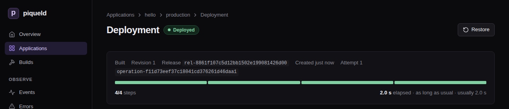
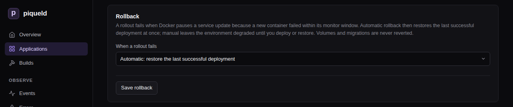

# Restoring a deployment

Return an environment to a deployment it ran before, exactly as it ran, such
as when a new version misbehaves. piqueld deploys it again with the same
manifest, images and secrets, without building anything. It can also do this
on its own when a rollout fails.

## Before you start

- The environment has an earlier deployment that succeeded. This page uses
  `hello`, from
  [deploying your first application](../getting-started/first-app.md), once
  you deployed it again after [changing it](../getting-started/first-app.md#change-it).
- Restoring an environment's deployment needs `apps:deploy` on the
  application, and a preview's `previews:deploy`. Choosing whether an
  environment rolls back on its own needs `apps:write`; see
  [permissions](../accounts/permissions.md#grants).
- `piquelctl` is signed in. Run the commands on this page on the host, or on
  any machine where `piquelctl` is
  [signed in](../getting-started/first-account.md#sign-piquelctl-in).

## Restore a deployment

### In the dashboard

1. Open the environment, such as **production** on `hello`'s **Environments**
   tab, then its **Deployments** tab. It lists the environment's deployments,
   newest first.
2. Select the deployment to return to, to expand it. Each deployment that
   succeeded offers **Restore**, except the newest one when the environment
   runs it. So after a deployment failed, you can restore the one before it.

   

3. Select **Restore**, and confirm.

The restore is a new deployment, at the top of the list. Its **Origin** reads
"Restored from deployment" and the ID of the one it restored.

### With piquelctl

1. List the environment's deployments, newest first:

   ```console
   $ piquelctl env history hello production
   operation-01a16da0f1c87a5e9b9d2b53a4f35b11  succeeded  created 2026-10-24 11:28:25Z  (current, last successful)
     Origin: built from its source
     Release: rel-01a16da0f4e17c2c84b4b8b6c1a5b8d2
   operation-01a16d9f8e3b7e6aa1f27c46d0b9a3c4  succeeded  created 2026-10-24 11:26:53Z
     Origin: built from its source
     Release: rel-01a16d9f90cf73f1b2a1e5d43e2c7f19
   ```

   Each line has the deployment's ID, its outcome, and when it was created,
   in UTC. `current` marks the one the environment runs. The
   command lists three deployments at a time, up to 100 with `--limit`, and
   prints a cursor to pass with `--cursor` for older ones.

2. Restore the earlier one:

   ```console
   piquelctl env restore hello production operation-01a16d9f8e3b7e6aa1f27c46d0b9a3c4
   ```

   After you confirm, the command waits until the deployment finishes. Add
   `--no-wait` to return once piqueld accepts it.

For a [preview](previews.md), use its **Deployments** tab in the dashboard,
or `piquelctl preview history` and `piquelctl preview restore`, which name the
preview as other `preview` commands do:

```console
piquelctl preview history blog feat/login
piquelctl preview restore blog feat/login <deployment-id>
```

There is no restore in the manifest: it describes what to deploy, not which
deployment to return to.

## What a restore deploys

A restore deploys what the earlier deployment ran: its manifest with the
values its variables had, its images, and the versions of its secrets.
piqueld fetches and builds nothing, and never uses a newer secret version.
It works for any environment, including
[promoted ones](environments.md#promote-releases), and starts a
[stopped](environments.md#stop-an-environment) environment again.

The restored deployment becomes the one piqueld keeps running. The saved
configuration doesn't change, though: the environment's next deployment
deploys its source again, as does the next push to its branch when it
[deploys on push](deploy-on-push.md#deploy-every-push). piqueld also deploys a
push it hasn't processed yet, such as one it missed while it was stopped.
Fix the cause, or revert it in the repository, before you deploy again.

> **Warning:** a restore never runs [jobs](jobs.md), and doesn't revert data.
> Volumes keep their contents, and the migrations that ran since stay
> applied: running the earlier deployment's migrations against newer data is
> what a restore avoids. So the restored version must work with the data as
> it is. Write migrations in steps that the previous version still runs
> against, such as adding a column before the code that needs it.

A promoted environment can also
[deploy an earlier release](environments.md#deploy-an-earlier-release),
rendered with its current variables and secrets instead.

## Roll back failed rollouts automatically

A rollout fails when Docker pauses it because a new container exited, or
failed its [health check](services.md#health-checks), soon after it started.
Each environment chooses what happens then:

- **Automatic** restores the environment's last successful deployment at once,
  as a restore by hand would.
- **Manual** leaves the environment on the failed deployment until you deploy
  it again or restore a deployment.

[Promoted environments](environments.md#promote-releases) roll back
automatically unless you choose otherwise. The others don't, and previews are
never rolled back. To have `production` roll back on its own:

- **In the dashboard**, open the environment's **Overview**. In its
  **Rollback** card, set **When a rollout fails** to **Automatic: restore the
  last successful deployment**, then select **Save rollback**. **Default**
  removes the setting.

  

- **With `piquelctl`**, use
  [`env rollback`](../reference/cli-commands.md#piquelctl-env-rollback), with
  `automatic`, `manual`, or `default` to remove the setting:

  ```console
  piquelctl env rollback hello production automatic
  ```

- **In the manifest**:

  ```toml
  [spec.environments.production]
  rollback = "automatic"
  ```

The dashboard and `piquelctl` save the setting in the application's manifest.
piqueld reads it from the manifest the environment deploys, though, so when a
change applies depends on where the environment gets its manifest:

- In an application without a manifest repository, an environment that
  isn't promoted uses it at once.
- In an application that [reads its manifest from a
  repository](deploy-on-push.md#edit-a-repository-backed-application), an
  environment that follows the repository's branch uses it from its next
  deployment. A push that changes the manifest file replaces the setting, so
  set it in the file too.
- An environment that follows another branch reads the manifest file on that
  branch. Set `rollback` there, then deploy the environment.
- A promoted environment reads the release it receives. A change applies once
  its source deploys a release with it, and you promote that release.

A rollback is a restore: a new deployment that runs no jobs and doesn't
revert data, as [the warning above](#what-a-restore-deploys) describes. Its
**Origin** reads "Rolled back from deployment" with the failed deployment's
ID, then the ID of the one it restored. The failed deployment keeps its own
outcome, so its history still shows what went wrong.

piqueld rolls back each failed deployment once at most. It doesn't roll back:

- a rollback whose own rollout fails: the environment stays on it;
- a deployment that succeeded before, then fails when piqueld rolls it out
  again, such as to repair a service someone changed by hand;
- a deployment whose [job](jobs.md) fails: the job stops it before its
  services roll out, so they keep running the previous version.

Docker only notices a container that exits or fails its health check.
Without a health check, in the manifest or in its image, a container that
runs but doesn't serve requests looks healthy, so its rollout doesn't fail.
When an environment rolls back automatically, its plans warn about each
service that routes send traffic to but whose manifest declares no health
check. [Declare one](services.md#health-checks), unless the service's image
already defines one. The dashboard shows the warning in **Preview**, and, for
a promoted environment, in the plan that its **Promote from** button opens.
`piquelctl app plan` and `piquelctl env promote --plan` print it as
`rollback_without_health_check`.

## Check that it works

The restore appears at the top of the environment's **Deployments** tab, and
of `piquelctl env history`:

```text
operation-01a16da2c7d05b1e2f8a9c3d4e5f6a7b  succeeded  created 2026-10-24 11:30:27Z  (current, last successful)
  Origin: restored from deployment operation-01a16d9f8e3b7e6aa1f27c46d0b9a3c4
  Release: rel-01a16d9f90cf73f1b2a1e5d43e2c7f19
```

It runs the release of the deployment it restored.

## Troubleshooting

- **Restoring fails with `deployment_not_restorable`.** That deployment never
  succeeded. Restore one that did.
- **Restoring fails with `image_unavailable`.** piqueld removed one of the
  deployment's images, and can't pull it again from a registry. The error
  names the service and image. piqueld keeps the images of each environment's
  last three successful deployments, and of a preview's current one:
  [`images.keep_deployments`](../reference/configuration-settings.md#imageskeep_deployments),
  in the daemon's configuration, changes that number. An image piqueld built
  is never built again for a restore.
- **Restoring fails with `restore_secrets_unavailable`.** A secret version
  the deployment used was deleted since, or discarded by
  [key recovery](secrets-and-variables.md#if-the-secret-key-is-lost). The
  error lists the secrets. Deploy the environment instead.
- **Restoring fails with `secret_access_denied`.** The deployment mounts a
  stored secret that the environment may no longer mount.
  [Allow it](secrets-and-variables.md#choose-who-may-mount-a-stored-secret)
  again, or deploy instead.
- **A failed rollout wasn't rolled back.** Previews and manual environments
  aren't rolled back. The **Rollback** card shows the saved setting, but an
  environment of an application that reads its manifest from a repository,
  or a promoted one, uses the setting of the manifest it last deployed, as
  [rolling back automatically](#roll-back-failed-rollouts-automatically)
  describes. When piqueld can't roll back,
  because no earlier deployment succeeded or its images or secret versions
  are gone, the failed deployment records a `rollback_unavailable` event
  saying why. To see it, expand the deployment on the **Deployments** tab
  and select **Events**. Fix the cause, then deploy again.
- **There is no Restore button.** The deployment didn't succeed, or it is
  the newest one and the environment runs it. Without `apps:deploy`, or
  `previews:deploy` for a preview, the dashboard doesn't offer it either.

[`piquelctl env restore`](../reference/cli-commands.md#piquelctl-env-restore)
lists the command's options, and the
[API reference](../reference/api.md#restoring-a-deployment) describes how a
restore works.
