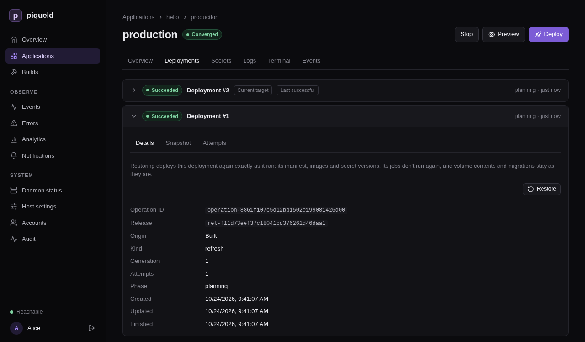

# Restoring a deployment

Return an environment to a deployment it ran before, exactly as it ran, such
as when a new version misbehaves. piqueld deploys it again with the same
manifest, images and secrets, without building anything.

## Before you start

- The environment has an earlier deployment that succeeded. This page uses
  `hello`, from
  [deploying your first application](../getting-started/first-app.md), once
  you deployed it again after [changing it](../getting-started/first-app.md#change-it).
- Restoring an environment's deployment needs `apps:deploy` on the
  application, and a preview's `previews:deploy`; see
  [permissions](../accounts/permissions.md#grants).
- `piquelctl` is signed in. Run the commands on this page on the host, or on
  any machine where `piquelctl` is
  [signed in](../getting-started/first-account.md#sign-piquelctl-in).

## Restore a deployment

### In the dashboard

1. Open the environment, such as **production** on `hello`'s **Environments**
   tab, then its **Deployments** tab. It lists the environment's deployments,
   newest first.
2. Select the deployment to return to, to expand it. Each deployment that
   succeeded offers **Restore**, except the newest one when the environment
   runs it. So after a deployment failed, you can restore the one before it.

   

3. Select **Restore**, and confirm.

The restore is a new deployment, at the top of the list. Its **Origin** reads
"Restored from deployment" and the ID of the one it restored.

### With piquelctl

1. List the environment's deployments, newest first:

   ```console
   $ piquelctl env history hello production
   operation-01a16da0f1c87a5e9b9d2b53a4f35b11  succeeded  created 1792841305114  (current, last successful)
     Origin: built from its source
     Release: rel-01a16da0f4e17c2c84b4b8b6c1a5b8d2
   operation-01a16d9f8e3b7e6aa1f27c46d0b9a3c4  succeeded  created 1792841213922
     Origin: built from its source
     Release: rel-01a16d9f90cf73f1b2a1e5d43e2c7f19
   ```

   Each line has the deployment's ID, its outcome, and when it was created,
   in Unix milliseconds. `current` marks the one the environment runs. The
   command lists three deployments at a time, and prints a cursor to pass
   with `--cursor` for older ones.

2. Restore the earlier one:

   ```console
   piquelctl env restore hello production operation-01a16d9f8e3b7e6aa1f27c46d0b9a3c4
   ```

   After you confirm, the command waits until the deployment finishes. Add
   `--no-wait` to return once piqueld accepts it.

For a [preview](previews.md), use its **Deployments** tab in the dashboard,
or `piquelctl preview history` and `piquelctl preview restore`, which name the
preview as other `preview` commands do:

```console
piquelctl preview history blog feat/login
piquelctl preview restore blog feat/login <deployment-id>
```

## What a restore deploys

A restore deploys what the earlier deployment ran: its manifest with the
values its variables had, its images, and the versions of its secrets.
piqueld fetches and builds nothing, and never uses a newer secret version.
It works for any environment, including
[promoted ones](environments.md#promote-releases), and starts a
[stopped](environments.md#stop-an-environment) environment again.

The restored deployment becomes the one piqueld keeps running. The saved
configuration doesn't change, though: the environment's next deployment
deploys its source again, as does the next push to its branch when it
[deploys on push](deploy-on-push.md#deploy-every-push). Fix the cause, or
revert it in the repository, before you deploy again.

> **Warning:** a restore never runs [jobs](jobs.md), and doesn't revert data.
> Volumes keep their contents, and the migrations that ran since stay
> applied: running the earlier deployment's migrations against newer data is
> what a restore avoids. So the restored version must work with the data as
> it is. Write migrations in steps that the previous version still runs
> against, such as adding a column before the code that needs it.

A promoted environment can also
[deploy an earlier release](environments.md#deploy-an-earlier-release),
rendered with its current variables and secrets instead.

## Check that it works

The restore appears at the top of the environment's **Deployments** tab, and
of `piquelctl env history`:

```text
operation-01a16da2c7d05b1e2f8a9c3d4e5f6a7b  succeeded  created 1792841427035  (current, last successful)
  Origin: restored from deployment operation-01a16d9f8e3b7e6aa1f27c46d0b9a3c4
  Release: rel-01a16d9f90cf73f1b2a1e5d43e2c7f19
```

It runs the release of the deployment it restored.

## Troubleshooting

- **Restoring fails with `deployment_not_restorable`.** That deployment never
  succeeded. Restore one that did.
- **Restoring fails with `image_unavailable`.** piqueld removed one of the
  deployment's images, and can't pull it again from a registry. The error
  names the service and image. piqueld keeps the images of each environment's
  last three successful deployments, and of a preview's current one:
  [`images.keep_deployments`](../reference/configuration-settings.md#imageskeep_deployments),
  in the daemon's configuration, changes that number. An image piqueld built
  is never built again for a restore.
- **Restoring fails with `restore_secrets_unavailable`.** A secret version
  the deployment used was deleted since, or discarded by
  [key recovery](secrets-and-variables.md#if-the-secret-key-is-lost). The
  error lists the secrets. Deploy the environment instead.
- **Restoring fails with `secret_access_denied`.** The deployment mounts a
  stored secret that the environment may no longer mount.
  [Allow it](secrets-and-variables.md#choose-who-may-mount-a-stored-secret)
  again, or deploy instead.
- **There is no Restore button.** The deployment didn't succeed, or it is
  the newest one and the environment runs it. Without `apps:deploy`, the
  dashboard doesn't offer it either.

[`piquelctl env restore`](../reference/cli-commands.md#piquelctl-env-restore)
lists the command's options, and the
[API reference](../reference/api.md#restoring-a-deployment) describes how a
restore works.
