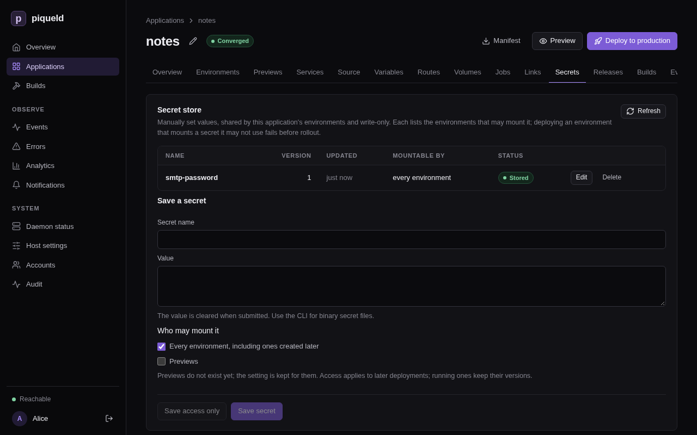
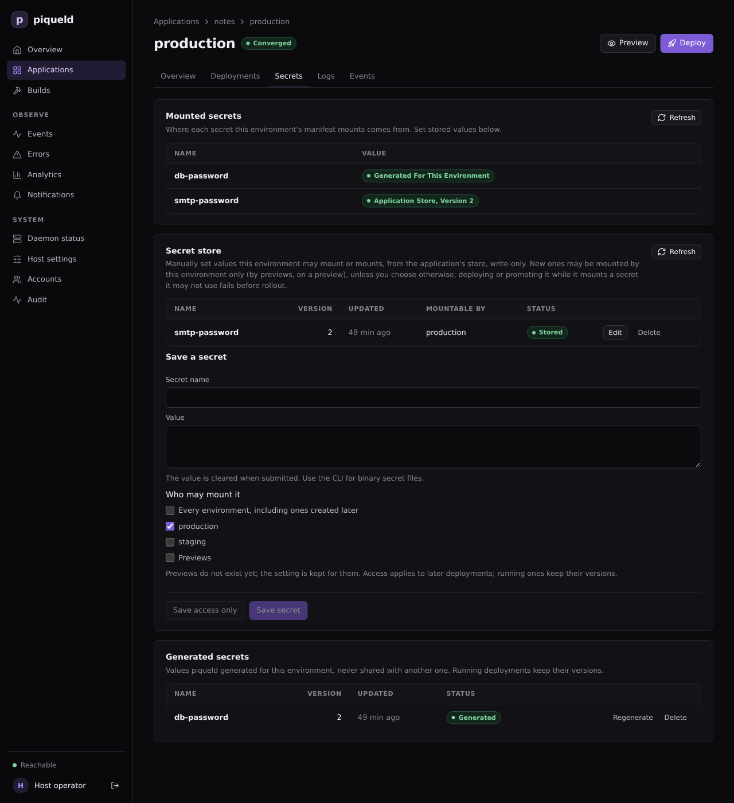

# Secrets and variables

Give your services passwords and API keys without writing them in the
manifest, and set values in one place with variables, such as how many
replicas a service runs.

## Before you start

- You have an application, such as the one from
  [Configuring services](services.md). The examples use `notes`, with a
  PostgreSQL service `db` and an nginx service `web`, and its one environment,
  `production`.
- Run the commands on this page on the host, or on any machine where
  `piquelctl` is [signed in](../getting-started/first-account.md#sign-piquelctl-in).
- Setting, regenerating and deleting secret values, and choosing who may mount
  them, needs the `secrets:write` [permission](../accounts/permissions.md#grants)
  on the application. Editing the manifest needs `apps:write`, deploying it
  `apps:deploy`, and [running a command](commands.md) in a container
  `apps:exec`.

## How secrets reach your services

piqueld puts each secret in a read-only file under `/run/secrets` in the
container. It never writes a secret value in the manifest or in an environment
variable, so point your service at the file. Many images read a variable
ending in `_FILE` for this, such as PostgreSQL's `POSTGRES_PASSWORD_FILE`.

A secret's value comes from one of two places:

- **Generated**: you declare the secret in the manifest, and piqueld generates
  a value for each environment. Use it for values nobody needs to type, such as
  a database password.
- **Stored**: you set the value yourself, in the application's secret store.
  Use it for values that come from elsewhere, such as an API key.

## Generate a secret

Declare the secret, then mount it in a service, as a file under
`/run/secrets/`. `notes`, from [Configuring services](services.md), already
generates the database's password, `db-password`, and mounts it in `db`.
To declare another one, such as `session-key`:

- **In the dashboard,** open the application's **Secrets** tab. On the
  **Generated secrets** card, select **Add generated secret**, fill in
  **Secret name**, choose what it **Generates**, and select **Save changes**.
- **With `piquelctl`:**

  ```console
  piquelctl app generated-secret set notes session-key --bytes 32
  ```

  `--rsa-bits 3072` makes an RSA key instead. `app generated-secret list
  notes` lists the declarations, and `app generated-secret remove` removes
  one.
- **In the manifest,** add a `[[spec.secrets]]` table.

Then mount it [as a stored secret is mounted](#store-a-secret), on the
service's **secret files** card, with `piquelctl app service secret add`, or
with a `[[spec.services.secrets]]` table. These are the lines of `notes.toml`
that generate and mount `db-password`:

```toml
[[spec.services]]
name = "db"
# ...

[spec.services.environment]
POSTGRES_PASSWORD_FILE = "/run/secrets/db-password"
# ...

[[spec.services.secrets]]
name = "db-password"
target = "/run/secrets/db-password"

# ...

[[spec.secrets]]
name = "db-password"
generate = { type = "random", bytes = 32 }
```

- `[[spec.secrets]]` declares the secret `db-password`, and how to generate
  it.
- `[[spec.services.secrets]]` mounts it in `db`, as the file
  `/run/secrets/db-password`.
- `POSTGRES_PASSWORD_FILE` tells PostgreSQL to read its password from that
  file.

Deploy once the secret is mounted.

The first deployment that mounts `db-password` generates its value: 32 random
bytes, written as 64 hexadecimal characters. Each environment gets its own
value and keeps it: later deployments and changes to the declaration never
replace it.

`generate` can also write the bytes as `base64url`, with
`encoding = "base64url"` or `--encoding base64url`, or make an RSA private
key, with `{ type = "rsa", bits = 3072 }`.
[Manifest settings](../reference/manifest-settings.md#specsecretsgenerate-1)
lists every option.

## Store a secret

Store the value in the application's secret store, then mount it in a
service, as a file under `/run/secrets/`. [Jobs](jobs.md) mount secrets the
same way. Here, `web` gets an SMTP password, `smtp-password`, and reads its
path from `SMTP_PASSWORD_FILE`. Deploy once it's mounted.

### In the dashboard

1. Open the application's **Secrets** tab. Under **Save a secret**, enter the
   **Secret name** and the **Value**, then select **Save secret**. The value
   can't be read back, and the dashboard only stores text: store binary files
   with `piquelctl`.

   

2. Below the store, each service has a **secret files** card. On `web`'s,
   select **Add secret file**, enter the **Secret name** and the **Container
   path**, `/run/secrets/smtp-password`, then select **Save changes**.
3. On `web`'s **Environment** tab, set `SMTP_PASSWORD_FILE` to
   `/run/secrets/smtp-password`.

### With piquelctl

Put the value in a file, then store it:

```console
piquelctl app secret notes set smtp-password --file ./smtp-password
```

After you confirm, it prints:

```text
Saved smtp-password generation 1, mountable by every environment. Deploy to use it.
```

piqueld stores the file byte for byte, including the newline at the end
that most editors add. Write the file with `printf '%s'` to leave it out.
To pipe the value in instead, use `--stdin`, which drops one trailing
newline, with `--yes`, since `piquelctl` can't ask you to confirm while it
reads the value:

```console
echo "$SMTP_PASSWORD" | piquelctl app secret notes set smtp-password --stdin --yes
```

Run in a terminal without a pipe, `--stdin` asks for the value instead, and
doesn't show what you type.

Values are 1 to 512,000 bytes long. Avoid typing them in a command, where
your shell history keeps them.

Then mount it in `web`, and point `web` at the file:

```console
piquelctl app service secret add notes web smtp-password /run/secrets/smtp-password
piquelctl app service env set notes web SMTP_PASSWORD_FILE /run/secrets/smtp-password
```

`app service secret list notes web` lists the service's mounts, and
`app service secret remove notes web /run/secrets/smtp-password` removes one.

### In the manifest

Mount it like a generated secret. A name that `spec.secrets` doesn't declare
comes from the store. Add to the existing `web` entry:

```diff
 [[spec.services]]
 name = "web"
 replicas = 2
 depends_on = ["db"]
+
+[spec.services.environment]
+SMTP_PASSWORD_FILE = "/run/secrets/smtp-password"
+
+[[spec.services.secrets]]
+name = "smtp-password"
+target = "/run/secrets/smtp-password"

 [spec.services.source]
```

### Choose who may mount a stored secret

By default, every environment may mount a stored secret, including
environments created later, but previews may not. To allow only production in
the dashboard, select **Edit** next to the secret. Under **Who may mount
it**, uncheck **Every environment, including ones created later**, check only
**production**, and select **Save access only**. With `piquelctl`:

```console
$ piquelctl app secret notes access smtp-password --environments production
Saved smtp-password generation 1, mountable by production. Deploy to use it.
```

`--environments` takes a comma-separated list of environment names, and
`--all-environments` allows every environment again. `--previews` lets
previews mount the secret too, and `--no-previews` stops them. `set` takes the
same options, to choose when you store a secret.
`piquelctl app secret notes list` shows who may mount each secret.

Changing who may mount a secret doesn't change running services. Deploying an
environment that mounts a secret it may not use fails at once, before changing
anything.

## Check that it works

In the dashboard, open the environment, then its **Secrets** tab:
**Mounted secrets** lists each secret the environment's manifest mounts, and
where its next deployment takes the value from. **Generated secrets** lists
the values piqueld generated for it.



`piquelctl env show` lists the same:

```console
$ piquelctl env show notes
production of notes (app-01a16d95420677219cf7b65149b4f7e7)

Intent: ready
Runtime: ready (observed 0 s ago)
...
Secret: db-password: generated for this environment
Secret: smtp-password: application store, version 1
```

To see the files themselves, [run a command](commands.md) in the container:

```console
$ piquelctl app exec notes db -- ls -l /run/secrets
total 4
-r--r--r--    1 root     root            64 Oct 24 11:08 db-password
```

## Use variables

Manifest variables hold values you set in one place, and that each environment
can [override](environments.md#give-each-environment-its-own-values).
Declare a default, and reference it as `${{ vars.<name> }}`. For example, to
set how many replicas `web` runs with `web_replicas`:

- **In the dashboard,** the application's **Variables** tab has one row per
  variable, with its **Default**, a column for each environment, and one for
  **Previews**. An empty cell has no value there. Select **Add variable**,
  fill in **Name** with `web_replicas` and **Default** with `2`, and select
  **Save changes**. Then set `web`'s **Replicas** to
  `${{ vars.web_replicas }}`.
- **With `piquelctl`,** quote the reference so that your shell leaves it
  alone:

  ```console
  piquelctl app variable set notes web_replicas 2
  piquelctl app service replicas notes web '${{ vars.web_replicas }}'
  ```

- **In the manifest,** declare the default in `[spec.variables]`, at the end
  of `notes.toml`, and use it in the `web` entry:

  ```toml
  [spec.variables]
  web_replicas = 2
  ```

  ```diff
   [[spec.services]]
   name = "web"
  -replicas = 2
  +replicas = "${{ vars.web_replicas }}"
  ```

`web` runs as many replicas as `web_replicas` says.

piqueld also sets a few variables itself, such as `${{ app.name }}` and
`${{ env.name }}`. See [variables](../reference/manifest.md#variables) for
them, and for the settings that accept references.

Variables are not secret: plans, `piquelctl app show` and `env show`,
deployments and the dashboard show their values, even in environment
variables. Keep passwords in secrets.

### Mount a different secret in each environment

When an application has several environments, as in
[environments and promotion](environments.md), a secret's name can come from a
variable, so each environment mounts its own stored secret at the same path.
For example, to give a `staging` environment of `notes` a test SMTP account:

1. Store the test password as `smtp-test`, mountable by staging only. When
   you save it in the dashboard, uncheck **Every environment, including ones
   created later** under **Who may mount it**, then check only **staging**.
   Or run:

   ```console
   piquelctl app secret notes set smtp-test --file ./smtp-test --environments staging
   ```

2. Give each environment its value of `smtp_secret`: `smtp-password` in
   production and `smtp-test` in staging. In the dashboard, add the variable
   on the **Variables** tab, fill in each environment's column, and select
   **Save changes**. With `piquelctl`:

   ```console
   piquelctl app variable set notes smtp_secret smtp-password --env production
   piquelctl app variable set notes smtp_secret smtp-test --env staging
   ```

   In the manifest, at the end of `notes.toml`:

   ```toml
   [spec.environments.production.variables]
   smtp_secret = "smtp-password"

   [spec.environments.staging.variables]
   smtp_secret = "smtp-test"
   ```

3. Then name `web`'s mount `${{ vars.smtp_secret }}`. In the dashboard, set
   **Secret name** on its **secret files** card, and select **Save changes**.
   With `piquelctl`, mount it again at the same path, which replaces the
   mount:

   ```console
   piquelctl app service secret add notes web '${{ vars.smtp_secret }}' /run/secrets/smtp-password
   ```

   In the manifest:

   ```diff
    [[spec.services.secrets]]
   -name = "smtp-password"
   +name = "${{ vars.smtp_secret }}"
    target = "/run/secrets/smtp-password"
   ```

   With a manifest file, `piquelctl app plan --file notes.toml --env staging`
   shows what staging would mount before you save it:

   ```text
   ...
   Variables:
     app.name = notes
     deployment.id = preview
     env.name = staging
     env.slug = staging
     vars.smtp_secret = smtp-test
     vars.web_replicas = 2
   ...
   ```

4. Save your changes, and deploy each environment:

   ```console
   piquelctl --timeout 5m env deploy notes staging
   piquelctl --timeout 5m env deploy notes production
   ```

5. Once staging no longer mounts `smtp-password`,
   [allow it](#choose-who-may-mount-a-stored-secret) only in production:

   ```console
   piquelctl app secret notes access smtp-password --environments production
   ```

## Rotate a secret

To replace a stored value, set it again: select **Edit** next to the secret
on the **Secrets** tab, enter the new **Value**, and select **Save secret**.
With `piquelctl`:

```console
$ piquelctl app secret notes set smtp-password --file ./new-smtp-password
Saved smtp-password generation 2, mountable by production. Deploy to use it.
```

Running services keep version 1 until you deploy them.

To replace a generated value, regenerate it in one environment.

> **Warning:** a new value only replaces the file. A database that stored the
> old password keeps it, so services that read the new file can't connect
> until you change it there too.

In the dashboard, open the environment's **Secrets** tab, and select
**Regenerate** next to the secret under **Generated secrets**. With
`piquelctl`:

```console
$ piquelctl env secret notes regenerate db-password
Generated db-password generation 2. Deploy the environment to use it.
```

Then deploy, and change the password in the database. For PostgreSQL:

```console
piquelctl app exec notes db -i -- psql -U notes <<'EOF'
\set pw `cat /run/secrets/db-password`
ALTER USER notes PASSWORD :'pw';
EOF
```

When the application has several environments, add `--env <name>` to
`env secret` and `app exec`.

## Delete a secret

Deleting a secret discards its value and every earlier version, and can't be
undone. You can only delete a secret that nothing uses. First, remove its
mounts, and deploy every environment that mounted it. Then select **Delete**
next to it on the **Secrets** tab, or run:

```console
piquelctl app secret notes delete smtp-password
```

A generated value is deleted in one environment, once nothing there uses it.
If a deployment mounts that secret again, it generates a new value, which a
database that stored the old one doesn't know. Select **Delete** next to it
under **Generated secrets**, on the environment's **Secrets** tab, or run:

```console
piquelctl env secret notes delete <name>
```

Removing a declaration from `spec.secrets` keeps the values already generated.

## If the secret key is lost

piqueld encrypts every value with the key in its data directory,
`secrets.key`. [Back it up](../guides/backups-and-upgrades.md) with the rest of
the data directory. A restored key must belong to the daemon's user, with mode
`0600`. Without it, piqueld can't read any secret value, and deployments that
need one fail with `secret_storage_unavailable`. Running services keep their
files. If no backup of the key exists, see
[recovering from a lost key](../reference/configuration.md#recovering-from-a-lost-key):
it discards every value, after which you store new ones and deploy.

## Troubleshooting

- **The deployment fails with `secret_missing`.** It mounts a stored secret
  with no value, often a misspelled name: `env show` reports it as
  `not set in the application store`. Store it, or fix the name, then deploy
  again. Running services are not changed.
- **The deployment fails with `secret_access_denied`.** The environment may not
  mount that stored secret, and `env show` reports it as
  `application store, not allowed here`.
  [Change who may mount it](#choose-who-may-mount-a-stored-secret).
- **Storing a secret, or applying a manifest, fails with
  `secret_name_conflict`.** A generated secret and a stored one have the same
  name. When you apply a manifest, the code is among the errors of
  `manifest_validation_failed`. Pick another name, or remove the declaration.
- **Deleting a secret fails with `secret_referenced`.** The saved manifest or a
  deployment still mounts it. Remove the mounts and deploy first.
- **Planning or deploying fails with `variable_value_missing`.** The
  environment has no value for a variable it uses, and the variable has no
  default. The error names the environment, the setting and the variable.
- **`--env` fails with `environment_unknown`.** No environment has that name.
  `piquelctl env list notes` lists them.
