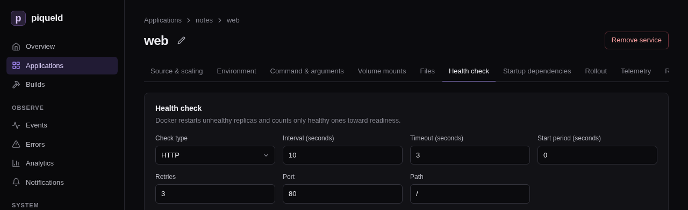

# Configuring services

A service is one container image that piqueld runs as one or more replicas.
This page sets up the services of a small application, `notes`: a PostgreSQL
database, and an nginx web server that starts once the database is ready.

## Before you start

- You've [deployed your first application](../getting-started/first-app.md),
  so you know how to create an application and add services to it.
- Run the commands on this page on the host, or on any machine where
  `piquelctl` is [signed in](../getting-started/first-account.md#sign-piquelctl-in).
- Creating `notes` needs the `apps:create`
  [permission](../accounts/permissions.md#grants). Editing it needs
  `apps:write` on it, and deploying it `apps:deploy`.

## Set it up

`notes` has two services:

- `db` runs PostgreSQL. Its password is a secret piqueld generates; see
  [secrets and variables](secrets-and-variables.md).
- `web` runs two replicas of nginx, and starts once `db` is healthy.

Each has a health check, which tells piqueld when it is ready.

### In the dashboard or with piquelctl

Create `notes` and add `db` and `web` to it, as in
[deploying your first application](../getting-started/first-app.md#create-and-deploy-it),
with the images `postgres:17-alpine` and `nginx:alpine`. Then set each service's
settings as the sections below describe.

In the dashboard, open the application's **Services** tab, then the service.
Its page has a tab for each group of settings. Once you change a field,
select **Save changes** below it.



With `piquelctl`, `piquelctl app service` has a command for each setting.

To give the database its generated password, declare it and mount it as
[generating a secret](secrets-and-variables.md#generate-a-secret) shows.

### From a manifest

1. Save this manifest as `notes.toml`:

   ```toml
   api_version = "piqueld.dev/v1alpha1"
   kind = "Application"

   [metadata]
   name = "notes"

   [[spec.services]]
   name = "db"

   [spec.services.source]
   type = "image"
   image = "postgres:17-alpine"

   [spec.services.environment]
   POSTGRES_USER = "notes"
   POSTGRES_DB = "notes"
   POSTGRES_PASSWORD_FILE = "/run/secrets/db-password"

   [[spec.services.secrets]]
   name = "db-password"
   target = "/run/secrets/db-password"

   [spec.services.healthcheck]
   type = "command"
   command = ["pg_isready", "-U", "notes"]
   interval_seconds = 5
   start_period_seconds = 30

   [[spec.services]]
   name = "web"
   replicas = 2
   depends_on = ["db"]

   [spec.services.source]
   type = "image"
   image = "nginx:alpine"

   [spec.services.healthcheck]
   type = "http"
   port = 80
   path = "/"

   [[spec.secrets]]
   name = "db-password"
   generate = { type = "random", bytes = 32 }
   ```

2. Save it and deploy it:

   ```console
   piquelctl --timeout 5m app apply --file notes.toml --deploy
   ```

### Deploy it

`app apply --deploy` saves the manifest and deploys it at once. A change you
save in the dashboard, or with `piquelctl app service`, changes the
application's configuration, not what's running. To apply it, select **Deploy to production** on the application's page, or run
`piquelctl --timeout 5m app deploy notes`. An application with several
environments deploys one at a time:
`piquelctl --timeout 5m env deploy notes <environment>`.

The deployment deploys `db` first, waits until it passes its health check,
then deploys `web`.

`--timeout 5m` lets `piquelctl` wait for the deployment for up to five
minutes, instead of 30 seconds. When a deployment changes a service, Docker
watches its new replicas for 30 seconds, as [rollout order](#rollout-order)
explains, so redeploying often takes longer than the default. The commands in
these guides that deploy use `--timeout 5m` too.

If `piquelctl` stops waiting first, it exits with code 4, but the deployment
carries on. Keep following it on the environment's **Deployments** tab, or
with `piquelctl --timeout 5m env wait notes`.

The services of an application reach each other by name: `web` reaches the
database at `db:5432`. Services of other applications can't, unless you
[connect the applications](links.md).

## Replicas

A service runs one copy, or replica, by default, and up to 100. In the
dashboard, set **Replicas** on the service's **Source & scaling** tab. With
`piquelctl`:

```console
piquelctl app service replicas notes web 3
```

In the manifest, it is `replicas`, in the service's entry.

## Environment variables

Every replica of a service gets its environment variables. In the dashboard,
use the service's **Environment** tab. With `piquelctl`:

```console
piquelctl app service env set notes web GREETING hello
piquelctl app service env remove notes web GREETING
```

In the manifest:

```toml
[spec.services.environment]
POSTGRES_USER = "notes"
```

Values reach the container as written, once
[variables](secrets-and-variables.md#use-variables) are replaced. Docker's
own templates, such as `{{.Service.Name}}`, aren't expanded.

Don't put passwords here: [mount them as secrets](secrets-and-variables.md)
instead.

## Command and arguments

The command replaces the image's entrypoint, and the arguments its default
arguments. Each element is one argument, passed as written, without a shell.
To raise PostgreSQL's connection limit, for example, give `db` the arguments
`-c` and `max_connections=200`:

- **In the dashboard,** use the service's **Command & arguments** tab, one
  element per row.
- **With `piquelctl`,** give the elements after `--`, and give none to go back
  to the image's own:

  ```console
  piquelctl app service arguments notes db -- -c max_connections=200
  piquelctl app service arguments notes db --
  ```

  `piquelctl app service command` sets the command the same way.
- **In the manifest,** set `command` and `arguments` in the service's entry:

  ```diff
   [[spec.services]]
   name = "db"
  +arguments = ["-c", "max_connections=200"]
  ```

## Health checks

A health check tells piqueld when a replica is ready. Deployments wait for
it, and Docker restarts a replica that keeps failing it. A service without a
health check counts as ready as soon as it runs.

There are two kinds:

- An **HTTP** check sends a `GET` request to a port of the container, which
  must answer with a 2xx or 3xx status. It needs nothing in the image, not
  even a shell, so it also works in minimal images. Its path is `/health`
  unless you set one.
- A **command** check runs a program in the container, which must exit with
  0. It runs without a shell: to use one, run `sh -c "…"`.

Both take these settings:

| Setting | Default | Meaning |
| --- | --- | --- |
| Interval | 10 | Seconds between checks. |
| Timeout | 3 | Seconds before a check fails. At most the interval. |
| Retries | 3 | Failed checks in a row before the replica is unhealthy. |
| Start period | 0 | Seconds after the replica starts during which failed checks don't count. |

Give slow starters, such as databases, a start period.

### In the dashboard

Use the service's **Health check** tab. Choose the **Check type**, then fill
in its fields. **None** removes the check.

### With piquelctl

`health http` and `health command` replace the check. They take the settings
above as `--interval`, `--check-timeout`, `--retries` and `--start-period`:

```console
piquelctl app service health http notes web 80 --path /
piquelctl app service health command notes db --interval 5 --start-period 30 -- pg_isready -U notes
```

Other commands change one setting, or remove the check:

```console
piquelctl app service health start-period notes db 60
piquelctl app service health clear notes web
```

### In the manifest

```toml
[spec.services.healthcheck]
type = "http"
port = 80
path = "/"
```

```toml
[spec.services.healthcheck]
type = "command"
command = ["pg_isready", "-U", "notes"]
interval_seconds = 5
start_period_seconds = 30
```

The settings above are `interval_seconds`, `timeout_seconds`, `retries` and
`start_period_seconds`.

## Startup dependencies

A service can depend on other services of the same application, which must
be ready before it is deployed. In the dashboard, check them on the service's
**Startup dependencies** tab. With `piquelctl`:

```console
piquelctl app service depends-on notes web -- db
```

In the manifest, it is `depends_on`:

```toml
[[spec.services]]
name = "web"
depends_on = ["db"]
```

A deployment waits until every replica of `db` passes its health check before
it deploys `web`. A dependency without a health check counts as ready once its
replicas run. If `db` fails, `web` keeps running its previous version.

Dependencies only order deployments: once deployed, `web` keeps running even if
`db` stops.

## Rollout order

When a deployment changes a service, Docker replaces its replicas one at a
time, in one of two orders:

- **`start-first`** starts the new replica, then stops the old one. There is no
  downtime, but both run for a moment.
- **`stop-first`** stops the old replica, then starts the new one. They never
  overlap, but the service is briefly unavailable.

By default, a service that mounts a [volume](volumes-and-files.md) it can
write to stops first, so that two copies of a database never write the same
files. Others start first.

Docker also watches each new replica, for 30 seconds by default. If one fails
within that time, Docker pauses the rollout: the replicas it hasn't replaced
yet keep running the previous version, and the deployment fails.

To choose the order and how long Docker watches, use the service's
**Rollout** tab in the dashboard. With `piquelctl`, run the command below;
without flags, it restores the defaults:

```console
piquelctl app service rollout notes web --order stop-first --monitor-seconds 30
```

In the manifest:

```toml
[spec.services.rollout]
order = "stop-first"
monitor_seconds = 30
```

`piquelctl app plan --file notes.toml` lists each service's order:

```text
Rollout:
  db: start-first (derived) · monitor 30s
  web: start-first (derived) · monitor 30s
```

Once `db` mounts a volume, as in [volumes and files](volumes-and-files.md),
its order becomes `stop-first`.

## Resource limits

Limit how much CPU and memory each replica may use. Without limits, a
replica may use all of the host's, except in [previews](previews.md#limits),
which get the daemon's defaults. CPU is in thousandths of a core, and memory
in bytes.

In the dashboard, use the service's **Resource limits** tab, and leave a
field empty for no limit. With `piquelctl`:

```console
piquelctl app service cpu notes web 500
piquelctl app service memory notes web 268435456
piquelctl app service cpu notes web --clear
```

In the manifest:

```toml
[spec.services.resources]
cpu_millis = 500          # half a CPU core
memory_bytes = 268435456  # 256 MiB
```

## Rename a service

In the dashboard, select the pencil beside the service's name, on its page.
Fill in **Service name** and select **Save**. Save or discard your other edits
to the service first. With `piquelctl`:

```console
piquelctl app service rename notes web frontend
```

Its routes, jobs and exports, and the services that depend on it, follow the
new name. In the manifest, change its `name`, and every place that names it.
Applications that [import](links.md) it must import the new name. The next
deployment replaces the running service with one of the new name.

## Check that it works

In the dashboard, open the environment: **Observed services** lists each
service with its healthy replicas. With `piquelctl`:

```console
$ piquelctl env show notes
production of notes (app-01a16d95420677219cf7b65149b4f7e7)

Intent: ready
Runtime: ready (observed 6 s ago)
...
```

`Runtime: ready` means every service runs all its replicas, and each passes its
health check.

## Troubleshooting

- **The deployment fails with `service_update_failed`.** A new replica failed
  its health check, or exited, and Docker paused the rollout. Read the
  service's logs with `piquelctl app logs notes --service web`, fix the cause,
  and deploy again.
- **A service never becomes healthy.** Check that the health check's port and
  path match what the container serves. An HTTP check connects to `127.0.0.1`
  inside the container, so the service must listen there too, such as on
  `0.0.0.0`. It doesn't follow redirects.
- **The deployment fails with `convergence_timeout`.** A service didn't become
  ready in time. A deployment gives up when no service has become ready for
  120 seconds, start periods included, and piqueld then retries on its own.
  Give a slow service a longer `start_period_seconds` so it isn't restarted
  while it starts, and raise
  [`reconciliation.convergence_timeout_seconds`](../reference/configuration-settings.md#reconciliationconvergence_timeout_seconds),
  in the daemon's configuration, if it needs more than that.
- **Validation fails with `service_dependency_cycle`.** Two services depend on
  each other, directly or through others. Remove one of the dependencies.

[Manifest settings](../reference/manifest-settings.md#specservices-1) lists
every setting of a service, and
[`piquelctl app service`](../reference/cli-commands.md#piquelctl-app-service)
every command that changes one.
