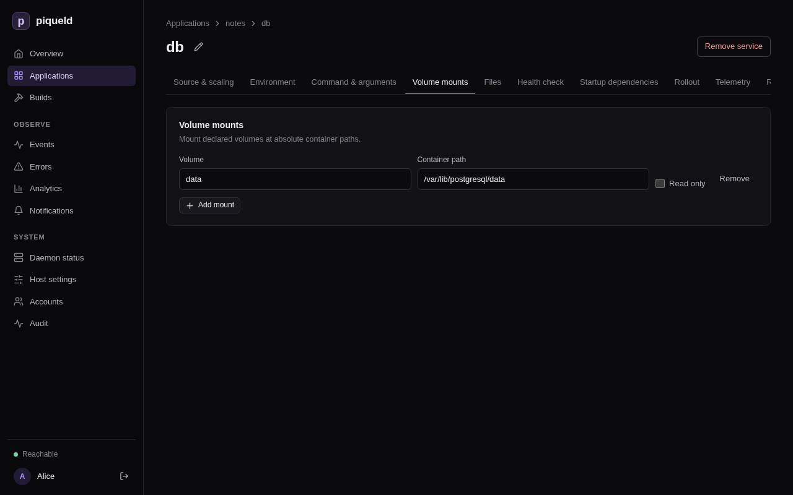

# Volumes and files

Keep a service's data across deployments in a named volume, and give services
read-only configuration files.

## Before you start

- You have an application, such as the one from
  [Configuring services](services.md). The examples use `notes`, with a
  PostgreSQL service `db` and an nginx service `web`.
- Run the commands on this page on the host, or on any machine where
  `piquelctl` is [signed in](../getting-started/first-account.md#sign-piquelctl-in).
- Editing an application needs the `apps:write`
  [permission](../accounts/permissions.md#grants) on it, and deploying it
  `apps:deploy`.

## Store data in a volume

A container's own files are lost when it's replaced, as a deployment that
changes its service does. Data that must last, such as a database's, goes in a
named volume.

> **Warning:** the volume starts empty. If `db` already holds data you want to
> keep, [back it up](#back-up-a-volume) first, and restore it after the
> deployment.

Declare the volume, mount it in `db` at `/var/lib/postgresql/data`, then
deploy. The next deployment creates the volume. Later deployments keep its
content. Each environment gets its own volume: environments never share data.

### In the dashboard

1. On the application's **Volumes** tab, select **Add volume** under **Named
   volumes**, enter `data`, and select **Save changes**.
2. On `db`'s **Volume mounts** tab, select **Add mount**, enter `data` under
   **Volume** and `/var/lib/postgresql/data` as the **Container path**, then
   select **Save changes**.

   

3. Select **Deploy to production**.

### With piquelctl

```console
piquelctl app volume add notes data
piquelctl app service mount set notes db data /var/lib/postgresql/data
piquelctl --timeout 5m app deploy notes
```

### In the manifest

1. Declare the volume, at the end of `notes.toml`:

   ```toml
   [[spec.volumes]]
   name = "data"
   ```

2. Mount it in the `db` entry, after its other settings:

   ```diff
    [spec.services.healthcheck]
    type = "command"
    command = ["pg_isready", "-U", "notes"]
    interval_seconds = 5
    start_period_seconds = 30
   +
   +[[spec.services.mounts]]
   +volume = "data"
   +target = "/var/lib/postgresql/data"

    [[spec.services]]
    name = "web"
   ```

3. Deploy:

   ```console
   piquelctl --timeout 5m app apply --file notes.toml --deploy
   ```

### Mount a volume read-only

Several services can mount the same volume. One that only reads it can mount
it read-only, such as a web server that serves the files another service
writes to an `uploads` volume. In the dashboard, check the mount's **Read
only**. With `piquelctl`, add `--read-only` to `mount set`. In the manifest,
add `read_only` to the mount:

```toml
[[spec.services.mounts]]
volume = "uploads"
target = "/usr/share/nginx/html/uploads"
read_only = true
```

A service that mounts a volume it can write to stops its old container before
starting the new one, so that two copies never write the same files. It's
briefly unavailable at each deployment; see
[rollout order](services.md#rollout-order).

## What happens to volume data

piqueld keeps the volume data of environments, but not of previews:

- **Removing a volume from the manifest** keeps its data. Declare a volume of
  the same name again, and the environment gets its data back.
- **Deleting an environment** keeps its volumes, with their data, in Docker on
  the host. A new environment never reuses them, even with the same name: it
  gets new, empty volumes.
- **Deleting an application** keeps its environments' volumes, in the same
  way, but deletes its [previews](previews.md), with their volumes.
- **Deleting a preview** deletes its volumes and their data.

So back up a volume before you delete its environment. Its data then stays on
the host until you remove it with Docker: the volume's name starts with
`piqueld-` and the environment's ID, as `piquelctl env show` prints it.

## Back up a volume

`piquelctl app exec` runs a command in the service's container and streams its
output, so you can save a backup on your machine. It needs the `apps:exec`
permission; see [running commands](commands.md).

For a database, use its own dump tool, which makes a consistent copy while it
runs:

```console
piquelctl app exec notes db -- pg_dump -U notes notes > notes.sql
```

To restore it, send the dump to the database:

```console
piquelctl app exec notes db -i -- psql -q -U notes notes < notes.sql
```

For other files, archive the directory where the volume is mounted, and
extract the archive there to restore it. For a service `api` that keeps
uploaded files in a volume mounted at `/srv/uploads`:

```console
piquelctl app exec notes api -- tar -cz -C /srv/uploads . > uploads.tar.gz
piquelctl app exec notes api -i -- tar -xz -C /srv/uploads < uploads.tar.gz
```

Don't archive a running database's files this way: the copy may be
inconsistent. To restore, the volume must be mounted writable.

piqueld's own [backup](../guides/backups-and-upgrades.md) doesn't include
volumes, so back them up separately.

## Mount a read-only file

piqueld can mount a configuration file you write, such as nginx's
`/etc/nginx/conf.d/default.conf`, into a service:

- **In the dashboard,** use the service's **Files** tab: select **Add file**,
  then enter the **Container path** and the **Content**, and select **Save
  changes**.
- **With `piquelctl`,** read the content from a file on your machine:

  ```console
  piquelctl app file add notes web /etc/nginx/conf.d/default.conf --from ./default.conf
  ```

  `--from` saves the file's content in the manifest when you run it. Use
  `--content` to give the text directly.
- **In the manifest,** add it to the `web` entry, after its other settings:

  ```diff
   [spec.services.healthcheck]
   type = "http"
   port = 80
   path = "/"
  +
  +[[spec.services.files]]
  +target = "/etc/nginx/conf.d/default.conf"
  +content = """
  +server {
  +    listen 80;
  +    location / {
  +        root /usr/share/nginx/html;
  +    }
  +}
  +"""
  ```

Deploy to mount it. Only the services that mount a changed file are replaced.

The file is read-only, owned by root, with mode `0444`: set another in
**Mode**, with `--mode`, or with `mode = "0440"`. piqueld mounts the content exactly as written: it
never replaces `${{ … }}` or anything else in it. Each file holds up to
512,000 bytes of text, and an application's files 2 MiB in total.

An application whose manifest is in a Git repository, as in
[deploying on push](deploy-on-push.md), can also mount files from that
repository; see [files](../reference/manifest.md#files).

## Check that it works

The service's **Files** tab lists its files, and `piquelctl app file list notes`
lists the application's:

```text
SERVICE  TARGET  MODE  SOURCE
web  /etc/nginx/conf.d/default.conf  0444  inline, 85 bytes
```

To see them in the container, [run a command](commands.md):

```console
$ piquelctl app exec notes web -- ls -l /etc/nginx/conf.d/default.conf
-r--r--r--    1 root     root            85 Oct 24 11:14 /etc/nginx/conf.d/default.conf
```

## Troubleshooting

- **Removing a volume fails with `mount_volume_missing`.** A service still
  mounts it. Remove the mount first, with
  `piquelctl app service mount remove notes db /var/lib/postgresql/data`.
- **The service can't write to a file.** Files are always read-only. An image
  that rewrites its configuration when it starts needs the file copied
  somewhere writable first, for example by its command.
- **Adding a file fails with `file_target_invalid`.** Another file, volume or
  secret of the service already uses that path, or the path is in
  `/run/secrets` or `/run/piqueld`, which piqueld uses.
- **The service can't write to its volume.** A new volume takes the owner of
  the directory the image has at the mount's path, or belongs to root if the
  image has none. A service that runs as another user can only write to a
  volume mounted where its image has a directory it owns.
- **The database's data is gone after a new deployment.** Check that the volume
  is mounted where the image keeps its data, such as `/var/lib/postgresql/data`
  for PostgreSQL. Data written anywhere else is lost when the container is
  replaced.
