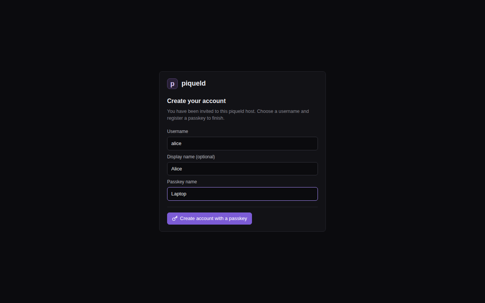

# Creating your account

Create the first administrator account, then sign `piquelctl` in with it.

You sign in with a passkey instead of a password. Your phone, laptop, password
manager or security key keeps it, so there's nothing to choose, remember or
leak.

## Before you start

- piqueld is [installed](install.md), and you've chosen the
  [address of its dashboard](install.md#choose-how-to-reach-the-dashboard).
- Your browser can create passkeys: a device with a PIN or biometrics, a
  password manager with passkey support, or a security key.

## Create the first account

1. On the piqueld host, print the setup link:

   ```console
   piquelctl setup-link
   ```

   It prints a link such as
   `https://piqueld.<tailnet>.ts.net/dashboard/auth#invite=…`. Add `--open` to
   also open it in the host's browser. Only root and members of the `piqueld`
   group can get the link, because it's only served on the host's socket.

2. Open the link in your browser. Choose a **Username**, and optionally a
   display name. Under **Passkey name**, keep `My passkey` or name the device
   that keeps it, such as `Laptop`.

   

3. Select **Create account with a passkey**, and save the passkey when your
   browser asks.

The dashboard opens, signed in. Your account has `admin` on every application.
The link only works once: when the first account exists, setup is closed for
good. Invite other people from the dashboard's **Accounts** page or with
`piquelctl account invite`; see
[invite someone](../accounts/accounts.md#invite-someone).

To sign in later, open the dashboard and select **Sign in with a passkey**.
You don't need to type your username.

## Sign piquelctl in

On the host, `piquelctl` connects to the daemon's socket. Root doesn't need to
sign in there: `sudo piquelctl` acts as the
[host operator](../accounts/recovery.md#the-host-operator). Members of
the `piqueld` group sign in as themselves.

On another machine, first tell `piquelctl` the dashboard's address, in the
shell you'll run the following commands in:

```console
export PIQUELD_URL=https://piqueld.<tailnet>.ts.net
```

With the [localhost option](install.md#localhost), keep the SSH tunnel open and
use `http://localhost:7845`. To keep the address for good, save it as a
[connection profile](../reference/cli.md#connection-profiles).

1. Start the login:

   ```console
   piquelctl login
   ```

   It prints a link, a code, and where the daemon sees the request coming
   from: your machine's network address, or the daemon's local Unix socket on
   the host.

2. Open the link, sign in, enter the code under **CLI code**, and select
   **Review request**.

3. Check that **Requested from** matches what your terminal printed, then
   select **Approve CLI login**.

Check who you're signed in as:

```console
piquelctl whoami
```

Next, [deploy your first application](first-app.md).

## Troubleshooting

- **`piquelctl setup-link` says setup is already completed.** An account
  exists already. If nobody can sign in with it any more, see
  [recovering administrator access](../accounts/recovery.md#no-administrator-can-sign-in).
- **The browser won't create or use the passkey.** Passkeys need HTTPS, or
  `localhost`, and only work at the address they were created on: the one you
  [chose when installing piqueld](install.md#choose-how-to-reach-the-dashboard).
  Open the dashboard at exactly that address.
- **You can't run `piquelctl` on the host.** The daemon also writes the setup
  link to the file `setup-link` in its data directory, `/var/lib/piqueld` by
  default. Only root and the daemon's user can read it.
