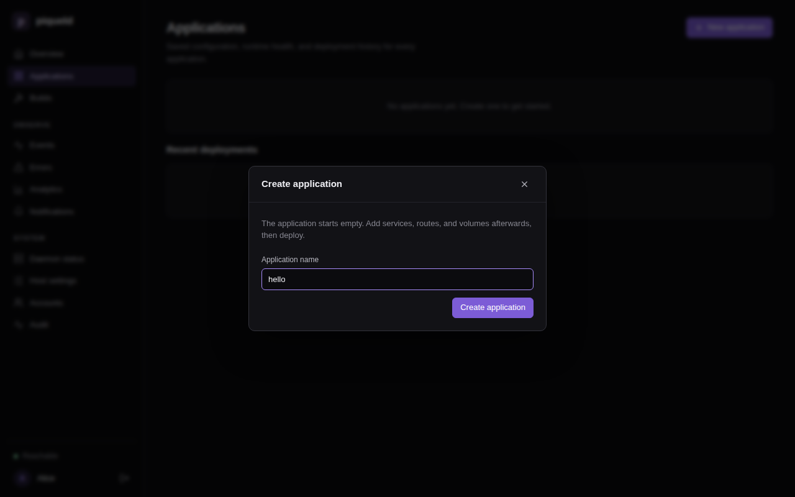
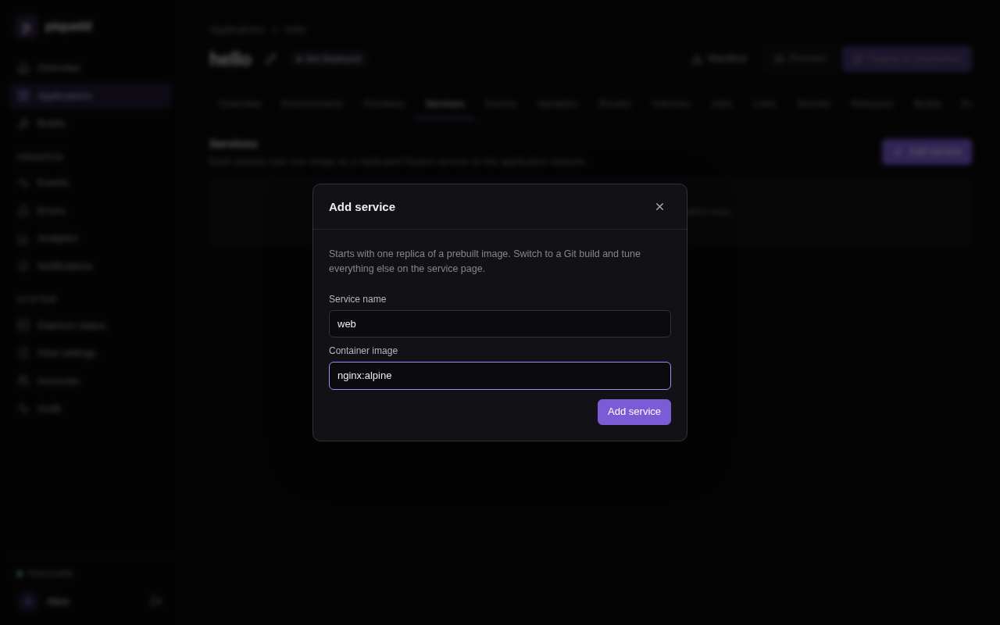
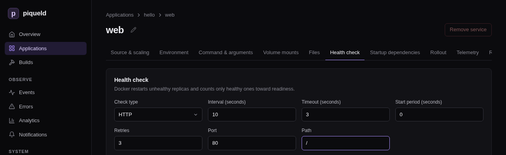

# Deploying your first application

This page deploys a small website: one nginx container that piqueld checks
over HTTP. You create it in the dashboard, with `piquelctl`, or from a
manifest, then watch it run.

## Before you start

- You have [an account](first-account.md), and `piquelctl` is signed in.
  Run the commands on this page on the host, or on any machine where
  `piquelctl` is signed in. On another machine, keep `PIQUELD_URL` set, as
  when you [signed it in](first-account.md#sign-piquelctl-in).
- The host can pull images from Docker Hub.

## Create and deploy it

The application, `hello`, has one service, `web`, which runs the
`nginx:alpine` image. Its health check tells piqueld that `web` is healthy
once it answers on port 80. Create it in any of these three ways.

### In the dashboard

1. Open **Applications**, select **New application**, and fill in
   **Application name** with `hello`. Select **Create application**.

   

2. The application opens, empty. On its **Services** tab, select **Add
   service**, fill in **Service name** with `web` and **Container image** with
   `nginx:alpine`, then select **Add service**.

   

3. Select `web` in the list, then its **Health check** tab. Set **Check type**
   to **HTTP**, **Port** to `80` and **Path** to `/`, and select **Save
   changes**.

   

4. Saving changes the application's configuration, but not what runs. Go
   back to the application's page, through **hello** above the service's
   name, and select **Deploy to production**.

### With piquelctl

```console
piquelctl app create hello
piquelctl app service add hello web nginx:alpine
piquelctl app service health http hello web 80 --path /
piquelctl app deploy hello
```

Each command asks you to confirm, then saves one change. `app deploy` deploys
them to the application's `production` environment. It prints each step and
waits until the deployment finishes. In a script, add `--yes` to skip the
confirmations.

### From a manifest

A manifest describes the whole application in a TOML file. Save this one as
`hello.toml`:

```toml
api_version = "piqueld.dev/v1alpha1"
kind = "Application"

[metadata]
name = "hello"

[[spec.services]]
name = "web"

[spec.services.source]
type = "image"
image = "nginx:alpine"

[spec.services.healthcheck]
type = "http"
port = 80
path = "/"
```

Each `[[spec.services]]` entry is a service. Check the manifest, then save it
and deploy it to `production`:

```console
$ piquelctl app validate --file hello.toml
Manifest is valid for application "hello".
$ piquelctl app apply --file hello.toml --deploy
```

To see what a deployment would change before you run it, select **Preview**
on the application's page in the dashboard, or run
`piquelctl app plan --file hello.toml`. The [manifest reference](../reference/manifest.md) describes every
setting. `piquelctl app manifest hello` prints the manifest of an application
you created in the dashboard or with `piquelctl`.

## Check that it works

In the dashboard, the **Overview** lists the deployment under **Recent
deployments**.


Open **Applications**, then **hello**, then **production** on its
**Environments** tab. **Observed services** lists `web` with one healthy
replica.


With `piquelctl`:

```console
$ piquelctl app show hello
hello (app-f11d73eef37c18041cd376261d46daa1)

Configuration revision: 3
Environment: production (app-f11d73eef37c18041cd376261d46daa1): ready, deploys from saved

Service: web
  Replicas: 1
  Source: image nginx:alpine
```

Read the service's output on the environment's **Logs** tab, or with
`piquelctl app logs hello`. piqueld's health checks show up there as requests
to `/`.

## Change it

To run two replicas of `web`:

- **In the dashboard,** set **Replicas** to `2` on the service's **Source &
  scaling** tab, and select **Save changes**. Go back to the application
  through the **hello** breadcrumb, then select **Deploy to production**.
- **With `piquelctl`,** run
  `piquelctl app service replicas hello web 2 --deploy`.
- **From the manifest,** add `replicas = 2` to the existing
  `[[spec.services]]` entry, then run
  `piquelctl app apply --file hello.toml --deploy` again.

## Next steps

- Put the website on an HTTPS address with a [route](../guides/ingress.md).
- Add a `staging` environment, as in
  [environments and promotion](../applications/environments.md).
- Build images from a Git repository, as in
  [building images from Git](../applications/git-builds.md).

When you're done, delete the application. This removes its containers and
history, and deletes its previews with their volumes. Its environments' named
volumes are kept, so that their data isn't lost by accident. In the
dashboard, select **Delete application** on the application's **Overview**.
Or run:

```console
piquelctl app delete hello
```

## Troubleshooting

- **`piquelctl` times out.** It waits 30 seconds by default, and pulling a
  large image can take longer. The deployment carries on: follow it in
  the dashboard, or give `piquelctl` longer, such as
  `piquelctl --timeout 5m app deploy hello`.
- **The deployment fails.** `piquelctl` prints the error. The environment's
  **Deployments** tab shows each step, and **Diagnostics** on its **Overview**
  says what went wrong.
- **The service never becomes healthy.** Check that the health check's port
  and path match what the container serves, and read its logs.
