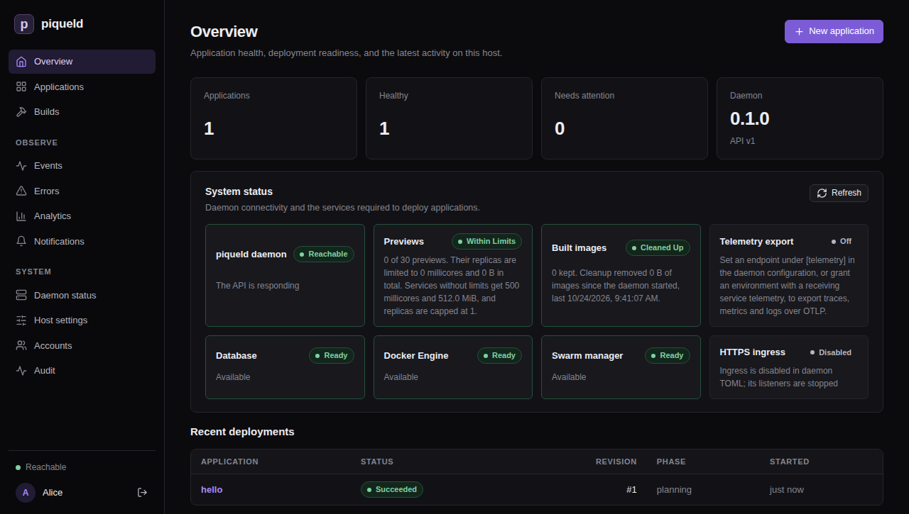
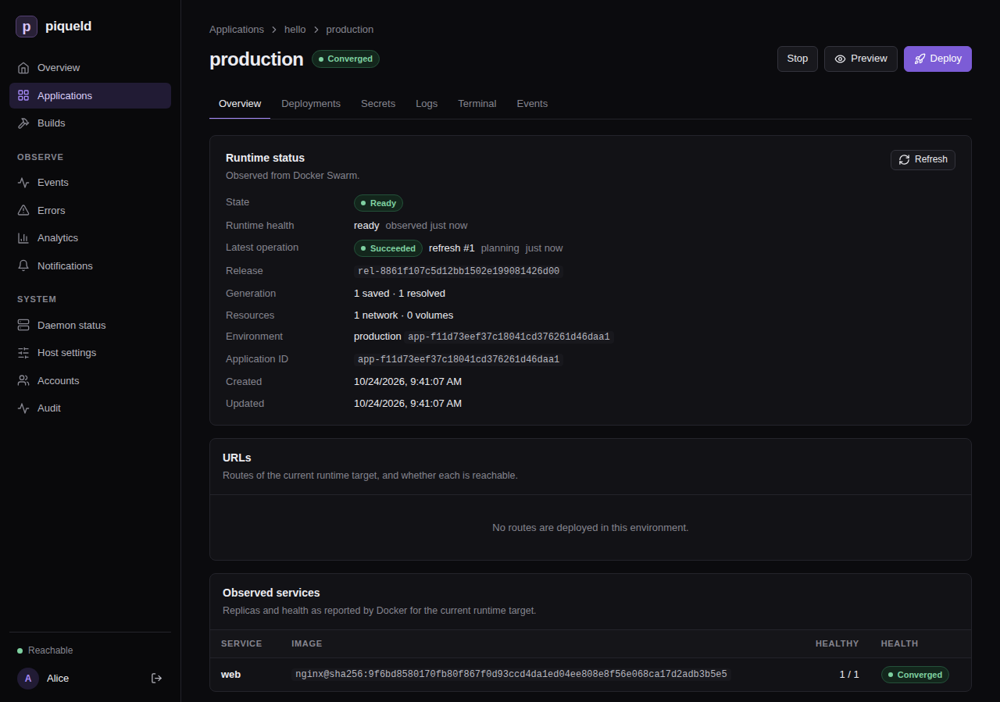

# Deploying your first application

This page deploys a small website: one nginx container that piqueld checks
over HTTP. You describe it in a manifest, deploy it with `piquelctl`, and
watch it run in the dashboard.

## Before you start

- You have [an account](first-account.md), and `piquelctl` is signed in. On
  another machine than the host, keep `PIQUELD_URL` set, as when you
  [signed it in](first-account.md#sign-piquelctl-in).
- The host can pull images from Docker Hub.

## Write the manifest

An application is described by a manifest, a TOML file. Save this one as
`hello.toml`:

```toml
api_version = "piqueld.dev/v1alpha1"
kind = "Application"

[metadata]
name = "hello"

[[spec.services]]
name = "web"

[spec.services.source]
type = "image"
image = "nginx:alpine"

[spec.services.healthcheck]
type = "http"
port = 80
path = "/"
```

- `metadata.name` names the application.
- Each `[[spec.services]]` entry is a service. Here, `web` runs the
  `nginx:alpine` image.
- The health check tells piqueld that `web` is healthy once it answers on
  port 80.

Check the manifest:

```console
$ piquelctl app validate --file hello.toml
Manifest is valid for application "hello".
```

The [manifest reference](../reference/manifest.md) describes every setting.

## Deploy it

```console
piquelctl app apply --file hello.toml --deploy
```

After you confirm, `piquelctl` saves the manifest and deploys it to the
application's `production` environment. It prints each step and waits until
the deployment finishes. In a script, add `--yes` to skip the confirmation.

To see what a deployment would change before you run it, use
`piquelctl app plan --file hello.toml`.

## Check that it works

```console
$ piquelctl app show hello
hello (app-01a16b1282cf755287920502b5793cd1)

Configuration revision: 1
Environment: production (app-01a16b1282cf755287920502b5793cd1): ready, deploys from saved

Service: web
  Replicas: 1
  Source: image nginx:alpine
```

In the dashboard, the **Overview** lists the deployment under **Recent
deployments**.



Open **Applications**, then **hello**, then **production**. **Observed
services** lists `web` with one healthy replica.



Read the service's output with `piquelctl app logs hello`, or on the
environment's **Logs** tab. piqueld's health checks show up there as requests
to `/`.

## Change it

Edit the manifest, for example to run two replicas of `web`. Add `replicas`
below the service's name:

```toml
[[spec.services]]
name = "web"
replicas = 2
```

Then run `piquelctl app apply --file hello.toml --deploy` again.

You can also edit the application in the dashboard, on its **Services** tab.
Saving changes the application's manifest but not what's running: select
**Deploy** to apply it.

## Next steps

- Put the website on an HTTPS address with a [route](../guides/ingress.md).
- Add a `staging` environment with
  [declared environments](../reference/manifest.md#declared-environments).
- Build images from a Git repository with
  [Git build sources](../reference/manifest.md#git-build-sources).

When you're done, delete the application. This removes its containers and
history, and deletes its previews with their volumes. Its environments' named
volumes are kept, so that their data isn't lost by accident:

```console
piquelctl app delete hello
```

## Troubleshooting

- **`piquelctl` times out.** It waits 30 seconds by default, which pulling a
  large image can take longer than. The deployment carries on: follow it in
  the dashboard, or give `piquelctl` longer, such as
  `piquelctl --timeout 5m app apply --file hello.toml --deploy`.
- **The deployment fails.** `piquelctl` prints the error. The environment's
  **Deployments** tab shows each step, and **Diagnostics** on its **Overview**
  says what went wrong.
- **The service never becomes healthy.** Check that the health check's port
  and path match what the container serves, and read its logs.
