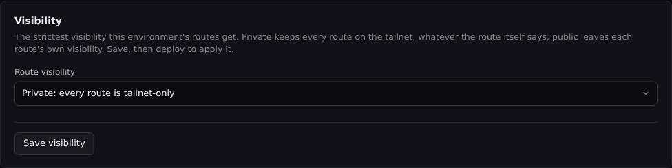

# Private routes on your tailnet

A private route serves a hostname, such as `admin.example.com`, only to the
devices on your tailnet, your private [Tailscale](https://tailscale.com)
network. Elsewhere, connections to it fail. Use private routes for admin
tools, staging environments and previews. Routes are private unless you make
them public.

piqueld serves them through a second tailnet device, the apps node, named
`piqueld-apps` by default. Your private hostnames' DNS records point at its
tailnet addresses, and it passes their connections on to the gateway. It is
separate from piqueld's [own tailnet node](../getting-started/install.md#piquelds-own-tailnet-node),
so you can give it its own tags and access rules.

## Before you start

- The gateway is enabled; see
  [Serving an application over HTTPS](routes.md#enable-the-gateway).
- A tailnet, and permission to add a device to it.
- A DNS provider for your domain, [Cloudflare](cloudflare.md) or
  [OVH](ovh.md). The certificate authority can't reach a private route, so
  piqueld gets its certificates through the provider; see
  [DNS-01 certificates](wildcards.md#dns-01-certificates).
- Run `piquelctl` on the host, or on any machine where it is signed in.

## Set it up

1. In the Tailscale admin console, create an
   [auth key](https://tailscale.com/kb/1085/auth-keys) for the apps node, and
   give it a [tag](https://tailscale.com/kb/1068/tags). Your tailnet's access
   rules can then control who reaches your private routes, and the node's key
   doesn't [expire](https://tailscale.com/kb/1028/key-expiry).

2. Save the key in a file only root can read, such as an agenix or sops-nix
   secret. The node uses it only to join the tailnet the first time.

3. Enable private routes in your configuration, with your DNS provider:

   ```nix
   services.piqueld.settings = {
     ingress.enabled = true;
     ingress.private = {
       enabled = true;
       hostname = "piqueld-apps";   # piqueld-apps.<tailnet>.ts.net
       auth_key_file = "/run/secrets/piqueld-apps-ts-auth-key";
     };
     dns.providers = [
       {
         kind = "cloudflare";
         api_token_file = "/run/secrets/cloudflare-dns-token";
       }
     ];
   };
   ```

   In `/etc/piqueld/config.toml`, pass the files to the service with
   `LoadCredential=`, as for the
   [tailnet auth key](../getting-started/install.md#other-linux-distributions):

   ```toml
   [ingress]
   enabled = true

   [ingress.private]
   enabled = true
   hostname = "piqueld-apps"
   auth_key_file = "ts-apps-auth-key"

   [[dns.providers]]
   kind = "cloudflare"
   api_token_file = "cloudflare-dns-token"
   ```

   `hostname` is the node's name on the tailnet: one DNS label, different
   from the name of piqueld's own node.

4. Restart the daemon. On NixOS, rebuild the system. Elsewhere, reload the
   unit you edited first:

   ```console
   sudo systemctl daemon-reload
   sudo systemctl restart piqueld
   ```

5. On the host, check that the node joined the tailnet, and note its
   addresses:

   ```console
   $ sudo piquelctl status
   ...
   Private listener: apps node piqueld-apps.<tailnet>.ts.net (Running, 100.101.102.103, fd7a:115c:a1e0::5a01:4c3d)
   ...
   ```

   In the dashboard, **System status** shows the **Private listener** card
   as **Ready**, with the same name and addresses.

6. For each private hostname, create an A record to the node's IPv4 address,
   and an AAAA record to its IPv6 address. If piqueld
   [manages your DNS records](dns-records.md), it creates them.

7. Add a route without `visibility`, so that it is private, and deploy:

   ```toml
   [[spec.routes]]
   hostname = "admin.example.com"
   service = "admin"
   port = 3000
   ```

   With `piquelctl`, `app route add` makes private routes by default:

   ```console
   piquelctl app route add notes admin.example.com admin 3000 --deploy
   ```

   In the dashboard's **Routes** tab, **Visibility** is **Private** unless
   you change it.

The apps node's identity lives in piqueld's data directory, under
`ingress/tailscale`, so [back it up](../guides/backups-and-upgrades.md#backing-up)
whole. Without it, the node joins the tailnet as a new device, with new
addresses.

## Check that it works

```console
$ piquelctl app route list notes
HOSTNAME  NAME  ENVIRONMENT  VISIBILITY  STATE  DESTINATION  DNS  RECORDS
admin.example.com  -  production  private  ready  admin:3000  manual  A/AAAA -> 100.101.102.103, fd7a:115c:a1e0::5a01:4c3d
```

`ready` means the hostname resolves to exactly the node's addresses, and that
the gateway serves the route with a trusted certificate. piqueld checks this
from the server, without crossing the tailnet.

From a device on your tailnet, open `https://admin.example.com`: your service
answers, and sees the device's tailnet address in `X-Forwarded-For`. From a
device off the tailnet, the connection fails. On your server's public address,
plain HTTP for the hostname gets a 404, and HTTPS fails, since the gateway has
no certificate for it there. If a public wildcard route covers the hostname,
HTTPS connects with the wildcard's certificate and also gets a 404.

## Make an environment's routes private

An environment can cap the visibility of its routes. To keep `staging` off the
internet, whatever its routes say:

```toml
[spec.environments.staging]
visibility = "private"
```

Or with `piquelctl`:

```console
piquelctl env visibility notes staging private
```

In the dashboard, open the environment's **Overview**. In its **Visibility**
card, set **Route visibility** to **Private: every route is tailnet-only**,
then select **Save visibility**.



Deploy the environment to apply it. A
[promoted environment](../reference/manifest.md#promoted-environments) applies
it once its source records a new release and you promote it.

Each route gets the stricter of its own visibility and the environment's, so a
cap can make a route private, but never public. Environments default to
`public`, which restricts nothing. Previews default to `private`; set
`[spec.previews] visibility` to change it, as
[previews](../reference/manifest.md#previews) describes.

For example, with these routes:

```toml
[spec.variables]
domain = "piquel.fr"

[spec.environments.production]

[spec.environments.staging]
visibility = "private"

[spec.environments.staging.variables]
domain = "staging.piquel.fr"

[[spec.routes]]
hostname = "${{ vars.domain }}"
service = "web"
port = 3000
visibility = "public"

[[spec.routes]]
hostname = "admin.${{ vars.domain }}"
service = "admin"
port = 3000
```

| Environment | Hostname | Reachable from |
| --- | --- | --- |
| production | `piquel.fr` | the internet |
| production | `admin.piquel.fr` | your tailnet |
| staging | `staging.piquel.fr`, `admin.staging.piquel.fr` | your tailnet |

## Change a route's visibility

```console
piquelctl app route visibility notes admin.example.com public
```

In the dashboard, change the route's **Visibility** on the **Routes** tab,
select **Save changes**, then **Deploy to \<environment>**.

When you deploy, a route made private leaves the internet as soon as the
deployment starts. A route made public is published once its service is ready.
Its DNS records must change too: you update the records piqueld doesn't
manage, and piqueld updates the ones it manages once the gateway has the new
routes. It may delete and recreate them on the way, and cached answers can
delay the change.

## DNS for private routes

- **A wildcard record per environment saves work.** With A and AAAA records
  for `staging.example.com` and `*.staging.example.com`, every new staging
  route already has its DNS.
- **Names aren't secret.** Private hostnames appear in public DNS and in
  certificate transparency logs. Only who can connect is restricted.
- **Some routers drop DNS answers for tailnet addresses.** Their DNS-rebinding
  protection refuses answers in `100.64.0.0/10`. Allow your domain in the
  router's settings, or use Tailscale's
  [split DNS](https://tailscale.com/kb/1054/dns).

## Serve the dashboard on your own domain

The dashboard and API are normally served at piqueld's own address, such as
`https://piqueld.<tailnet>.ts.net`. You can serve them on your own domain
instead, through the apps node. Like a private route, the hostname is then
only reachable from your tailnet, and gets its certificate through your DNS
provider. Applications can't route it, or any name below it.

**Switching breaks your passkeys.** The dashboard only works at the address
`auth.public_url` names, so leave it unset or set it to
`https://dashboard.example.com`. A passkey only works at the address it was
created on, so the passkeys you have stop working, at the old address too.
The steps below add a new one.

1. [Sign `piquelctl` in](../getting-started/first-account.md#sign-piquelctl-in)
   with your account. The host operator can't create enrollment links.

2. Set the hostname in your configuration, with private routes
   [enabled](#set-it-up):

   ```nix
   services.piqueld.settings.ingress.private.dashboard_hostname = "dashboard.example.com";
   ```

   Or, in `config.toml`:

   ```toml
   [ingress]
   enabled = true

   [ingress.private]
   enabled = true
   dashboard_hostname = "dashboard.example.com"
   ```

3. Rebuild the system, or restart the daemon.

4. Create A and AAAA records for the hostname to the apps node's addresses,
   as for a private route. If piqueld [manages your DNS records](dns-records.md),
   it creates them.

5. Create a link that adds a passkey to your account:

   ```console
   piquelctl account enroll alice
   ```

6. Open the link on a device on your tailnet, and save the new passkey.

If no CLI login works any more,
[recover administrator access](../accounts/authentication.md#recovering-administrator-access).

piqueld's own tailnet node keeps serving the API at its address, for
`piquelctl`. `piquelctl status` then reports
`Tailnet problem: auth.public_url is not https://piqueld.<tailnet>.ts.net, so passkeys do not work on this origin`,
which is expected.

The [audit trail](../guides/observability.md#audit-trail) records the tailnet
user of each request, and
[tailnet-bound tokens](../accounts/authorization.md#tailnet-bound-tokens) work
on this hostname. For both, piqueld needs the `tailscale` command on its
`PATH`. The NixOS module adds it; on other distributions, install Tailscale on
the host.

## Troubleshooting

- **Private routes are `disabled` with `Private ingress is disabled in daemon
  TOML ([ingress.private])`.** Enable `[ingress.private]` and restart.
- **`The apps node needs login`.** The node has no auth key, its auth key
  expired before its first login, or, without a tag, its node key
  [expired](https://tailscale.com/kb/1028/key-expiry). The daemon logs a login
  URL: open it, or set `auth_key_file` and restart.
- **A route is `failed` with `No DNS-01 certificate`.** The rest of the
  message says why. `no configured DNS provider zone contains …` means no
  provider covers the zone. Anything else is the latest issuance error; see
  [renewal and failures](wildcards.md#renewal-and-failures).
- **`Private HTTPS is not verified yet`.** Check that the hostname's A and AAAA
  records point at the apps node's addresses, and nothing else.
- **`Swarm address pool <pool> overlaps the tailnet ranges`.** Your Swarm was
  set up with custom address pools. Docker gives application networks
  addresses from them, which piqueld can't tell apart from tailnet devices, so
  it keeps private routes off until the Swarm's pools are outside
  `100.64.0.0/10` and `fd7a:115c:a1e0::/48`.
- **Devices on the tailnet can't resolve the hostname.** Check your router's
  [DNS-rebinding protection](#dns-for-private-routes).
- **The daemon doesn't start, with `ingress.private.dashboard_hostname requires
  ingress.enabled and ingress.private.enabled`.** Enable both, as in
  [Set it up](#set-it-up).
