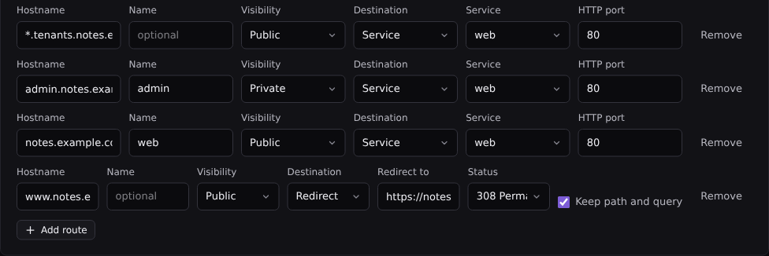

# Serving an application over HTTPS

This page puts an application's service on a public HTTPS address, such as
`https://hello.example.com`. piqueld runs a gateway in front of your
applications: it receives requests on ports 80 and 443, gets a certificate for
each hostname, and forwards each request to its service.

A route can also be private, so that only devices on your tailnet reach it;
see [private routes](private-routes.md).

## Before you start

- A domain name, and access to its DNS records.
- A server that the internet reaches on ports 80 and 443, with nothing else
  listening on them. Without inbound ports, such as behind NAT, serve your
  routes through a [Cloudflare Tunnel](cloudflare.md#serve-public-routes-through-a-cloudflare-tunnel)
  instead.
- Docker Engine 28 or later on the server.
- An application whose service serves plain HTTP, such as `hello` from
  [Deploying your first application](../getting-started/first-app.md).

piqueld doesn't put a sign-in in front of your routes: anyone can open a
public route, so your application handles its own authentication.

## Enable the gateway

1. Enable it in your configuration:

   ```nix
   services.piqueld.settings.ingress.enabled = true;
   ```

   Or, in `/etc/piqueld/config.toml`:

   ```toml
   [ingress]
   enabled = true
   ```

2. Open TCP ports 80 and 443 in the server's firewall. The NixOS module
   doesn't open them:

   ```nix
   networking.firewall.allowedTCPPorts = [ 80 443 ];
   ```

3. Rebuild the system, or restart the daemon with
   `sudo systemctl restart piqueld`. piqueld reads its `[ingress]` settings
   only when it starts.

On the host, check that the gateway runs:

```console
$ sudo piquelctl status
...
Public listener: healthy: Caddy is running and routing configuration is applied
Public ingress: ports 80/443
```

In the dashboard, **System status** on the **Overview** shows **HTTPS
ingress** as **Ready**.

## Add a route

1. Create a DNS record for the hostname: an A record to your server's public
   IPv4 address. Add an AAAA record to its IPv6 address only if public IPv6
   traffic actually reaches your server. piqueld can also
   [create these records](dns-records.md) for you.

2. Add a route to the manifest, `hello.toml`:

   ```toml
   [[spec.routes]]
   hostname = "hello.example.com"
   service = "web"
   port = 80
   visibility = "public"
   ```

   - `service` and `port` say where requests go: the `web` service, on the
     port it serves HTTP on inside its container. The port doesn't need to be
     published.
   - `visibility = "public"` lets anyone on the internet connect. Without it,
     the route is [private](private-routes.md).

3. Deploy it:

   ```console
   piquelctl app apply --file hello.toml --deploy
   ```

You can also add the route without editing a file:

```console
piquelctl app route add hello hello.example.com web 80 --visibility public --deploy
```

In the dashboard, open **Applications**, then **hello**, then its **Routes**
tab. Select **Add route**, fill in the **Hostname**, set **Visibility** to
**Public**, **Destination** to **Service**, then the **Service** and its
**HTTP port**. Select **Save changes**, then **Deploy to production**.



Removing a service on the **Services** tab also removes its routes from the
saved configuration.

Saving a route doesn't change what's served; deploying does. piqueld starts
serving the route once its service is ready. The gateway then gets the
hostname's certificate from a public certificate authority, Let's Encrypt or
ZeroSSL, and renews it by itself. It redirects plain HTTP requests to HTTPS.

## Check that it works

```console
$ piquelctl env url hello production
URL: https://hello.example.com ready
```

The URL is `ready` once all of these hold:

- the gateway serves the route;
- piqueld itself fetched `https://hello.example.com`, with a trusted
  certificate, and reached this server's gateway;
- its [DNS records](dns-records.md), if piqueld manages them, are in place;
- its service is healthy.

Until then, it is `pending`, followed by what it waits for. In the dashboard,
the environment's **Overview** lists it in the **URLs** card.

To see every route of the application, with what each one's hostname needs
from DNS:

```console
$ piquelctl app route list hello
HOSTNAME  NAME  ENVIRONMENT  VISIBILITY  STATE  DESTINATION  DNS  RECORDS
hello.example.com  -  production  public  ready  web:80  manual  A/AAAA -> this server's public addresses
```

Each route is in one of these states:

| State | Meaning |
| --- | --- |
| `ready` | piqueld reached the route over trusted HTTPS. |
| `pending` | It waits for the gateway, DNS or its certificate. The next line says what to check. |
| `failed` | It can't be served, for example without a certificate; the next line says why. |
| `disabled` | The gateway, or [private routes](private-routes.md), are turned off. |

The application's **Routes** tab shows the same in **Deployed routes**.

## Redirect a hostname

A route can answer with a redirect instead, for example from `www` to your
main hostname:

```toml
[[spec.routes]]
hostname = "www.hello.example.com"
redirect = { to = "https://hello.example.com" }
visibility = "public"
```

Or:

```console
piquelctl app route redirect hello www.hello.example.com https://hello.example.com --visibility public
```

In the dashboard, set the route's **Destination** to **Redirect**, then fill
in **Redirect to**.

The gateway answers redirects itself, so they need no service. It sends a 308
redirect and keeps the request's path and query: `www.hello.example.com/about`
goes to `hello.example.com/about`. To change that, set `status` and
`preserve_path`, or in the dashboard **Status** and **Keep path and query**;
see [routes](../reference/manifest.md#routes). Redirect hostnames get
certificates like any other.

## Give each environment its own hostname

A hostname belongs to one environment. Several hostnames can lead to one
service, but two environments can't share a hostname: saving or deploying a
manifest that renders the same hostname in two environments fails with
`hostname_conflict`.

Give each environment its own hostname with a
[variable](../reference/manifest.md#variables):

```toml
[spec.variables]
domain = "hello.example.com"

[spec.environments.production]

[spec.environments.staging.variables]
domain = "staging.hello.example.com"

[[spec.routes]]
hostname = "${{ vars.domain }}"
service = "web"
port = 80
visibility = "public"
```

An environment keeps its hostnames until a deployment withdraws its routes,
so no other environment or application can take them in the meantime.

To keep an environment, such as `staging`, off the internet, make its routes
[private](private-routes.md#make-an-environments-routes-private).

## Read the client's address

Your service receives requests from the gateway, not from the client. The
gateway adds the client's address in `X-Forwarded-For`, and sets
`X-Forwarded-Proto` and `X-Forwarded-Host`. It replaces any `X-Forwarded-For`
the client sent.

Trust those headers only when they come from the gateway. While the gateway is
enabled, each service a route leads to gets the variable
`PIQUELD_INGRESS_PROXIES`: the comma-separated address
ranges the gateway connects from, such as `10.0.3.0/24`. In Express, for
example:

```js
app.set("trust proxy", process.env.PIQUELD_INGRESS_PROXIES.split(","));
```

The application's other routed services connect from that range too, so
trusting it also trusts them.

## Turn the gateway off

Set `ingress.enabled = false` and restart the daemon. The gateway stops, ports
80 and 443 close, and every route reports `disabled`. piqueld keeps your
routes and certificates, and still accepts and deploys manifests with routes.
When you enable it again, it serves the routes of your deployments, including
those deployed while it was off.

While the gateway is off, piqueld deletes the DNS records it
[manages](dns-records.md), and deletes [DNS-01 certificates](wildcards.md#dns-01-certificates)
once they expire.

Stopping the daemon, on the other hand, leaves the gateway running: your
routes stay up, and the gateway keeps renewing its certificates.

## Limits

- The service must serve plain HTTP, over HTTP/1.1. WebSockets and streaming
  responses work.
- A route serves a whole hostname: there is no routing by path, and no TCP or
  UDP port.
- An application has up to 64 routes.
- The hostnames of the dashboard and of piqueld's
  [webhooks](webhooks.md), and the names below them, can't be routed.

## Troubleshooting

- **The route stays `pending` with `Public HTTPS is not verified yet`.**
  Check that the hostname's A and AAAA records point at your server and no
  other, and that ports 80 and 443 are open to the internet. piqueld checks
  the route from the server itself, so a router that can't loop the server's
  public address back to it keeps the route `pending`, even when it works from
  elsewhere.
- **`Waiting for the gateway configuration to be applied`.** Check **HTTPS
  ingress** in **System status**. `Ingress unavailable: could not prepare the
  Caddy gateway (requires free ports 80/443 and Docker 28+)` means another
  program uses port 80 or 443, or Docker is too old. If you run your own
  reverse proxy for the dashboard, move it to other ports or another server.
- **Saving fails with `hostname_conflict`.** Another environment or
  application already has the hostname, or piqueld uses it itself. See
  [the previous section](#give-each-environment-its-own-hostname).
- **Your service sees the same client address for every IPv6 request.** Docker
  forwards IPv6 to an IPv4-only network through a proxy, which hides the
  client. Serve the route over IPv4 only, by removing its AAAA record.
