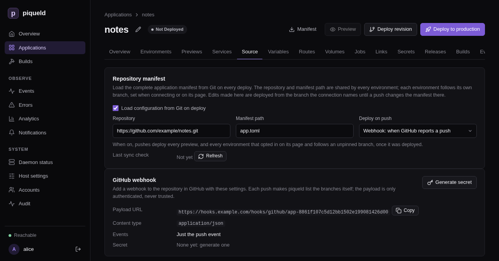

# Receiving webhooks

This page lets GitHub tell piqueld about each push, so that applications that
[deploy on push](../reference/manifest.md#deploying-on-push) with
`sync = { mode = "webhook" }` deploy it right away. GitHub needs a public
address to send these reports to, but piqueld's API and dashboard stay off the
internet. So piqueld receives them on a webhook hostname: a public hostname on
which it accepts GitHub's push webhooks, and nothing else.

## Before you start

- The gateway serves public routes, on ports 80 and 443 or through a
  [Cloudflare Tunnel](cloudflare.md#serve-public-routes-through-a-cloudflare-tunnel);
  see [Serving an application over HTTPS](routes.md). Or you run
  [your own reverse proxy](#behind-your-own-reverse-proxy).
- A hostname for webhooks alone, such as `hooks.example.com`. Applications
  can't route it or any name below it, so don't pick your website's domain:
  with `hooks.example.com`, `example.com` and its other subdomains stay
  available.
- An application whose manifest lives in a GitHub repository; see
  [repository-backed manifests](../reference/manifest.md#repository-backed-manifests).
- Run `piquelctl` on the host, or on any machine where it is signed in.
- Generating the webhook secret needs the `apps:write`
  [permission](../accounts/permissions.md#grants) on the application, and
  turning on deploying on push `apps:deploy` too. The dashboard hides or
  disables the controls you can't use.

## Set it up

1. Set the hostname in your configuration:

   ```nix
   services.piqueld.settings.ingress = {
     enabled = true;
     webhook_hostname = "hooks.example.com";
   };
   ```

   Or, in `config.toml`:

   ```toml
   [ingress]
   enabled = true
   webhook_hostname = "hooks.example.com"
   ```

2. Rebuild the system, or restart the daemon. piqueld reads the setting only
   when it starts.

3. Create the hostname's DNS records, as for a public route: an A record to
   your server, or a proxied CNAME record to your tunnel. If piqueld
   [manages your DNS records](dns-records.md), it creates them.

   The gateway gets the hostname's certificate like a public route's. Through
   a tunnel, Cloudflare serves its HTTPS.

4. Make the application deploy on push with the webhook:

   - In the dashboard, open the application's **Source** tab, set **Deploy
     on push** to **Webhook: when GitHub reports a push**, then select
     **Save changes**.
   - With `piquelctl`, use
     [`app repository sync`](../reference/cli-commands.md#piquelctl-app-repository-sync):

     ```console
     piquelctl app repository sync notes webhook
     ```

   - In the manifest you apply with `piquelctl app apply`, set `sync` in
     `[spec.manifest]`. piqueld ignores it in the file it fetches from the
     repository.

     ```toml
     [spec.manifest]
     sync = { mode = "webhook" }
     ```

5. Opt the `production` environment in. Pushes deploy only the environments
   that opt in, and `production` doesn't by default:

   - In the dashboard, open the environment's **Overview**. In its
     **Source** card, select **Deploy on push**. Its **Deploy on push** label
     then says `following`.
   - With `piquelctl`, use
     [`env sync`](../reference/cli-commands.md#piquelctl-env-sync):

     ```console
     piquelctl env sync notes production on
     ```

   - In the manifest, set `sync` in the environment's
     [declaration](../reference/manifest.md#declared-environments):

     ```toml
     [spec.environments.production]
     sync = true
     ```

   An environment that was never deployed starts following pushes from its
   first deployment. Until then, the label says `waiting for a deployment`.

6. Generate the application's webhook secret. Each application has its own
   payload URL, ending with its ID, and its own secret.

   In the dashboard, the **Source** tab now has a **GitHub webhook** card.
   Select **Generate secret**: the card shows the new secret below the
   payload URL.

   

   With `piquelctl`, after you confirm, the command prints the payload URL
   and the new secret:

   ```console
   $ piquelctl app repository webhook rotate notes
   Payload URL: https://hooks.example.com/hooks/github/app-01a16b4ba32d7170a360c97d0a2cd503
   Secret: <64 hexadecimal characters>
   Configure this secret in GitHub now; piqueld never shows it again.
   ```

7. In GitHub, add a webhook to the application's repository, as GitHub's
   [Creating webhooks](https://docs.github.com/en/webhooks/using-webhooks/creating-webhooks)
   describes, with:

   - the payload URL from step 6;
   - the content type `application/json`;
   - the secret from step 6;
   - only the `push` event.

The [deploying on push](../reference/manifest.md#deploying-on-push) reference
describes the application's side.

## Check that it works

In GitHub, the webhook's
[recent deliveries](https://docs.github.com/en/webhooks/testing-and-troubleshooting-webhooks/viewing-webhook-deliveries)
list its first one, a `ping`, answered with `204`. Each push then adds a
`push` delivery, also answered with `204`.

The **GitHub webhook** card shows the webhook's settings again, without the
secret, and so does `piquelctl`:

```console
$ piquelctl app repository webhook show notes
Payload URL: https://hooks.example.com/hooks/github/app-01a16b4ba32d7170a360c97d0a2cd503
Content type: application/json
Events: push
Secret: generated; rotate it to see a new one
```

From any machine, a request for anything else on the hostname gets a 404:

```console
$ curl -s -o /dev/null -w '%{http_code}\n' https://hooks.example.com/
404
```

## What piqueld accepts

piqueld only accepts `POST` requests to
`https://hooks.example.com/hooks/github/<application-id>`, signed with that
application's secret, the way GitHub signs them in its
`X-Hub-Signature-256` header:

| Response | When |
| --- | --- |
| 204 | The delivery is signed with the application's secret. |
| 401 | It isn't signed, or the signature is wrong, or the application doesn't exist or has no secret yet. |
| 404 | Any other path. |
| 405 | Another method than `POST`, on a webhook path. |
| 408 | The request took more than 10 seconds. |
| 413 | Its body is over 1 MiB. |
| 503 | piqueld can't read the application's secret, or 16 deliveries are already being handled. |

Plain HTTP requests are redirected to HTTPS. Through a tunnel, Cloudflare
redirects them once **Always Use HTTPS** is on.

A signed `push` makes piqueld check the repository's branches soon, at most
once every 30 seconds for each repository. Other events, such as GitHub's
`ping`, change nothing. piqueld never reads what a delivery says: it lists the
branches itself, so a delivery can't choose what gets deployed.

piqueld shows each secret only once. A new one, from **Rotate secret** in the
dashboard or `webhook rotate`, replaces the old one at once, so give it
to GitHub straight away. Like other secrets, it is encrypted with the
[secret master key](../reference/configuration.md#secret-storage), and lost-key
recovery deletes it.

Refused deliveries aren't recorded in the audit trail. A wrong signature is
logged as `webhook delivery refused: its signature does not verify`.

## Behind your own reverse proxy

piqueld serves webhooks whenever `webhook_hostname` is set, even with
`ingress.enabled = false`. It listens on a Unix socket in its data directory,
`/var/lib/piqueld/ingress/control/webhooks.sock` by default. Without the
gateway, another reverse proxy can forward to it:

- It serves HTTPS for the webhook hostname.
- It forwards only paths starting with `/hooks/github/` to the socket.
- It runs as the daemon's user, `piqueld`, the only one that can open the
  socket.
- It refuses request bodies over 1 MiB, like the gateway.

`webhook show` prints the same address. Without the gateway, piqueld doesn't
manage the hostname's DNS records or certificate: you create the records, and
your proxy gets the certificate.

## Troubleshooting

- **The GitHub webhook card says `This daemon does not receive webhooks`,
  or `webhook show` prints `not served; set ingress.webhook_hostname on the
  daemon`.** Set it, as in [Set it up](#set-it-up), and restart.
- **GitHub reports `401`.** The secret in GitHub isn't the application's
  current one, or the address ends with the application's name instead of its
  ID. Copy the address from the **GitHub webhook** card or `webhook show`,
  and generate a new secret if you no longer have it.
- **GitHub reports `503`.** Check the daemon logs: piqueld can't decrypt the
  secret, for example after its secret key changed.
- **A route for the webhook hostname, or a name below it, is refused with
  `hostname_conflict`.** piqueld keeps it for webhooks.
- **The daemon doesn't start, with `ingress.private.dashboard_hostname must
  differ from ingress.webhook_hostname`.** Use two different hostnames.
