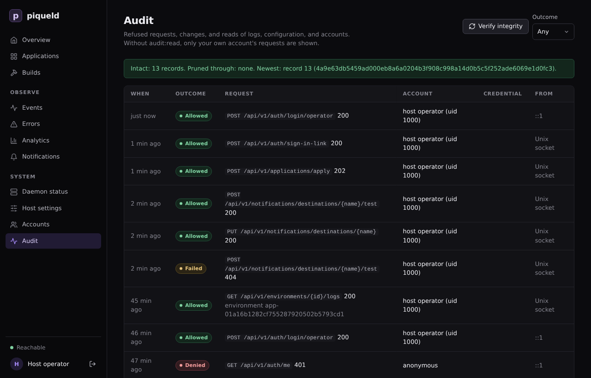

# Audit trail

See who did what through piqueld's API, and check that nobody rewrote that
record.

## What it records

The audit trail records:

- every request piqueld refused, for a missing credential or permission, a
  rejected browser origin, or too many attempts;
- every change and every sign-in;
- every command run in a container with `app exec` or `preview exec`;
- reads of logs, of the daemon's configuration, of downloaded manifests, and
  of the account list.

Each record keeps the request, its outcome (**Allowed**, **Denied** or
**Failed**), the account and credential that made it, and where it came from:
a network address, the Unix socket, or a tailnet user and device. Request
bodies are never recorded. Records outlive the accounts, credentials and
applications they name.

Routine reads, such as the dashboard refreshing a page, aren't recorded.

## Read it

The dashboard's **Audit** page lists the trail, newest first, and filters it
by outcome. On the **Accounts** page, each session and token links to its own
activity.



With `piquelctl`:

```console
$ piquelctl audit --limit 3
1792797893351  allowed  200 GET /api/v1/environments/{id}/logs on environment app-01a16b1282cf755287920502b5793cd1  host operator (uid 1000)  unix socket
1792797804727  allowed  200 POST /api/v1/auth/login/operator  host operator (uid 1000)  ::1
1792797775115  denied  401 GET /api/v1/auth/me  anonymous  ::1
Next cursor: v1:5
```

`--outcome denied` shows only refused requests, and `--credential <id>` only
the requests of one session or token (`piquelctl token list` shows their IDs).

Everyone can read their own account's requests. Reading other accounts' needs
the `audit:read` permission, which administrators have.

## Check that nobody changed it

Each record is linked to the one before it by a hash, so editing, inserting or
removing a record breaks the chain from that point on. To check the chain,
select **Verify integrity** on the **Audit** page, or run:

```console
$ piquelctl audit verify
Chain: intact
Records checked: 7
Pruned through: none
Newest: 7 7a625b7a247a086b8e1f4724ff7595dffdfa117145f79e52b881f30a667bc402
```

If the chain is broken, the command fails and names the first record that
doesn't match.

The chain can't tell who wrote the database. Someone who controls the host
could rewrite the whole trail, or delete its newest records. To catch that,
keep the **Newest** line somewhere piqueld can't change, such as a ticket or a
scheduled job's log, and check later that it's still part of the chain.

## How long it's kept

`retention.audit_days` keeps records for 365 days by default; `0` keeps them
forever. Pruning only removes old records while the chain through them is
intact, so it never erases evidence of tampering. `Pruned through` then names
the last record removed, which the remaining chain starts from.

## Get alerted

The `security` [notification](notifications.md) category reports, as they
happen:

| Event | When |
| --- | --- |
| `admin_granted` | An account receives `admin` on every application: through a grant change, an invitation, the first account, or a recovery link |
| `privileged_token_created` | An API token is created without an expiry date, or with `admin` |
| `admin_recovery_issued` | `piquelctl recover-admin` issued a [recovery link](../accounts/authentication.md#recovering-administrator-access) |
| `operator_sign_in_issued` | `piquelctl sign-in-link` issued a link that signs a browser in as the [host operator](../accounts/authentication.md#the-host-operator) |
| `access_denial_burst` | 20 requests from one address and account are refused within a minute (then at most every 10 minutes while it lasts) |
| `credential_new_address` | A session, CLI login or token is used from a new network address |
| `secret_key_recovered` | The secret key was recovered, discarding stored values |
| `notification_destination_changed` | A notification destination was created, changed, disabled or deleted |

An unexpected `admin_recovery_issued` or `operator_sign_in_issued` means
someone with root on the host is acting: treat it as a host compromise.

## Troubleshooting

- **You only see your own requests.** Reading the whole trail needs
  `audit:read`.
- **`piquelctl audit verify` fails.** The database was changed outside
  piqueld. Compare the first mismatching record, and the records just before
  it, with your backups.
