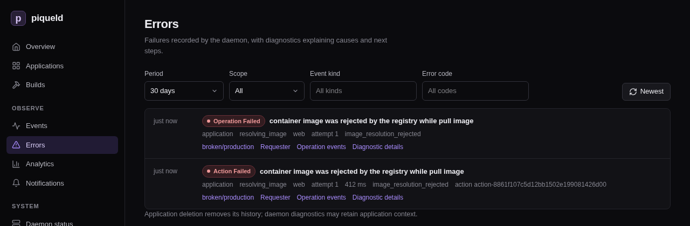

# History and diagnostics

Find out what piqueld did, when, and why something failed.

Run the `piquelctl` commands on this page on the host, or on any machine where
`piquelctl` is signed in.

## See what happened

piqueld records every deployment step, configuration change, secret change
and failure as an event. Secret values, environment values and webhook URLs
are never part of them.

- In the dashboard, the **Events** page lists every event you can read, and
  each environment's **Events** tab lists that environment's.
- With `piquelctl`, give an application's ID, which `piquelctl app show`
  prints:

  ```console
  $ piquelctl events --application app-01a16b1282cf755287920502b5793cd1 --limit 3
  11  1792797737680  environment_created  -  attempt -     created environment production  by host operator (uid 1000)
  12  1792797737682  refresh_requested  operation-01a16b1282d27232a446f3dbc4a19808  attempt 0       by host operator (uid 1000)
  13  1792797737713  operation_started  operation-01a16b1282d27232a446f3dbc4a19808  attempt 1       by host operator (uid 1000)
  Next cursor: v1:13
  ```

  Events come oldest first, 50 at a time unless you pass `--limit`, up to
  100. Pass the printed cursor with `--cursor` to read the next page.

Each line has the event's number, its time in Unix milliseconds, its kind, and
then, where they apply, its operation, attempt, phase, resource, error code,
message, and who caused it.

To see where a deployment is, expand it on the environment's **Deployments**
tab, which lists its steps. With `piquelctl`, run
`piquelctl operation <operation-id>`, which also waits for it to finish.

## Find out why something failed

The **Errors** page lists failures, newest first. Filter them by period,
scope, event kind or error code.



Each failure has a diagnostic. Select **Diagnostic details** to read it:

- its heading is a stable error code, such as `image_resolution_rejected`, and
  a summary of what went wrong;
- a badge says whether it's **retryable** or **needs attention**;
- **Causes** lists what led to it, such as the Docker request that failed and
  its HTTP status;
- **Next action** says what to do.

The **Errors** page links each failure to its environment and to the events of
its deployment. **Requester** opens the audit trail of the session or token
that started it. When a command fails, `piquelctl` prints the same code and
message, with a hint for what to do next.

## Read logs and build output

- A service's output: in the dashboard, it's on the environment's **Logs**
  tab. With `piquelctl`, run `piquelctl env logs <app> <environment>`, or
  `piquelctl app logs <app>` when the application has a single environment.
  These are recent lines read from Docker; for a lasting record,
  [export them](telemetry.md).
- A build's output: in the dashboard, see the **Builds** page and each
  application's **Builds** tab. With `piquelctl`, `piquelctl builds list`
  lists recent builds, and `piquelctl builds logs <id>` prints one's output.

## Watch the daemon itself

The dashboard's **Daemon status** page shows:

- whether the database, the Docker engine, the Swarm manager and HTTPS ingress
  are ready;
- the **Installation checks**: whether the daemon's public URL, its tailnet
  node, the Docker engine, ports 80 and 443, its secret key and its API socket
  are set up, each with a next step when one needs action. They run when the
  page opens, and again when you select **Run checks**;
- how many previews run against their limits, what image cleanup removed, and
  where telemetry is exported;
- the daemon's uptime, memory, CPU, database size and free disk space;
- how many events and diagnostics are kept, and how much build output;
- running and queued operations, and pending and failed notifications.

These are current values. For their history, [export telemetry](telemetry.md).

With `piquelctl`:

- `piquelctl status` shows the daemon's version, HTTPS ingress, how many
  previews run against their limits, what image cleanup removed, and where
  telemetry is exported.
- `piquelctl doctor` runs the installation checks. It exits with code 6 when
  one fails.
- `piquelctl resources` shows the daemon's resource usage and counters.

The **Host settings** page shows the daemon's
[configuration](../reference/configuration.md) as it runs, and
`piquelctl settings` prints it. Credentials appear only as the file they're
read from. To change a setting, edit the configuration and restart the daemon.

These pages and commands need the `system:read` permission.

The **Analytics** page sums up deployments over the last 24 hours, 7, 30 or 365
days: how many succeeded or failed, how long attempts took, how often they were
retried, how long each kind of step takes, and the most common failure codes.
`piquelctl analytics` prints the same summary, for the last 30 days unless you
pass `--since`:

```console
piquelctl analytics --since 7d
```

`--app` limits it to one application's environment. Name the environment
with `--env` when the application has several.

## How long history is kept

| Setting | Default | What it keeps |
| --- | --- | --- |
| [`retention.event_days`](../reference/configuration-settings.md#retentionevent_days) | `90` | Application and environment events |
| [`retention.daemon_event_days`](../reference/configuration-settings.md#retentiondaemon_event_days) | `90` | Daemon events |
| [`retention.audit_days`](../reference/configuration-settings.md#retentionaudit_days) | `365` | The [audit trail](audit.md) |
| [`retention.finished_operation_days`](../reference/configuration-settings.md#retentionfinished_operation_days) | `10` | Finished operations other than deployments |

`0` keeps everything. Deployment history is kept until its environment is
deleted. Build output has its own limits, of
[size](../reference/configuration-settings.md#build_historylog_max_bytes) and
[age](../reference/configuration-settings.md#build_historylog_retention_days).

Deleting an environment keeps its events in the application's history.
Deleting an application deletes its history.

## Troubleshooting

- **An event you expected is missing.** You only see the applications you have
  the `events:read` permission on, and daemon events need `system:read`; see
  [permissions](../accounts/permissions.md). It may also be older than the
  retention period.
- **`piquelctl events` rejects the application.** It takes the application's
  ID, not its name.
