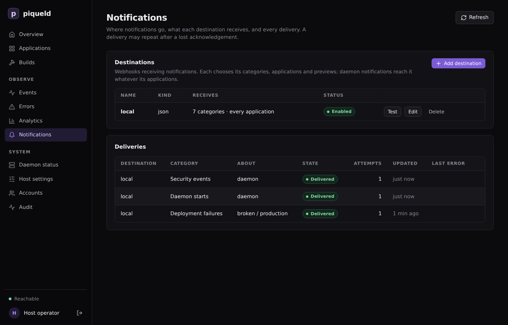

# Notifications

Get a message in Discord, or a JSON webhook of your own, when a deployment
fails, a service degrades, or someone gains administrator access.

## Before you start

- You need the `notifications:manage` permission to add and change
  destinations. Seeing them needs it or `system:read`. Administrators have
  both; see [permissions](../accounts/authorization.md).
- A webhook URL: a Discord channel's webhook, or an endpoint of your own that
  accepts JSON. It must use HTTPS, except to `localhost` or a loopback IP
  address.
- Run the `piquelctl` commands on the host, or on any machine where
  `piquelctl` is [signed in](../getting-started/first-account.md#sign-piquelctl-in).

## Add a destination

On the dashboard's **Notifications** page, select **Add destination**. Or, with
`piquelctl`:

1. Create the destination, then paste the webhook URL and press Ctrl-D:

   ```console
   piquelctl notification set ops --kind discord --url-stdin
   ```

   `ops` is its name. The URL is a credential: anyone who has it can post to
   your channel, so it's read from standard input rather than the command
   line. It's stored encrypted, and can't be read back.

2. Send a test notification:

   ```console
   $ piquelctl notification test ops
   ops acknowledged the test notification.
   ```

A new destination receives every category but successful deployments, about
every application, without previews.

In Discord, each notification shows as a card coloured by category, such as
red for failures and green for recoveries. It names the application,
environment and branch, with the cause and next step of a failure, and links
to its page or diagnostic in the dashboard.

## Choose what it receives

Each destination picks its categories:

| Category | Dashboard label | Sent when |
| --- | --- | --- |
| `build_failures` | Build failures | A build fails |
| `deployment_failures` | Deployment failures | A deployment fails |
| `service_degradation` | Service degradation | A deployed service stays unhealthy for two minutes |
| `daemon_failures` | Daemon failures | Docker, the Swarm or the ingress gateway stays unavailable for two minutes, a certificate piqueld needs keeps failing to renew in its last 14 days, or the daemon hits an internal error |
| `recovery` | Recoveries | A failure the destination was sent is resolved |
| `security` | Security events | Access to piqueld changes; see [the audit trail](audit.md#get-alerted) |
| `daemon_started` | Daemon starts | The daemon starts, including after an update |
| `deployment_succeeded` | Deployments | A deployment succeeds |

For example, to send only deployment failures and recoveries about `shop`, and
to mention a Discord role with each failure:

```console
piquelctl notification set ops \
  --categories deployment_failures,recovery \
  --apps shop \
  --message 'deployment_failures=<@&123456789012345678>'
```

- `--categories` replaces the list.
- `--message CATEGORY=TEXT` adds a text of up to 1000 characters to a
  category's notifications, and subscribes the destination to it. In Discord,
  that text is the message, so mentions in it notify people.
  `--no-message CATEGORY` removes it.
- `--apps` limits it to some applications, by name or ID. They stay selected
  when renamed. `--all-apps` covers every application, including later ones.
  Daemon notifications, such as security events, reach every destination,
  whatever its applications.
- `--previews true` adds notifications about
  [previews](../reference/manifest.md#previews).

Options you don't give keep their current value. `piquelctl notification list`
shows what each destination receives, and the
[CLI reference](../reference/cli.md) lists every option.

Changes apply at once and never replay the past: a category you add starts
with the next event.

## Change or remove a destination

- **Turn it off:** `piquelctl notification set ops --enabled false` stops it,
  and cancels what it hadn't delivered yet. Turned back on, it starts with the
  next event.
- **Change its URL or kind:** it then counts as a new receiver. What it hadn't
  delivered is cancelled, and it won't receive the recovery of a failure sent
  to the old one.
- **Delete it:** select **Delete** on the **Notifications** page, or run
  `piquelctl notification delete ops`. This cancels what it hadn't delivered.
  Its deliveries stay in the history, under its name.

## Read the delivery history

The **Deliveries** list on the **Notifications** page, or
`piquelctl notification deliveries`, shows each notification sent, newest
first. Test notifications aren't part of it.



When the receiver can't be reached, times out, or answers 408, 429 or a 5xx
status, piqueld retries with increasing delays, for up to 24 hours. Any other
non-2xx answer fails the delivery at once. To send a failed delivery again, select
**Retry**, or run `piquelctl notification retry <delivery-id>`. Both need the
`system:operate` permission.

## When piqueld notifies

- A build or deployment failure notifies once. Later failures in the same
  environment and category stay silent until an operation there succeeds.
- Service and dependency problems notify only once they've lasted two minutes,
  so a quick restart doesn't page you. Once piqueld sees them recover, a new
  problem notifies again.
- Each kind of internal daemon error notifies only the first time it happens,
  and no recovery follows.
- A recovery goes only to the destinations that were sent the failure.
- When a deployment fixes a failure, the destination receives the recovery
  instead of a `deployment_succeeded` notification, unless the recovery
  couldn't be delivered.
- `daemon_started` is sent as soon as the daemon accepts requests, even
  before Docker is ready. After an update, its message names the previous
  version, such as `piqueld 0.2.0 started (previously 0.1.0)`. A missing one
  doesn't prove the start failed: check the daemon's
  [history](history.md).

## Receive notifications in your own service

1. Create a `json` destination pointing at your service:

   ```console
   piquelctl notification set hooks --kind json --url-stdin
   ```

2. Handle the POST request piqueld sends for each notification. This is a
   deployment failure, shortened:

   ```json
   {
     "version": 2,
     "instance_id": "instance-01a16b10b8307c61b5ac3d27d4bf7937",
     "delivery_id": "delivery-01a16b3c72347691b00a9c4fac1e1f9b",
     "category": "deployment_failures",
     "title": "Deployment failed",
     "subject": {
       "application": "broken",
       "environment": "production",
       "branch": null,
       "preview": false
     },
     "message": null,
     "event": {
       "id": 53,
       "kind": "operation_failed",
       "scope": "application",
       "created_at_ms": 1792800485797,
       "message": "container image was rejected by the registry while pull image",
       "error_code": "image_resolution_rejected",
       "diagnostic": {
         "summary": "container image was rejected by the registry while pull image",
         "next_action": "Check the image reference and registry credentials, then retry the deployment.",
         "causes": ["Docker operation: pull image", "Docker returned HTTP status 404"]
       }
     }
   }
   ```

   - `subject` names the application, the environment (or the preview's slug,
     when `preview` is `true`) and the branch, as they were when the
     notification was queued. Each is `null` when the notification isn't about
     one.
   - `message` is the destination's text for the category, or `null`.
   - `event` is the history event behind the notification, including who
     caused it, as `actor`.
   - A test notification has a `null` category, a `delivery_id` starting with
     `test-`, and an event of kind `notification_test`.

3. Answer with any 2xx status to acknowledge it.

When you write the receiver:

- A notification may arrive more than once. Every request carries an
  `Idempotency-Key` header with the delivery ID: ignore a key you've already
  handled.
- piqueld honours an integer `Retry-After` header, up to one hour.
- Requests time out after 10 seconds, and redirects aren't followed.
- Payloads aren't signed, so keep the URL secret.

## Troubleshooting

- **The test fails.** `piquelctl notification test` says why. Check that the
  daemon's host can reach the URL, and that it accepts a POST request.
- **A notification never arrived.** Look it up in the delivery history. If it
  isn't there, check the destination's categories, applications and previews
  with `piquelctl notification list`.
- **Retrying a delivery is refused.** A delivery can only be sent again while
  its destination still exists unchanged, is enabled, and still receives its
  category. A failure can't be sent again once its problem has been resolved,
  and a recovery can't once the problem has come back.
- **Destinations disappeared.** Recovering a lost
  [secret key](../reference/configuration.md#secret-storage) deletes them,
  since their URLs were encrypted with it. Add them again.
